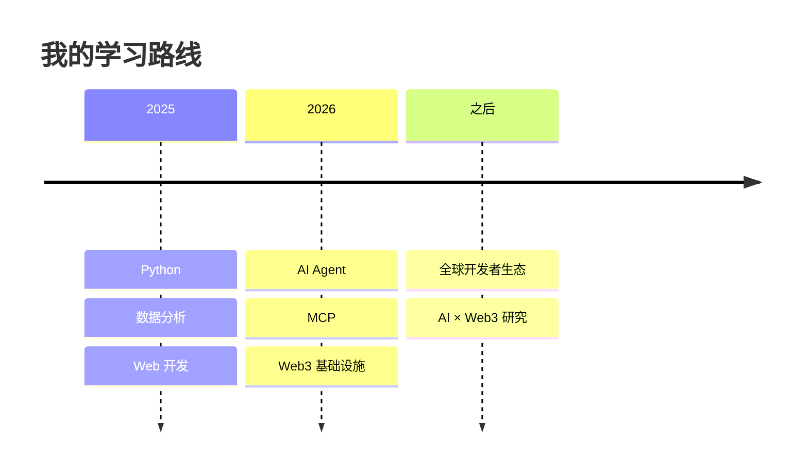

# 关于这个 Wiki

<b>Web3 Learning Wiki</b> 是我个人的 Web3 × AI 兴趣^专业学习笔记本：把一手行业活动，
整理成能长期翻查的结构。它是个人化的日常跑会与交换、交流学习记录，也可以作为大家的学习资料使用！> < 希望得到大家的喜欢！qwq

## 为什么会有它

我在消化行业活动和官方文档时，总遇到两个问题：

1. **术语密度太高**——初学者很容易在陌生概念面前掉队，一看那些名词和缩写就头疼；
2. **资料太分散**——很难跟上实时生态，纯AI圈也如此，毕竟产业革新变化过于快速。

于是我把每一次学习、构建和复盘都写成结构化笔记：既可以倒逼自己真正理解，也可以服务于同样还在学习入行之路挣扎的同学们（某种程度费曼学习法）。**学习 → 构建 → 验证 → 输出 → 文档**，大概是这个WIKI的workflow。

## 学习理念

- **Output over input**：看十小时资料，不如写一小时笔记、做一个能跑的小东西——这也是为什么课本后面总有一堆练习题；
- **项目驱动，而不是课程驱动**：学一点基础 → 立刻动手 → 遇到不懂再回来补。我很喜欢「3:7」的说法：掌握一个行业 30% 就可以入局，剩下 70% 用实践补；
- **找到自己的差异化优势**：跨语言、跨生态的信息差是长期存在的机会。跳出舒适圈，找几个方向交叉发展；
- **不碰看不懂的钱**：学习阶段优先用测试网、小额和模拟环境（比如 Sepolia / Base 测试网）；
- **默认公开**：每一条笔记、每一次提交都是公开可验证的记录——这和链上所谓「公开透明」的理念不谋而合。

## 维护者

{ width="56" height="56" loading=lazy }

### MIA_Ether

AI × Web3 Builder · 开源贡献者。在 AI 系统、Web3 基础设施与数据的交汇处，把研究变成能跑的软件；关注 Agent 信任、MCP、链上数据质量与 AI × 金融。Building in public。

<a class="w3-social" href="https://github.com/mia03ther" target="_blank" rel="noopener noreferrer"><svg viewBox="0 0 16 16" aria-hidden="true"><path fill="currentColor" d="M8 0C3.58 0 0 3.58 0 8c0 3.54 2.29 6.53 5.47 7.59.4.07.55-.17.55-.38 0-.19-.01-.82-.01-1.49-2.01.37-2.53-.49-2.69-.94-.09-.23-.48-.94-.82-1.13-.28-.15-.68-.52-.01-.53.63-.01 1.08.58 1.23.82.72 1.21 1.87.87 2.33.66.07-.52.28-.87.51-1.07-1.78-.2-3.64-.89-3.64-3.95 0-.87.31-1.59.82-2.15-.08-.2-.36-1.02.08-2.12 0 0 .67-.21 2.2.82.64-.18 1.32-.27 2-.27s1.36.09 2 .27c1.53-1.04 2.2-.82 2.2-.82.44 1.1.16 1.92.08 2.12.51.56.82 1.27.82 2.15 0 3.07-1.87 3.75-3.65 3.95.29.25.54.73.54 1.48 0 1.07-.01 1.93-.01 2.2 0 .21.15.46.55.38A8.01 8.01 0 0 0 16 8c0-4.42-3.58-8-8-8z"/></svg>GitHub</a>
<a class="w3-social" href="https://x.com/MIA03ther" target="_blank" rel="noopener noreferrer"><svg viewBox="0 0 24 24" aria-hidden="true"><path fill="currentColor" d="M18.9 2H22l-7.3 8.4L23 22h-6.8l-5.3-6.9L4.8 22H1.7l7.8-9L1 2h6.9l4.8 6.4L18.9 2Zm-1.2 18h1.9L7.4 4H5.4l12.3 16Z"/></svg>X / Twitter</a>
<a class="w3-social" href="mailto:mia03ther@gmail.com"><svg viewBox="0 0 24 24" aria-hidden="true"><path fill="currentColor" d="M3 5h18a1 1 0 0 1 1 1v12a1 1 0 0 1-1 1H3a1 1 0 0 1-1-1V6a1 1 0 0 1 1-1Zm0 2 9 5.7L21 7v12H3V7Z"/></svg>Email</a>
<a class="w3-social" href="https://github.com/mia03ther/web3-learning-wiki/discussions" target="_blank" rel="noopener noreferrer"><svg viewBox="0 0 24 24" aria-hidden="true"><path fill="currentColor" d="M12 3a9 9 0 0 0-9 9c0 1.7.47 3.3 1.3 4.7L3 21l4.5-1.2A9 9 0 1 0 12 3Z"/></svg>Discussions</a>

### 正在做的项目

  

    AI Agent 身份
    
VeritasOS

    
AI Agent 的「护照」与声誉层。探索 ERC-8004、Agent 身份与链上声誉。

  

  

    AI × 合约自动化
    
Arbitera

    
AI 驱动的托管仲裁法庭。探索 AI 法官、MCP、The Graph 与智能合约自动化。

  

  

    校园产品
    
YutuHub

    
AI 驱动的校园知识平台。练全栈开发、社区产品与 AI 应用。

  

## 开源与许可

- 所有内容以 [CC BY-NC-SA 4.0](https://creativecommons.org/licenses/by-nc-sa/4.0/) 开源：可以转载、改编，但要署名、非商业、以相同方式共享；
- 源码托管在 [GitHub](https://github.com/mia03ther/web3-learning-wiki)，欢迎 fork 和 PR；
- 每次更新都记录在 [版本发布](../changelog.md)。

## 参与共建

- 发现错误或过时信息 → 群里直接说，或在 [GitHub Issues](https://github.com/mia03ther/web3-learning-wiki/issues) 提出；
- 想直接改 → 任意页面右上角 ✏️ 提交 PR；
- 有好的资料 / 课程推荐 → 欢迎在 [Discussions](https://github.com/mia03ther/web3-learning-wiki/discussions) 里分享；
- 想支持这个 Wiki 的持续维护 → [支持这个 Wiki](../support/index.md)。
