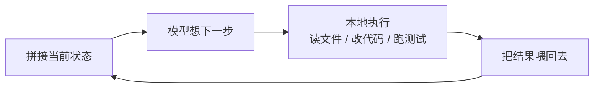

# AI 辅助开发

<p class="w3-lead">
这一页合并了 ETHShenzhen 2026 上两场分享：Tiny 熊讲「<b>怎么让 AI 干得好</b>」，Qi Zhou 讲「<b>AI 干完之后人该负什么责</b>」。
不管你用 Claude Code、Codex、Cursor 还是别的工具，这些原则都通用；写论文、做调研也一样适用。
</p>

<div class="w3-tldr" markdown>
<span class="k">一句话版本</span>

AI 是一个**没有记忆、靠上下文干活、会自信犯错**的预测器。所以：给它干净、精准的上下文；让程序替它做它不擅长的事；**最后由人来理解、审核、负责**。
</div>

## 1. 先理解它：大模型的五个先天缺陷

LLM 的本质是「根据前文预测下一个 token」，经过预训练 → 监督微调 → 强化学习三个阶段长成现在的样子（详见 [Day 1 · Tiny 熊](../field-notes/ethshenzhen-2026/day1-workshops.md#part-2)）。由此带来五个先天缺陷：

| 缺陷 | 你会遇到的情况 | 对策 |
|---|---|---|
| 难说「不知道」 | 编造不存在的函数、库、参数（幻觉） | 关键事实核实；要求它不确定就提问 |
| Token 化丢失细节 | 算错数、数错字母 | 计算交给代码 / 工具 |
| 容易被无关信息带偏 | 对话越长越乱 | 一个会话只做一件事 |
| 知识冻结在训练时 | 用了过时的 API、旧版本写法 | 用文档、搜索、Skills 补最新知识 |
| 无状态 | 换个会话就忘了你的项目 | 写 `AGENTS.md`，让每次对话都能「入职培训」 |

## 2. Agent = LLM + Harness

Agent 是在大模型外面加上「手、眼睛和规矩」（Harness）：上下文管理、工具、约束、验证。它在一个循环里干活：



**Harness 工程**的核心思想：理解 AI 的局限，把适合用程序做的事（计算、搜索、测试、格式检查）从模型身上剥离出来。

## 3. 给它好的上下文

**提示词**

1. 讲清角色、背景、范围和约束——让它知道为什么做、做到什么程度；
2. 说不清就举例子；
3. 关键信息放开头或结尾（模型对中间部分记得最差）；
4. 复杂问题先让它**分析和拆解**，确认思路后再动手；
5. 明确要求：「**不确定就问我，不要自己猜**」。

**上下文管理**

- 大任务让它维护一份**待办清单**，做完一项勾一项，防止中途忘了目标；
- 上下文出了错会「越错越错」（**上下文腐化**），别跟它较劲，**开新会话重来**；
- 不要在一个会话里频繁切换话题。

## 4. 让它懂你的项目

### 4.1 写一份 `AGENTS.md`

放在项目根目录，Agent 每次开工都会先读它。**保持精简**（它会被全量加载），细节拆到别的文件里按需读取：

```markdown title="AGENTS.md"
# AGENTS.md

## 项目
一个基于 Foundry 的 ERC-20 + 质押合约项目，部署在 Sepolia 测试网。

## 目录
- src/      合约源码
- test/     Foundry 测试（*.t.sol）
- script/   部署脚本

## 常用命令
- 编译：forge build
- 测试：forge test -vvv

## 规矩
- 用 OpenZeppelin 的标准实现，不要手写 ERC-20
- 每个外部函数都要有对应测试
- 永远不要把私钥写进代码、日志或提示词；部署读取 .env
- 改了接口要同步更新本文件和 README

## 需要时再读
- 涉及升级逻辑：docs/upgrade.md
- 涉及前端：frontend/AGENTS.md
```

### 4.2 用 Skills 装「领域操作手册」

Skill 就是写给 AI 的操作手册，好比入职时公司给你的流程说明。每个 Skill 一个目录，核心是 `SKILL.md`：

```text
skills/
└── erc20-deploy/
    ├── SKILL.md      # 必须：开头写名称、描述、什么时候用；后面是详细步骤
    └── scripts/      # 可选：配套脚本
```

```markdown title="skills/erc20-deploy/SKILL.md"
---
name: erc20-deploy
description: 把 ERC-20 合约部署到测试网时使用，包含环境检查、部署和验证步骤。
---

# 部署 ERC-20 到 Sepolia
1. 检查 .env 里是否有 SEPOLIA_RPC_URL，没有就停下来问我
2. forge test 全部通过后再部署
3. ……
```

Agent 平时只读描述，**用到时才加载全文**（渐进式加载），所以可以装很多个而不撑爆上下文。模型的知识大约滞后一年，**新协议、新最佳实践（比如 x402、ERC-4337）正适合写成 Skill**。

### 4.3 让代码「容易被搜到」

AI 读代码靠**搜索**，不是像 IDE 一样跳转到定义：

- 命名具体：`getUserProfile` 而不是 `get`；
- 一个概念只用一个词，不要 `user` / `profile` / `customer` 混用；
- 注释写在**函数定义的正上方**；
- 依赖显式声明，别让它猜。

## 5. AI 写完之后：人的规矩

Qi Zhou 的团队在区块链节点开发里总结的做法（详见 [Day 2 下午](../field-notes/ethshenzhen-2026/day2-afternoon.md#part-2)）：

<ol class="w3-steps" markdown>
<li markdown>**先讲清楚再动手**：复杂任务找 1～2 人结对，**不看电脑在白板上把方案讲清楚**，对齐后再写提示词。</li>
<li markdown>**控制粒度**：一个 PR 只做一件事。一天做不完，说明任务太大，拆。</li>
<li markdown>**双模型交叉验证**：同一个任务交给两个不同的模型，和自己脑中的预期对比，差异处往往就是 bug。</li>
<li markdown>**隔天复审**：今天生成并提交，明天重新审一遍，后天补齐细节再合并。</li>
<li markdown>**能解释每一行 + 至少两人审核**：作者讲不清 AI 写的代码，就不能合并。</li>
</ol>

!!! danger "Web3 项目的额外红线"
    - **私钥、助记词永远不要出现在提示词、代码或日志里**；
    - 不要让 Agent 自动签名或自动发送主网交易，测试网先行；
    - 合约代码哪怕是 AI 写的、测试全绿，上主网前也要人工审，最好再找人审；
    - 区块链的损失是「突发型」的：**99% 正确也可能是灾难**。

## 6. 开工前检查清单

- [ ] 项目根目录有一份精简的 `AGENTS.md`
- [ ] 这次任务的目标、范围、约束我能用三句话说清楚
- [ ] 复杂任务已经让 AI 先出方案，我看过了
- [ ] 会话变乱了，我知道该开新会话
- [ ] 生成的代码我能逐行解释，测试覆盖了边界情况
- [ ] 不可逆操作（部署、转账、删除、发布）由我亲手确认

## 延伸阅读

- [Day 1 · Tiny 熊：Vibecoding On Ethereum](../field-notes/ethshenzhen-2026/day1-workshops.md#part-2)
- [Day 2 · Qi Zhou：AI 时代的区块链开发](../field-notes/ethshenzhen-2026/day2-afternoon.md#part-2)
- [开发者工具](index.md) · [MCP 与 AI Agents](../ai-web3/mcp-agents.md)
