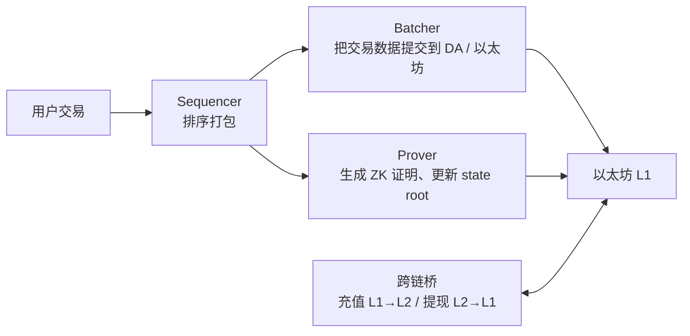

# AI × Web3 产业创新交流会：工具、落地与培训避坑

这是 9 月 19 日在深圳办的「AI × Web3 开发者与产业创新交流会」，主办方是几家 AI / Web3 培训社区和一家 Web3 中间件公司：前面讲 AI，后面讲 Web3，中间穿插了不少课程和产品推介。
我把推销部分去掉了，只留下对群友有用的干货；机构和讲者名字统一隐去。最后一节是我自己写的<b>「怎么判断一个付费培训靠不靠谱」</b>，建议每个人都看一眼。

  
时间2026.09.19（周六）14:00–18:00 · 深圳（R01，这个赛季的第一站）

  
形式交流会 · 分享 + 现场演示 + 课程推介

  
议程AI 落地与 Agent SaaS · Web2 开发者的能力迁移 · Web2 企业怎么落地 Web3 产品 · 未来 3–5 年的投资与创业机会（几段课程介绍略过）

  
素材现场录音约 150 分钟

TL;DR

- **学 AI 的正确姿势**：从「每天最浪费时间的重复工作」开始交给 AI，别信「学了马上挣一百万」。
- **自动化的边界**：Agent 能一句话发完小红书，但公众号最后一步必须管理员扫码——**平台不把关键权限交给 Agent**，这是好事。
- **值得学的 Web3 知识点**：MPC 动态委员会、Rollup 组件抽象、RWA 的国内 / 海外两条路径。
- **培训避坑**：就业率、薪资是机构自报的，打折听；承诺「包装薪资流水」「帮你过背调」的，直接远离。

---

## Part 1 · 「AI 让生产力平权」

第一位讲者的经历挺打动人：做过服装连锁和餐饮，疫情后关店，48 岁「中年失业」，去年才开始接触 AI，今年开始做 AI 自媒体，现在课件、海报、视频几乎都用 AI 生成。他的核心观点：

- **AI 不会淘汰人，会用 AI 的人会替代不会用的人**；
- **AI 让生产力平权**：每个人都能直接用上「全世界最聪明的大脑」设计出来的模型；
- 学 AI 的同时顺便学英文术语——agent、workflow、API、scale……他自己就是这样一个个认识的；
- 正确的开始方式：**找出你每天最浪费时间、最重复的事情，交给 AI**；不需要先懂技术、懂代码；
- 不存在「AI 是魔法、学了马上挣一百万」这回事，它能做的是**大幅提高效率**。

他举的企业场景：

| 场景 | 做法 |
|---|---|
| 电商直播 | 把几十名运营的聊天记录交给 AI，提炼成一套标准话术，新人当天就能上岗——把「最厉害的那个人」复制给所有人 |
| 本地服务获客 | 让 AI 检索同城平台上同行的信息，分析别人怎么推广 |
| 园区管理 | 巡逻头盔上装摄像头联网，AI 实时监控卫生和安全状态 |
| 报价、投标、供应链 | 让 AI 汇总各家供应商的资质和历史，替代大量人工筛选 |

!!! warning "讲者的个人观点，仅供参考"
    他认为「执行类」任务上国外工具明显更强（点名 Codex、Claude Code、Grok），国内模型做对话、写作、搜索够用；还说某国产模型「被高估了」。工具好不好用因人因事而异，**自己都试一试**比听别人下结论靠谱。另外他提到用 AI 分析股票——投资有风险，AI 的分析也会出错。

---

## Part 2 · 现场演示：一句话发小红书 / 公众号

### Codex：一句话发布小红书笔记

在网页版 ChatGPT 里挂一个浏览器插件，把提前写好的提示词交给 Codex，它会自己完成：上传视频 → 根据视频内容写文案 → 生成配图和标题 → 发布。视频本身是提前用 **Seedance** 视频模型 + 豆包语音模型自动生成、自动剪辑的短片。演示中途接口卡了一下，最后发布成功，现场扫码就能看到。

### WorkBuddy：一句话发布公众号文章

腾讯今年 3 月推出的办公智能体 [WorkBuddy](https://www.ithome.com/0/978/468.htm)，手机端和电脑端互通：

1. 在手机上拍 5 张现场照片发给它，说「写一篇活动报道，发到公众号」；
2. 它自动写稿、验证公众号后台登录、把图片传到图床、拟标题；
3. **最后一步需要管理员扫码确认才能正式发布**——这是公众号平台的安全限制，智能体绕不过去。

!!! example "我觉得最有意思的是第 3 步"
    这正是 [ETHShenzhen 圆桌](ethshenzhen-2026/day2-afternoon.md#part-5) 里说的「**关键一步留给人**」。平台没有把发布权限交给 Agent，看起来是「不够自动」，其实是在保护你的账号。反过来说：把已登录的账号会话交给 Agent 操作，本身就是风险，要想清楚给它多大的权限。

---

## Part 3 · 企业 Agent 的落地思路

主办方介绍了自家的企业级 Agent 平台（产品细节略去），里面有几个思路值得了解：

- **电商全流程**：告诉 Agent 行业和目标网站 → 自动选品 → 生成图文 → 上架到各个平台 → 生成直播 / 种草内容做推广 → 用企业知识库 + 记忆数据库做智能客服，**人可以随时接管**；
- **从 B 端到 C 端**：用 MCP 插件让 Agent 在手机 App 里帮你点一杯咖啡——打开 App、领券、下单、付款、把取餐码给你。这就是 [MCP](../ai-web3/mcp-agents.md) 「让 AI 能用工具」的直观例子；
- **多模型路由**：底层同时接多家模型，按任务类型和预算自动选择（比如预算低的视频生成就走便宜的模型）；
- **报表推送**：自动生成运营报表，定时推到 Telegram、飞书、钉钉。

!!! question "一个存疑的说法"
    讲者说他们借鉴以太坊的 **Merkle Patricia Trie（默克尔帕特里夏树）** 做知识库的快速检索。这个我没太看懂：MPT 在以太坊里是用来存账户状态、生成可验证证明的，和「语义检索」不是一回事。听到这种「把区块链名词套在别的地方」的说法，**多问一句它到底解决了什么问题**。

---

## Part 4 · 下半场：几个值得学的 Web3 知识点

### 4.1 MPC 动态委员会

托管大额资产时，主流的 MPC（多方计算）方案是**静态**的 2-of-3 或 3-of-3：比如一份密钥分片给用户，一份给第三方托管，一份在机构手里。问题是节点作恶的成本很低。

讲者介绍的「动态委员会」思路：

- 节点要**质押资金**才能参与；
- 每次签名时，用零知识证明的机制**随机选出**一批节点；
- **被选中就必须签**：漏签、拒签、乱签都会被罚没质押金；正常签名能拿奖励——和 PoS 的激励思路很像。

### 4.2 Rollup 的「组件抽象」

一条 Layer 2（Rollup）背后有好几个角色：

讲者的观点：数据提交、证明生成、state root 更新这些环节都可以做成标准化服务，项目方**只需要部署 Sequencer 和跨链桥**（这两个和资金强相关），其他直接调用现成组件。理解这张图，基本就理解了「L2 是怎么搭起来的」。

### 4.3 RWA（现实世界资产上链）的两条路

| | 国内路径 | 海外路径 |
|---|---|---|
| 怎么做 | 在联盟链上做资产确权 → 到数据 / 文化类交易所挂牌 | 在公链上发行代币 → 进 DEX / CEX 交易 |
| 难点 | 资产「出境发币」的合规路线还没打通，国企资产基本不现实 | 合规要求因地区而异 |

还有一个技术问题：同一份资产如果国内外两边都在交易，就会有**价差和套利**。两边都是 NFT 时可以跨链映射；一边是 NFT、一边是代币时，就需要**做市商或预言机**把价格拉平。

### 4.4 AI 生成的预测市场

讲者介绍的做法：由 AI 生成事件（BTC 涨跌、新闻、政治事件）→ 调用模型做定价 → 对接多条链结算。

---

## Part 5 · 行业与求职：讲者怎么说

> 以下是讲者自述，**未经核实**，打折听。

- 熊市里，懂底层（钱包、交易所撮合与结算、合约）的人比只做上层业务的人更不容易被裁；
- 学 Web3 有两条路：**自学**（B 站、YouTube 资料很多，免费但零散）或**找培训**（贵，选错了也学不成）；
- 他给的判断方法里，有一条我非常认同：**讲师的经历要能查到**——做过钱包、交易所的人，代码多半是开源的，去 GitHub 看；项目经历可以去 RootData 这类数据平台核实。

---

## Part 6 · 怎么判断一个付费培训靠不靠谱（我的清单） { #training-checklist }

这场活动里听到了一些让我很警惕的说法，所以单独写一节，给所有在考虑报班的群友：

  

    ✅ 可以看的
    

      · 大纲是否系统，有没有真实项目的代码可以看 
      · 讲师经历能否在 GitHub、RootData、领英上查到 
      · 能不能联系到往期学员（不是机构安排的那几个） 
      · 退费规则是否白纸黑字写进合同
    

  

  

    ⚠️ 打折听的
    

      · 就业率、平均薪资——都是机构自己报的数字 
      · 「学员年薪百万」——个例不代表你 
      · 「零基础也能月入几万」——问清楚样本有多少人 
      · 「现场报名立减」「名额有限」——制造紧迫感
    

  

  

    🚫 直接远离的
    

      · 承诺帮你<b>「包装薪资流水」「过背调」</b>——这是简历和材料造假，入职后被发现会被开除，严重的可能涉嫌违法 
      · 承诺「包就业」却不写进合同 
      · 要求先交钱再看大纲
    

  

**别忘了免费的路**：Web3 最好的入门资源大多是免费的——见 [精选课程中心](../roadmap/courses.md)（Cyfrin Updraft、WTF Academy、CryptoZombies 等）。先把免费的学完一门，再决定要不要花钱，你会更清楚自己缺的到底是什么。

---

## 小白能学到什么

1. **AI 自动化的价值在「重复劳动」**，而不是取代判断；越关键的步骤（发布、付款），越应该留给人确认；
2. **听到区块链名词被用在奇怪的地方，多问一句「它解决了什么问题」**；
3. Rollup 组件图、MPC 签名、RWA 路径这三个知识点，面试 Web3 岗位时很常被问到；
4. 对任何「保证结果」的承诺保持怀疑——这条在 Web3 圈尤其重要。

## 现在能做什么

- [ ] 列出你每天最浪费时间的三件事，挑一件试着交给 AI；
- [ ] 画一遍 Part 4.2 的 Rollup 组件图，能给别人讲清楚每个角色干什么；
- [ ] 如果正在考虑报班：拿着上面的清单，逐条问清楚再决定。

!!! quote "转写说明"
    这场录音前半段比较清楚，后半段现场嘈杂、穿插大量私下聊天，我只整理了台上能听清的内容。机构与讲者信息已隐去，数字均为讲者口述、未经核实。
