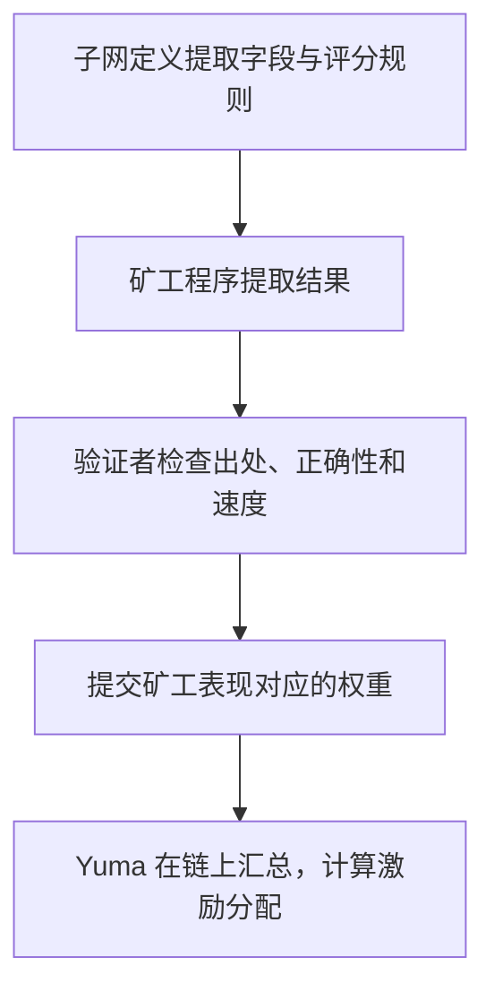

# Bittensor 共学营：把「去中心化 AI」拆成一份能跑的作业

  
活动Bittensor 第二期中文共学营（R05）

  
时间2026.11.10–23 · 线上

  
形式开源教程自学、每日任务与社群答疑

  
本篇开营说明、基础机制与个人实操复盘 · 11.17 更新

刚接触 Bittensor 时，我最容易卡在这里：矿工、验证者、子网、代币都听过了，放到一起，还是不知道一段 AI 代码究竟怎么参与进去。这次共学营给了一个很具体的入口：**先做中文材料的结构化提取，再看结果怎样被打分、记录和奖励。**

共学营的日期与两周安排见 [HackQuest 官方活动页](https://www.hackquest.io/zh-cn/co-learning/Bittensor-%E7%AC%AC%E4%BA%8C%E6%9C%9F%E5%85%B1%E5%AD%A6%E8%90%A5)。本页里的作业规则只对应这一期。

我以同学身份参加，自己的 [camp-kit 学习分支](https://github.com/mia03ther/bittensor-camp-kit) fork 自 [moonshotcommons 的课程仓库](https://github.com/moonshotcommons/bittensor-camp-kit)。这篇也记下了[我目前做到哪一步](#my-progress)，方便之后回头看。

## 这场先记住什么

- **Bittensor 有很多子网**，各自组织一种可评测的工作。任务可以涉及推理、数据、存储或算力，具体做什么要看子网规则。
- **矿工做事，验证者评分，子网创建者设计激励机制**。不同角色写的代码、承担的成本都不一样。
- **前一周看懂规则和工具，后一周在本地教学链实操**。先跑通流程，再考虑真实子网的门槛。
- **结营要交运行记录和自己的解释**。只留一张成功截图，很难说明自己改了什么、为什么有效。

## Part 1：一个子网，先从「怎样算做好」开始 {#part-1}

把子网想成一个长期运行的比赛，会比直接记代币名容易一些。

**Subnet Owner（子网创建者）** 定义要做的工作和评测机制，并维护参与接口。**Miner（矿工）** 运行程序，提供这个子网需要的结果或服务。**Validator（验证者）** 按规则评估矿工，提交反映表现的权重。这里的「挖矿」可能是在优化一个算法、维护一个服务，硬件要求取决于具体任务。[官方子网说明](https://www.bittensor.com/docs/concepts/network)把这几层职责列得很清楚。

用这次材料提取练习来理解，流程大致是：

**Yuma Consensus 管的是评分怎样影响激励分配。** 它汇总验证者对矿工的权重，并考虑质押权重、评分的一致性等因素；不能把它理解成简单的一人一票，也不能因为分数上链，就认定一段 AI 输出必然真实。输入的任务和评分标准仍然需要认真设计。见 [Yuma 官方说明](https://www.bittensor.com/docs/concepts/emissions#yuma-consensus)。

AI 计算通常在链下进行，链上处理身份、权重和激励等状态。先分清这两边，才知道自己是在调模型、修通信，还是查链上交易。

## Part 2：第一周，读懂工具里显示的东西 {#part-2}

开营介绍的第一周重点是环境、钱包、浏览器和 `btcli`，再往下看子网激励与成本。

我会按这几个问题检查自己有没有看懂：

1. **我连的是哪条链？** 本地链、测试网和主网要分清；练习记录里写下网络与子网编号 `netuid`。
2. **钱包里的两把钥匙做什么？** Coldkey 管资产和敏感管理操作，hotkey 用于矿工、验证者的日常运行。具体权限见 [官方钱包与密钥说明](https://www.bittensor.com/docs/concepts/wallets)。
3. **Metagraph 是什么？** 可以先把它理解成子网参与者及其链上状态的视图。看一个节点时，把身份、角色、表现与获得的激励对应起来，别只盯排名。
4. **我读到的奖励用什么计价？** TAO 是网络代币；dTAO 下，普通子网有自己的 alpha 代币和 TAO/alpha 流动性池，root 子网是特殊情况。数量、兑换价格和最终可兑现收入，需要分别看。

dTAO 的池子意味着兑换结果会受流动性和价格变化影响。做成本作业时，可以把机器、带宽、模型调用、注册和维护时间一起记下来，再分别算不同价格、不同在线率下的结果。**某一天拿到的排放数量，只是这笔账里的一个输入。** 机制背景见[官方子网经济说明](https://www.bittensor.com/docs/concepts/staking-pools)。

## Part 3：第二周，用中文提取任务跑通闭环 {#part-3}

这期练习围绕本地教学链展开：矿工从中文材料中提取名称、金额、机构、编号等字段，验证者检查原句出处、字段正确性和响应速度。后面再接代码优化、打分上链与进程守护。

为了理解「怎么评分」，可以自己造一小段测试材料：

> 虚构练习文本：青禾实验室公布项目 A17，计划投入 300 万元。

预期结果里，机构应是「青禾实验室」，编号应是「A17」，金额要保留「300 万元」的单位。然后追问三个问题：

- **出处对不对？** 返回的依据能不能在输入材料中逐字找到？
- **字段对不对？** 有没有把计划投入当成已完成融资，或者漏掉金额单位？
- **响应稳不稳？** 一次成功之后，换一批材料、遇到超时或空字段，还能不能正常处理？

这也解释了为什么任务不能只比「模型听起来聪不聪明」。返回格式、证据、边界情况和服务稳定性都会影响一个实现是否可用。

具体到这套教学代码，先过格式、证据和超时检查，再合并字段正确率与速度分；它用的是 **70% 正确率 + 30% 速度**。这是[课程里的简化评测函数](https://github.com/moonshotcommons/bittensor-camp-kit/blob/main/arena/common/protocol.py)，真实子网需要分别读各自的规则。

工程上可以分五步留下证据：

1. **先跑基线**：保留代码版本、依赖版本、启动方式和一份原始输出。
2. **再改矿工实现**：一次改一个点，比如解析、提示词或超时处理；用同一批样本比较正确率与耗时。
3. **读验证逻辑**：查清错误字段、缺失字段和超时分别怎样扣分，避免只对着一个样例优化。
4. **追到链上**：区分本地打印的分数、发出的权重交易和实际写入的状态。课程涉及 Commit-Reveal 时，还要检查提交与揭示是否完整。
5. **补运行维护**：用 PM2 或 Docker 管进程，观察日志、重启和异常退出后的行为。能在终端跑一次，距离持续提供服务还有几步。

本地链可以让这些步骤反复试验，练习用资产也与主网资产分开。启动与初始化可以对照[课程脚本](https://github.com/moonshotcommons/bittensor-camp-kit/tree/main/scripts)，依赖则沿用配套资料指定的版本，避免把不同版本的命令混在一起。

## 我的实操复盘：本地 Miner 已经启动 {#my-progress}

**截至 11 月 17 日，我已经完成本地教学链初始化、教学节点注册，并启动了自己的 Miner。** 最后保留的运行结果显示 `network=local`、`netuid=2`，服务监听端口 `8091`，提取引擎是「本地规则」。

这里有几个层次，写学习记录时要分清：

- **模拟器 / mock**：用给定数据演算机制，适合观察权重变化；这类输出不能证明节点已经连接区块链。
- **本地教学链（local）**：这次实际启动的是这一层，有自己的链上状态、教学账户和子网编号。`netuid=2` 只对这次本地环境有意义。
- **公共测试网与主网**：各自有独立网络和注册状态，本地运行结果不能当作公共网络的运行或收益证明。

这次用本地规则引擎做提取，也让我更容易理解：Bittensor 的参与程序可以先是一段能评测的普通代码，不必从训练一个大模型开始。

我接下来要验证的是请求能不能真正抵达矿工、签名与许可检查是否正常，再往后才是验证者打分和权重上链。启动日志能证明服务起来了；要记录「完整闭环」，还需要补上这些后续步骤的结果。

### Windows、WSL 2 和 Docker：我踩过的几个坑 {#environment}

这次花了不少时间把几个环境接在一起。同一段终端输出里混着路径、Shell 和 Docker 报错，我把它们按层记下来，下次遇到就知道先查什么。

**第一层是终端和路径。** 我在 PowerShell 里直接用了 `/mnt/d/...` 和 `source .../activate`，结果路径找不到、命令也不认识。`D:\...` 是 Windows 路径，同一块盘在 WSL 中通常挂到 `/mnt/d/...`；`source` 则是 Bash 的用法。之后我把 Linux 侧的操作放到 Ubuntu 终端，或明确通过 `wsl.exe -d Ubuntu -- bash -lc '...'` 调用。[微软的 WSL 文件系统说明](https://learn.microsoft.com/en-us/windows/wsl/filesystems)解释了两边的路径和命令互通。

**第二层是 Docker 客户端和引擎。** 我先遇到 WSL 里找不到 `docker`，后来能显示客户端版本了，又碰到 `/var/run/docker.sock` 连接失败。对我这次环境，处理顺序是检查 Docker Desktop 的 Ubuntu WSL 集成，再确认引擎已运行，最后在 Ubuntu 里用 `docker info` 检查服务端是否可用。只看到 `docker --version` 还不足以判断能不能启动容器，设置可对照 [Docker 官方 WSL 2 指南](https://docs.docker.com/desktop/features/wsl/)。

**第三层是监听地址和别人访问我的地址。** `0.0.0.0:8091` 表示进程监听本机各接口，验证者实际访问时需要一个可达的地址。Windows、WSL 和 Docker 之间还隔着各自的网络设置，不能照抄别人截图里的 IP，也不能默认容器里的 `127.0.0.1` 就指向我的矿工。最终应从验证者所在环境测试连接。

我还在[公开矿工源码](https://github.com/mia03ther/bittensor-camp-kit/blob/main/arena/day09_10_miner/camp_miner.py)里确认了一件容易误读的事：`--external-ip` 用于指定地址，`--serve` 才会触发发布链上端点。终端打印「对外地址」之后，仍要查元图，确认链上确实登记了正确的 IP 和端口。

这几天让我长记性的，是不要把「客户端装好」「容器能启动」「节点注册」「服务监听」「验证者请求成功」揉成一个「跑通了」。每一步留一条对应的检查结果，排错时就知道从哪里接着查。

## Part 4：打卡、验收和 AI 工具怎么用 {#part-4}

开营说明里，学习方式是自己按任务推进，每晚有助教答疑；「每天约一小时」是讲者的估计，基础概念和环境配置需要的时间因人而异。

这期提交有几件容易漏掉的小事：

- **提交邮箱保持一致**，方便把每天的作业关联到同一个学员。
- 每次写清题号、解题过程和结果，附对应截图或运行证据，尽量当天交，留出反馈时间。
- 开营口径是**第 14 天下午 2 点前交齐**；具体日历、表单和后续通知看[官方任务中心](https://moonshotcommons.notion.site/Bittensor-40ee74465ed580e082f9c9b0d9796c72?source=copy_link)。
- 结业材料整理成一份可回看的运行记录和学习笔记。证书、周边按本期活动安排发放；实习推荐还要看项目需求与个人表现，开营没有承诺固定岗位或远程形式。

讲者也提醒了一个很实际的问题：把整道题交给 AI，它很快就能吐出答案，但自己可能连命令操作了哪个对象都不知道。

我觉得可以这样用：先读题和文档，跑一次，把「想得到什么、实际发生什么、已经试过什么」写下来，再让 AI 解释具体报错或一个不懂的参数。改完后，自己再解释一遍。例如容器的「只读挂载」，至少要说清被挂载的是哪个目录、进程能读什么、写入会在哪里失败。

这类练习也能接到本站的 [AI 辅助开发](../devtools/ai-coding.md)：把一次排错过程留住，比积攒一长串从没运行过的答案有用。

## 小白能学到什么

这次共学最值得带走的是一条完整路径：**定义任务 → 产出结果 → 评测 → 提交权重 → 观察激励 → 持续运行。** 拆到这一步，「去中心化 AI」就能对应到文件、进程、日志和链上状态了。

还有一个可以继续研究的问题：评分奖励的行为，与真实用户需要的东西有多接近？读一个子网时，除了看激励数据，也可以找它的代码、评测样例和实际服务入口。

## 现在能做什么

- 画一张这期练习的角色关系图，分别标出链下计算和链上状态。
- 跑通一个提取样例，再加一个缺字段、一个金额单位不同的样例，比较返回结果。
- 整理一份运行小记：环境、版本、输入、输出、失败原因、修改和复测结果。
- 把一个最难理解的点写成自己的解释，让同学照着复现一次。

## 继续读

- [Bittensor 第二期共学营 · 官方活动页](https://www.hackquest.io/zh-cn/co-learning/Bittensor-%E7%AC%AC%E4%BA%8C%E6%9C%9F%E5%85%B1%E5%AD%A6%E8%90%A5)：活动时间、两周安排与任务入口。
- [Bittensor 官方开发文档](https://www.bittensor.com/docs)：SDK、命令行与版本变化。
- [课程源仓库](https://github.com/moonshotcommons/bittensor-camp-kit) · [我的学习分支](https://github.com/mia03ther/bittensor-camp-kit)：教程、样例程序与每日任务。
- [The network](https://www.bittensor.com/docs/concepts/network)：参与角色、网络与子网。
- [Staking and pools](https://www.bittensor.com/docs/concepts/staking-pools)：流动性池、兑换与价格。
- [Emissions · Yuma Consensus](https://www.bittensor.com/docs/concepts/emissions#yuma-consensus)：验证者的权重怎样影响激励分配。
- [Wallets and keys](https://www.bittensor.com/docs/concepts/wallets)：身份、资产与日常运行权限。
