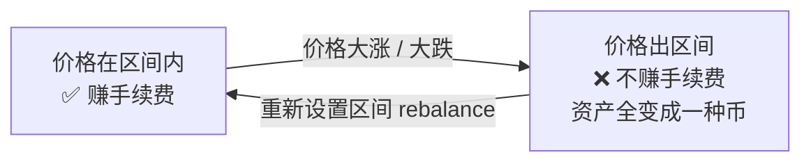

# Day 1：黑客松现场展示

下午四点提交截止后，28 支队伍轮流上台演示。我只录到了其中几支，现场很吵、每队只有几分钟，所以这一篇偏「速记」：
每个项目讲清楚<b>它想解决什么、怎么做、我觉得值得学的点</b>。最后附一个讲 LP（流动性提供）的小工具 Demo。

  
时间2026.10.24 下午

  
形式黑客松现场展示 · 每队约 3–5 分钟

  
队伍18 号起的若干队伍 + LP 工具

!!! note "关于项目名"
    这些项目的正式名字在公开资料里查不到，下面先用队伍编号（18～26 号，和 28 个参赛项目对得上）称呼。

一句话看完

| 队伍 | 项目方向 | 关键词 |
|---|---|---|
| 消费语义 | 补上链上支付缺失的「消费 / 兑换」语义层 | `consume` `redeem` `Receipt` |
| 18 号 | 把 AI 漏洞验证做成**可复现**的工作流 | 可解释性、可复查 |
| 19 号 | 全球 AI Agent 打榜，付费前先比一比 | 4180 个 Agent、83 个类别 |
| 22 号 | Agent 规划旅行行程 + 二维码凭证核销 | 询价、核销、评分 |
| 23 号 | 开源作者感谢墙：发感谢信 + 打赏 | 作者认领、身份验证 |
| LP 工具 | 帮新手做 LP：选池子、出区间提醒、动态费率 | 集中流动性 |

---

## 消费语义：钱花出去了，然后呢？

> 「支付就像外卖送到了门口——**但用户真的吃了吗？**」

**三个痛点**：

1. **钱花了，不知道值不值**：现有工具都在回答「花了多少、花在哪」，没人回答「这笔钱换来了什么」；
2. **履约说不清**：中间的 Receipt（收据）层设计不完善，买卖双方有争议时，拿出这张收据也说不清楚；
3. **绑定不严导致漏损**：凭证可以被多次验证，最终损害买家利益。

**他们的方案**：现有支付协议缺两层语义，他们来补上——

- **consume**：这个结果有没有被消费？被谁消费了？
- **redeem**：同一张凭证被兑换了几次？

**为什么是现在**：讲者认为 12 个月内，相关标准会收敛到大约 8 个，各方都在抢位置、证明自己的设计「中立」——窗口期就是现在。

!!! example "值得学的点"
    「支付完成」不等于「交易完成」。这和 [Day 2 下午圆桌](day2-afternoon.md#part-5) 讲的退款、撤销、履约是同一个问题：**Agent 付完钱之后的世界，协议还没设计好**。

---

## 18 号：让 AI 漏洞验证「可以复现」

**背景**：10 月 20 日起，一个很严重的 PHP 漏洞爆发——攻击者**不用登录就能控制服务器**，大量网站受影响。开发团队收到漏洞报告后，还得自己确认：这个漏洞在我这儿发生过吗？影响多大？有多深？

**目标**：把「用 AI 发现并验证漏洞」的过程做成**简单、可复现的工作流**，让安全判断有据可查。

**三个架构设计**：

1. **约束模型**：系统自动从代码里提取函数等信息，校验后再进入测试，避免模型自由发挥；
2. **注意力层面的可解释性**：输出注意力权重图，用来判断这次判定能不能被验证、能不能溯源，**减少漏判**；
3. **执行记录关联测试状态**：每一次状态变化都能对应回具体的测试，让安全结论可以复查。

现场演示了一段**实时**的 Agent 攻防对抗：选一个合约，Agent 发起攻击，指标打到 0.96 时合约被「打停」——他们特意强调这不是预录的。

**市场**：他们引用的报告称，全球区块链安全市场到 2033 年将达 313 亿美元；首批客户是项目方的合约团队和审计机构，以后可以扩展到「Agent 写代码、调接口时也用这套验证」。

!!! example "值得学的点"
    「AI 说有漏洞」不够，**要能证明、能复查**。这和 Qi Zhou 讲的「作者必须能解释每一行」是一个道理：AI 时代，**可验证性**本身就是产品。

---

## 19 号：给全球 AI Agent 打榜

**产品**：一个 AI Agent 榜单——在你付费购买某个 Agent 之前，先看它的**价格、条款、文档、性能**等维度的综合评分。

- 收录了全球约 **4180 个**已上线的 Agent，覆盖 **83 个类别**，实时更新；
- 已经实测了 12 个网站；同一个任务分发给约 **100 个不同的 Agent**，公开打榜选出表现最好的；
- 前序产品是一个 **GPU 算力租用比价平台**（讲者称是国内第一家），榜单是同一套「比价」思路的延续。

!!! example "值得学的点"
    Agent 越来越多，「**哪个好用**」本身就是刚需——这是一个不需要高深技术、但需要持续投入数据的方向。

---

## 22 号：Agent 规划行程 + 凭证核销

**流程**：

1. 告诉 Agent 你的需求，它向各个服务提供方**询价**，自动生成完整的行程规划；
2. 不满意可以增删微调，右侧实时显示报价；
3. 确认后去门店领取、完成授权，Agent 给你颁发带**二维码的凭证**；
4. 到店扫码**核销**，之后可以评价——如果不满意打了低分，这个分数会影响后续的推荐筛选。

目前一部分维护工作还靠管理员手动操作。

!!! example "值得学的点"
    这正好是 Jason 在 [Day 2 下午](day2-afternoon.md#part-3) 讲的「场景化数据」：订机票、订酒店、做行程——**用户轨迹 + 评价**，本身就是有价值的数据。

---

## 23 号：开源作者感谢墙

**想法**：开源作者很少收到真正的「感谢」，更别说金钱上的感谢。

**怎么用**：

- 输入作者名就能找到他，写一封感谢信（比如「这个 skill 真的提高了我的效率」），同时附上一笔感谢费；
- 每个开源作者都有自己的**感谢墙**，能看到谁感谢过自己；
- 作者领取费用前要**验证身份**：发布一份声明到指定位置，确保是本人领取（这类「证明你是某个 GitHub 账号主人」的做法，常见的是发一个公开的 Gist）；
- 演示跑在测试网上。

!!! example "值得学的点"
    「证明你是某个 GitHub 账号的主人」是 Web3 里很常见的需求，用 Gist 发一段签名声明是最经典的做法之一。和 [Day 2 的 GCC](day2-afternoon.md#part-1) 一样，都在回答「开源公共物品怎么获得回报」。

---

## 附：LP 工具 Demo

一个很短的 Demo（约 3 分钟），讲的是帮大家做 **LP（Liquidity Provider，流动性提供者）**。

### 先搞懂 LP 是什么

在去中心化交易所（DEX）里，没有传统的买卖挂单。你把**两种代币**（比如 ETH 和 USDC）一起存进一个「池子」，别人来换币时付的手续费就分给你——这就是做 LP。

现在主流的是「**集中流动性**」（Uniswap v3 那一类）：你可以只在某个价格区间里提供流动性，资金效率更高，但**价格跑出你的区间后，你就赚不到手续费了**。

### 工具的三个功能

1. **选池子**：新手常被「看起来很高的年化」吸引，但那可能是**过去**的交易量算出来的，等你加进去已经没那么多收益了。这个工具关注**最近半小时真实产生的交易量**，并附上常用 DEX 数据网站的跳转和历史价格区间，帮你判断风险；
2. **出区间提醒**：订阅后把你的地址加进去，**名下任何一个仓位价格出了区间，就发提醒**，方便及时调整；
3. **动态费率**：资产波动大时**提高手续费率**多赚一点，波动小时**降低费率**吸引更多交易量。

!!! warning "提醒"
    做 LP 有「**无常损失**」风险：币价大幅波动时，你拿回来的资产可能比单纯持有还少。真金白银参与前先在测试网或用很小的金额练手。

---

## 现在能做什么

- [ ] 挑一个最感兴趣的项目，用三句话写下「痛点 / 方案 / 我会怎么改进」——这就是黑客松选题的基本功；
- [ ] 在 DexScreener 上随便点开一个池子，看看「交易量」「流动性」这些数字分别是什么意思；
- [ ] 读一遍 [黑客松参赛指南](../../handbook/hackathon.md)，想想如果是你，会在这 28 个项目里怎么脱颖而出。

!!! quote "说明"
    项目名、数字以讲者现场口述为准，未经核实。
