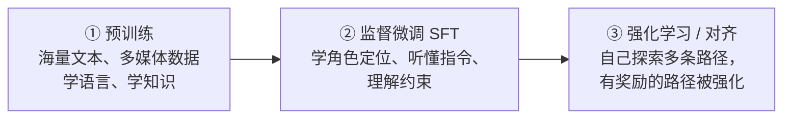
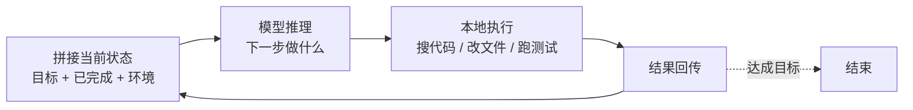

# Day 1：一块开发板的硬件钱包，和 AI 写代码的底层逻辑

10 月 24 日，程序员节，黑客松开赛日。上午两场工作坊一硬一软：OSKey 带大家用淘宝开发板 DIY 自己的硬件钱包；
登链社区的 Tiny 熊从「大模型到底是什么」讲起，一路讲到 Agent、Harness 工程和怎么让 AI 写好以太坊代码。

  
时间2026.10.24（1024 程序员节）

  
形式Hackathon Build Day · 工作坊

  
讲者张文超（OSKey）· Tiny 熊（登链社区）· Jack Xiao（FluxA）

  
素材现场笔记 + OpenBuild 官方回顾

TL;DR

- **OSKey**：不卖硬件的开源硬件钱包——买块开发板刷固件就能用；助记词管理、以太坊交易签名、FIDO2 登录都支持，还在探索「用自然语言让 AI 帮你设计硬件」。
- **LLM 的本质是「预测下一个 token」**：所以它不爱说「不知道」、不会数 strawberry 里有几个 r、会被无关信息带偏、训练完就不再学习、而且没有记忆。
- **Agent ≈ LLM + Harness**：Harness 负责上下文、工具、约束和验证，让模型在「思考 → 执行 → 看结果」的循环里把活干完。
- **让 AI 写好代码**：写清楚 `AGENTS.md`、用 Skills 渐进加载领域知识、命名具体、注释写在函数上方、上下文坏了就重开。

---

## Part 1 · OSKey：Build Your Hardware Wallet { #part-1 }

**讲者**：张文超（OSKey 项目开发者）· 开源地址：[butterfly-community/oskey-firmware](https://github.com/butterfly-community/oskey-firmware)

### 1.1 私钥保管的进化史

> 在区块链上，你的资产、你的一切，本质上就是你的私钥。

| 阶段 | 形态 | 问题 |
|---|---|---|
| 热钱包 | 跑在 Windows 电脑上，电脑同时还是一个节点 | 电脑联网，随时可能被黑 |
| 冷钱包 | 把私钥隔离出来「放进保险箱」，只用来签名 | 手机钱包的蓝牙、WiFi 固件历史上出过很多问题 |
| 硬件钱包 | 从无屏的卡片，到带屏幕、能解析交易内容的设备 | 以太坊交易越来越复杂（合约调用），需要能看懂再签名 |

比特币生态里有两三款可以 DIY 的**开放**硬件钱包（比特币死忠粉很在意这个），但以太坊生态一直没有——以太坊的交易涉及合约调用、各种签名，做起来复杂得多。**OSKey 就是专注以太坊体验的开放硬件钱包平台。**

### 1.2 OSKey 是什么

- **纯软件项目，不卖硬件**：为了避免商业上的各种问题，OSKey 没有自己的硬件产品。你从淘宝或任何平台买一块开发板，刷上 OSKey 的固件，它就是一个硬件钱包；
- **「拼图」式设计**：每块开发板能力不同——有的有硬件随机数发生器，有的有安全芯片，有的没有。OSKey 把主控、屏幕、陀螺仪、安全芯片等能力都做成独立组件，按你的板子拼起来；
- **能力**：助记词生成与导入、HD 钱包派生、以太坊交易解析与签名，商业硬件钱包有的它基本都有；种子可以存进可选的 **NXP EdgeLock A5000** 安全芯片，带 PIN 重试保护；
- **不止是钱包**：支持 **FIDO2 / Passkey**，刷了固件的开发板可以当 USB 硬件安全密钥，用来登录 Google 等网站，或者给 OpenSSH 做认证；
- **兼容性**：讲者说大约 **8000 多款开发板、200 多款芯片**都能跑；官方说明是支持多家厂商的数百款芯片，最便宜的只要 0.3 美元。演讲最后还感谢了 GCC 的资助。
- **新版本**：活动第二天（10 月 25 日），张文超在 GitHub 发布了 [OSKey 0.8.0](https://github.com/butterfly-community/oskey-firmware/releases/tag/0.8.0)，加入了安全芯片管理页、可恢复的 FIDO2 凭证、签名固件升级等。

### 1.3 AI × 硬件：用一句话设计你的设备

他们在探索的方向：你用自然语言描述需求，AI 引导你选主控、选屏幕、要不要陀螺仪（摇动陀螺仪可以生成更强的随机数）……下一步甚至能让 AI **生成 PCB 设计和外观设计**，交给工厂生产——一个真正「独属于你、由你设计」的硬件。

### 1.4 现场 DIY 小记

演讲完，现场发了开发板和配件，大家动手组装：

- 亚克力外壳上有保护膜，**记得先撕掉**；
- 螺丝分长短：**屏幕那一侧用长螺丝，厚壳那一侧用短螺丝**，每个孔一长一短对应；
- 没带螺丝刀可以手拧，但最好还是用工具拧紧；
- 组装完可以现场找讲师刷固件，也可以带回家自己刷——**代码是开源的，自己刷反而更放心**。

!!! example "小白能学到什么（OSKey 部分）"
    1. **「开源 + 自己刷固件」= 不必信任厂商**，这和区块链「不需要信任中间人」是同一种思路；
    2. 硬件钱包的核心价值是**让私钥永远不碰联网设备**，屏幕的作用是让你「看懂再签」；
    3. FIDO2 / Passkey 是互联网登录的未来方向，一个设备同时管钱包和登录，正好呼应 Vitalik 说的「通用安全硬件」（见 [Day 2 上午](day2-morning.md#part-1)）。

---

## Part 2 · Tiny 熊：Vibecoding On Ethereum { #part-2 }

**讲者**：Tiny 熊（登链社区发起人）

他的出发点很有意思：**把 AI 当成一个人来理解**——了解它的成长经历、背景和性格，才能更好地和它沟通。

### 2.1 大模型是怎么「长大」的

LLM 的本质是**根据前文预测下一个 token**，一个接一个，直到输出完整答案。它的「智力」来自三个训练阶段：

- **预训练**像小孩大量阅读：看得越多，知识越多；
- **监督微调**像教规矩：你是谁、该怎么回答、哪些不能做；
- **强化学习**像让它自己做题：多条解法里，做对的被奖励，慢慢学会举一反三。

### 2.2 先天缺陷：知道它不擅长什么

| 缺陷 | 表现 | 怎么绕开 |
|---|---|---|
| **难说「不知道」** | 本质是预测模型，会自信地编（幻觉）；新模型学会了反问，但仍会一本正经地胡说 | 关键事实要核实；让它不确定时提问 |
| **Token 化丢失细节** | 不擅长多位数算术；数不清 strawberry 里有几个 r（单词被切成 token，「字母」概念没了） | 计算交给程序 / 工具 |
| **抗干扰差** | 对话里塞进无关信息，推理表现会明显下降（人能在嘈杂现场专注听一个人说话，AI 不行） | 上下文保持干净，一个会话只聊一件事 |
| **训练完就冻结** | 知识停在训练截止时，跟它聊再多也不会变聪明 | 用搜索、文档、Skills 补最新知识 |
| **无状态** | 每次都是独立的「一问一答」，它根本不记得上一句 | 由客户端 / Agent 维护对话历史 |

最后两条是理解后面所有内容的关键：**AI 记不住，所以要有人帮它记。**

### 2.3 两种 API：谁来记住对话？

- **Chat Completions API**（经典接口）：客户端自己维护完整的 `message history`，每次请求都把全部历史发过去。比如先问「世界最高的山」，再问「第二高的呢？」——如果不把上一轮一起发，它根本不知道「第二」指什么；
- **Responses API**（新接口）：服务端帮你记录对话状态，还把搜索、代码执行、生图等工具打包在后台，客户端不用每次重传。

**缓存**：每次都重发全部历史，模型要重新计算注意力，很耗资源。所以服务商会把算过的内容缓存起来。DeepSeek 等模型的**缓存命中和未命中价格差很大**——这也是为什么同一个对话越长、越乱，越贵。

**工具调用**分两种：

- **本地工具**：你告诉 AI 有哪些工具，它回复「调用哪个工具、传什么参数」，由你的客户端执行，再把结果发回给它分析；
- **服务端工具**：比如搜索，服务商在后台直接帮你调，抓取公开网页补全模型不知道的东西。

### 2.4 Agent ≈ LLM + Harness

如果大模型是大脑，**Agent 就是在大脑外面加上手、眼睛和规矩**。这一圈「外围设施」叫 **Harness**（直译是马具、挽具），包括：

- **上下文管理**：哪些内容要传给模型；
- **工具**：读写文件、执行代码、搜索、跑测试……
- **约束**：做事要遵守哪些规则；
- **验证**：做完了怎么检查。

Agent 的工作方式是一个循环：

我们平时用的 Claude Code、Codex、Cursor 之类，本质都是这样的 Agent。它们弥补了 LLM 的短板：算术交给程序算，不知道的新东西去搜。

### 2.5 上下文：Agent 的「工作记忆」

- 每个会话（session）一开始，Agent 会拼一段很长的**系统提示**：操作系统、当前目录、项目说明（`AGENTS.md`）、可用的 Skills 列表……最后才是你的需求；
- 之后的每一轮都是**只追加不删除**，直到上下文窗口快满了，再做压缩或重开；
- **状态清单**：大任务做着做着，AI 会忘了自己在干嘛。所以 Agent 会不断往上下文里追加一份「待办 / 已完成」清单；你也可以手动提醒它：「现在还有哪些没做完？重新梳理一下。」
- **上下文腐化**：模型每次都把自己的输出当作下一次的输入，中间一旦出错，错误会被带着一路错下去——它不像人能打草稿再擦掉。**最好的办法是直接丢掉这段上下文，开个新会话重来。**
- 一个会话里**不要频繁切换话题**，否则上下文很快被污染。

### 2.6 Harness 工程：比提示词工程更大的概念

以前大家讲「提示词工程」，后来讲「上下文工程」，现在更常听到 **Harness 工程**——它包含前两者，再加上**怎么和环境交互、怎么设计接口、怎么验证结果**。核心思想只有一句：

> 理解 AI 的局限，把适合在本地（用程序）做的事情，从模型身上剥离出来。

### 2.7 提示词的五条朴素建议

1. **Garbage in, garbage out**：没有完美的提示词，把 AI 当成人来沟通；
2. **讲清角色、背景、范围、约束**：让它知道为什么做、做到什么程度（模型越强，越不需要事无巨细，但边界要清楚）；
3. **说不清就举例子**：比如日期格式，给一个例子比描述半天有效；
4. **首尾效应**：模型对开头和结尾印象最深、中间容易忘，关键信息放首尾，必要时再提醒一次；
5. **复杂问题先分析、再动手**：明确告诉它「别急，先把问题拆开想清楚」，再看它的思路对不对。不然它会凭训练出来的「肌肉记忆」直接开干。

### 2.8 让 AI 真正懂你的项目

**文档化**——AI 没有记忆，换个会话、换个工具（比如 Codex 额度用完换别的），它就对你的项目一无所知：

- 写一份 `AGENTS.md`：项目是干什么的、架构、数据库、API、怎么测试、怎么部署、设计风格、注意事项；
- **保持精简**：`AGENTS.md` 会被全量加载进每次对话，太臃肿就浪费 token；
- **渐进式加载**：把数据库、UI 等细节拆到单独文档，在 `AGENTS.md` 里写「涉及数据库时去读 xxx.md」；
- 代码改了，**提醒 AI 同步更新文档**。

**Skills**——给 AI 的「领域操作手册」：

- 好比入职时公司给你的指引：请假找谁、抄送谁……这些是你们内部特有的规则；
- 每个 Skill 是一个目录，里面一定有一个 `SKILL.md`：前面是元信息（描述、什么时候用），后面是详细指令，可能还带脚本；
- Agent 先只读描述，**需要时才加载全文**（渐进式），避免一次塞满上下文；
- 有全局 Skills，也有项目级 Skills；
- 模型的知识大约滞后一年，**最新的开发最佳实践靠 Skills 补上**。

**用脚手架起步**：他演示了用 [Scaffold-ETH 2](https://docs.scaffoldeth.io/build-with-ai/skills)（`npx create-eth@latest`）一键创建模板工程：合约部分用 **Foundry** 和 **OpenZeppelin**，项目根目录自带一份 `AGENTS.md`，`.agents/skills/` 下预装了 ERC-721、SIWE（用以太坊账户登录）、x402（Agent 支付）等 Skills。之后你只要用自然语言说需求，Agent 就会自己找到合适的 Skill 去做。

**代码可发现性**——AI 读代码靠**搜索**，而不是像 IDE 那样「跳转到定义」：

- **命名要具体**：叫 `getUserProfile`，别叫 `get`。在十几万行的项目里搜 `get`，会搜出几千处无关代码，AI 立刻迷失方向；
- **一个概念只用一个词**：`user`、`profile`、`customer` 混着用，AI 分不清是一个东西还是三个；
- **注释写在函数定义的正上方**：Agent 截取代码片段时更容易把注释一起带上；最好的情况是名字本身就说明了用途；
- **显式声明依赖**，别让 AI 去猜。

!!! example "小白能学到什么（Tiny 熊部分）"
    1. 用 AI 写代码不神秘：**它是一个没有记忆、靠上下文干活的预测器**，所有技巧都是围绕「给它对的上下文」展开的；
    2. 今天就可以做的事：给自己的项目写一份 `AGENTS.md`，哪怕只有十行；
    3. 这套方法不只适用于写代码——用 AI 写论文、做调研也一样。完整整理见 [AI 辅助开发](../../devtools/ai-coding.md)。

---

## Part 3 · FluxA：当 Agent 开始替人花钱 { #part-3 }

**讲者**：Jack Xiao（FluxA Head of Ecosystem）· 《Beyond x402: FluxA Brings Agents to Real-World Commerce》

!!! note "说明"
    这一段根据 OpenBuild 官方回顾整理。

Agent 开始帮人订票、买服务、调用付费 API，支付系统也要适应这个新的「交易主体」。和人付款相比，Agent 支付有几个不同：

- 会产生**大量小额、高频**的交易请求；
- 常常要在**用户不参与每一步**的情况下完成付款；
- 因此对**交易身份、支付授权、风险控制、支付状态确认**都提出了新要求。

即使 Agent 已经能通过 x402、稳定币自主发起支付，**商户端**仍是难点：商户接不接受这种支付方式？怎么结算？异常订单怎么处理？这些都需要完整的商业支付基础设施。FluxA 就在围绕这些环节构建 Agent 支付能力。

> x402 是什么：借用 HTTP 里一直没被正式用起来的状态码 **402 Payment Required**，让 Agent 访问付费资源时可以「自动付钱再拿结果」。更多见 [MCP 与 AI Agents](../../ai-web3/mcp-agents.md)。

---

## 延伸概念

`硬件钱包` `冷钱包` `安全芯片` `FIDO2 / Passkey` `开源固件` `LLM` `Token` `SFT` `RLHF` `幻觉` `Chat Completions API` `Responses API` `上下文窗口` `提示词缓存` `工具调用` `Agent` `Harness` `上下文腐化` `AGENTS.md` `Skills` `Scaffold-ETH` `Foundry` `OpenZeppelin` `ERC-4337` `x402`

## 现在能做什么

- [ ] 去 GitHub 看一眼 [OSKey 固件仓库](https://github.com/butterfly-community/oskey-firmware) 的 README，了解支持哪些开发板；
- [ ] 问你常用的 AI：「strawberry 里有几个 r？」再让它「逐个字母列出来再数」，体会 token 化的影响；
- [ ] 给自己的一个项目（哪怕是课程作业）写 `AGENTS.md`；
- [ ] 下次 AI 越改越乱时，别跟它较劲——**开新会话**，把目标和关键背景重新讲一遍；
- [ ] 把代码里那些叫 `data`、`info`、`get` 的变量名，改成说人话的名字。

!!! quote "说明"
    OSKey 的功能细节和 Scaffold-ETH 2 的 Skills 以官方发布说明和文档为准。
