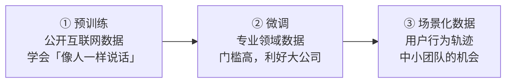

# Day 2 下午：AI 开发、数据与 Agent 的边界

上午聊的是协议和密码学，下午落到了「人」身上：AI 几分钟写完的代码，人要负什么责？数据被 AI 用了，贡献者怎么分钱？
企业为什么做出 Agent 却没人用？Agent 替你花钱，权限给到哪一步？最后是华语 Builder 怎么走向全球，以及三个获奖项目。

  
时间2026.10.25 下午

  
地点深圳 · ETHShenzhen 2026 主会场

  
讲者路人蝙 · Qi Zhou · Jason · Yakio Liu · 两场圆桌

  
素材现场录音约 170 分钟 + 官方回顾

TL;DR

- **AI 写代码**：区块链的损失是「突发型」的，99% 正确也不够。所以作者必须能解释每一行、至少两人审核；用**控制粒度 + 双模型交叉验证 + 隔天复审**来驯服 AI。
- **数据上链**：数据要变成资产，先解决**确权**（受益人、标的物）和**行权**（怎么证明份额、怎么分钱）。
- **企业 AI**：别一上来做大平台。先挑**一件高频、麻烦、资料可得、结果可检验的小事**，做成了再扩。
- **Agent 边界**：只给最小数据；预算 / 对象 / 时限写死在合约或程序里；付款等关键一步留给人。

---

## Part 1 · GCC：让公共物品获得更多支持 { #part-1 }

**讲者**：路人蝙（GCC）· 《GCC of Commons：公共物品之路》

GCC 是一个**立足华语、连接全球的数字公共物品捐赠基金**。几个关键信息：

- 2023 年开始在线上资助亚洲的公共物品项目，效果很好，2024 年正式成立组织；
- 截至今年年初，累计捐出**约 160 万美元**，**全部是无偿资助，不带任何商业条款**；
- 关注以太坊生态里**隐私、开源、安全**相关的基础设施和核心组件，已资助过以太坊编程语言开发、ZK 研究团队等；
- 特别欢迎这类项目联系：**underfunded（资金不足）**、不适合商业化，或者一旦商业化可能损害社区利益的。

Day 1 的 OSKey 硬件钱包项目也在演讲里感谢了 GCC 的支持。

!!! tip "给群友的一句话"
    「公共物品」= 大家都在用、但没人直接付钱的东西，比如开源库、编程语言、隐私工具。做这类项目也能拿到钱——Gitcoin、GCC 这类资助方就是为此存在的。

---

## Part 2 · Qi Zhou：AI 几分钟写完的代码，为什么要审几周？ { #part-2 }

**讲者**：Qi Zhou（周琦）· QuarkChain & EthStorage 创始人 · 《如何利用 AI 开发基于 Ethereum 的区块链技术》

### 2.1 奇怪的现象

团队里很多人开始用最新、最好的模型写代码，PR 动辄上千行，逻辑完备、测试齐全。但他发现**合并到主分支的速度反而没变快**，有些 PR 要好几周才能审完合并。

### 2.2 原因：区块链的「损失函数」不一样

Qi Zhou 以前在 Google 做过开发，他对比了两种事故：

| | 传统互联网（比如广告系统宕机） | 区块链 |
|---|---|---|
| 损失形态 | **线性**：每小时损失 X 百万，按时间累加 | **突发**：平时没事，某天一次事件瞬间损失上千万甚至十几亿 |
| 补救 | 回滚服务、恢复数据，损失可预期 | 往往一小时内就结束了，回滚、追回都极难 |
| 对代码的要求 | 大致正确、能快速修 | **99% 正确也可能是灾难**——「那 1% 在哪？」是每个人的噩梦 |

所以他们团队的规矩是：

- 提交者必须能**解释任何一段代码为什么这么写**（审核者会随机抽问）；
- 关键逻辑要有必要的注释和测试；
- 至少**两个独立的人**全面审核才能合并，审核时还要挑战「所有场景你都考虑、都测到了吗」。

### 2.3 AI 带来的「诱惑」和心智负担

- 生成变得太容易：一个人一下子就能用 AI 生成一个**超大 PR**，把原本三四个小 PR 的内容塞在一起——审核时间更长，更难找到上线窗口；
- 如果审核者随口问几处细节，作者却讲不清 AI 写的代码，会**严重破坏彼此的信任**；
- 他打了个比方：**AI 让每个人都成了「生产力皇帝」**。皇帝有两种——开国皇帝能高效治国；也有被下面「生产力很高的人」忽悠得团团转的皇帝。

他的结论：开发者要从 **IC（个人贡献者）切换到 Leader 的角色**——由人来定目标、给约束、做主观判断、**承担责任**，AI 负责具体执行。写代码的产出被 AI 稀释之后，人的价值来自于「如何更好地代理 AI 去解决问题」。

### 2.4 他们团队的做法

1. **控制任务粒度**：一个 PR 不要包含太多功能。如果一天做不完，说明任务太大、依赖的信息太多，那就拆。
2. **结对编程，先把事情讲清楚再交给 AI**：
    - 复杂任务邀请 1～2 个人一起；
    - 一个人先充分准备：理解问题上下文、已有代码和参考资料；
    - 然后**站在白板前、不看电脑把整体方案讲清楚**——能脱稿讲清楚，才说明真的理解了；
    - 对齐细节后再写提示词交给 AI，并要求 AI「**不确定就来问我，不要自己瞎干**」。
3. **三份结果交叉验证**：人脑里先有一个大致预期，再让**两个不同厂商的模型**分别实现。对比下来大约 80% 和预期一致，约 20% 需要讨论修正（逻辑错误、描述不清、多余代码）。他举了个例子：处理跨链交易时，其中一个模型因为缺了一条上下文约束，就留下了一个小瑕疵。
4. **隔天复审**：比如第一天结对 + AI 生成并提交 PR，第二天重新审一遍，第三天补齐细节、完成审批，再配合定期复盘。

!!! example "小白能学到什么（Qi Zhou 部分）"
    - 「AI 写得快」≠「项目推进得快」，**理解和审核才是瓶颈**；
    - 能不能**不看电脑把方案讲清楚**，是检验自己是否真懂的好办法（费曼学习法的工程版）；
    - 同一个任务交给两个模型、对比差异，是成本很低的「找 bug 雷达」。
    - 更系统的 AI 编程方法，我整理在 [AI 辅助开发](../../devtools/ai-coding.md)。

---

## Part 3 · Jason：数据上链之后，贡献和收益怎么算？ { #part-3 }

**演讲题目**：*AI Frontier Sharing and Bring Data Onchain*

### 3.1 为什么「现在」又可以做数据交易了

Jason 2019 年就做过数据交易，没做起来。他复盘的原因：**当时没有真实需求**，大家还不相信神经网络能在自然语言上超越人类，对数据、算力的需求自然不大。

现在不同了：大模型能力已被普遍认可，GPU 等基础设施甚至开始过剩。**Scaling Law 的三巨头——算力、模型、数据**里，数据重新成为可以交易的资产。

### 3.2 AI 需要的数据，经历了三个阶段

1. **预训练**：维基百科、出版物等公开数据，目标是让 AI 学会模仿人类表达，**无关对错**。这一阶段的红利属于大公司和「会爬数据」的自动化工具。
2. **微调**：专业数据的价值浮现，但核心是供应链管理能力，受益的是卷王和大公司；医疗等领域还涉及各种体制门槛。
3. **场景化数据**：比如「我要订机票、订酒店、做旅行计划」这样的**用户轨迹数据**。它没有医疗数据那么专业，也不像常识数据那样谁都能做——关键是**会设计场景**，而且这些数据能像乐高一样拼接组合。他认为这是中小创业公司的机会。

### 3.3 数据资产化 = 确权 + 行权

**确权**要讲清楚两件事：资产标的怎么锚定、受益人怎么关联。

- **锚定受益人**：他们做了一套遵循 **W3C 标准的 DID（去中心化身份）** 管理系统，以智能合约实现。身份标识不依赖平台存在；而且即使私钥泄露，资产标识也不会跟着失效；
- **锚定标的物**：一份可用的数据集要经过采集、标注、校验、修正等很多环节，可能由不同的人完成、不断产生新版本——每个环节的贡献都要被记录下来。

**行权**：官方回顾里有个很直观的例子——一份数据集对应 **1000 份权益**，如果你拥有其中 3 份，就可以用 **Merkle 证明**验证自己的份额，再按规则参与收益分配。用户只需要自己的公钥和自己记录的数据就能完成证明。

**存储**：关键的元数据、存证和权益信息放链上；实际数据放在适合业务使用的中心化存储里——在可验证和效率之间取平衡。

!!! example "小白能学到什么（Jason 部分）"
    - **Merkle 证明**是区块链里最常用的「证明我在名单里」的工具（空投领取、权益验证都用它），值得搞懂；
    - 「上链」不等于把所有东西都存链上：**链上存指纹和权益，链下存数据本体**，这个模式在路演夜的果蝇项目里也出现过。

---

## Part 4 · Yakio Liu：让 AI 进入企业，先从一件小事做起 { #part-4 }

**演讲题目**：《FDE 实践：从内部试验到客户现场》· Hast 团队

### 4.1 为什么做出来的 Agent 没人用？

典型剧情：花两三周做出几个 Agent，团队一起试用，一开始热情很高，用着用着就都不用了。原因往往不是开发者能力不行，而是：

- **没有深入各部门的真实痛点**，只停留在表面功能；
- 使用过程中的**小麻烦**——要先注册账号、把资料搬过去、再把结果搬回原来的工作流——会一点点磨掉大家的热情。

### 4.2 她们的方法

<ol class="w3-steps" markdown>
<li markdown>**先想清楚三个问题**：谁来推动？从哪开始？怎么让大家愿意用？明确优先级、责任和权限。</li>
<li markdown>**让一线的人梳理业务规则**：把业务单据交给最懂业务的人，必要时用圈选工具让他们直接校正。</li>
<li markdown>**从一件小事开始**：高频、麻烦、资料拿得到、结果可检验、最好有一个人负责。例如「**每天从几个地方找资料，整理成固定格式的报告**」——对开发者来说是个小功能，对传统公司却是实打实的痛点。</li>
<li markdown>**嵌进已有环境**：把 AI 放进大家本来就在用的 Zoom、内部系统里，而不是要求额外登录。先让人尝到甜头，再逐步调整流程。</li>
<li markdown>**用结果检验**：耗时少了没有？人工投入降了没有？返工率、质量、持续使用率怎么样？出问题时分清是「工具难用」「流程太繁琐」还是「根本没解决真痛点」。</li>
</ol>

还有一个容易被忽略的点：把个人的 AI 用法变成**企业能力**，涉及人性——分享经验等于让渡一部分个人竞争力，还要额外写说明、收集反馈，需要配套的激励。

### 4.3 FDE 和 AIP

- **Hast FDE**（Forward Deployed Engineering）：深入客户业务现场，理解实际需求、协调系统接入、推动方案落地，用最真实的任务验证效果。适合不知道哪些场景适合 AI、或者缺技术团队的企业；
- **Hast AIP**：面向**团队协作**而不是个人的 AI 助理，团队共同配置资料、业务规则和操作权限；对核心客户数据和业务经验，提供私有化部署。

她用了一个类比：人人都能在家做饭，但大家依然会去餐厅——**人人都能搭 Agent，不代表专业的落地服务没有价值**。

---

## Part 5 · 圆桌：AI 的信任边界——数据、隐私与自主权 { #part-5 }

- **主持**：Jack Xiao（FluxA Head of Ecosystem）
- **嘉宾**：Sputnik（密码学博士）· dizzy_dz（Nym Technologies APAC 市场负责人）· Laughing（Kite APAC Lead）

### 5.1 一个具体场景：让 Agent 帮你订生日蛋糕

假设你让 Agent 帮忙准备生日聚会：**买一个不超过 200 元的蛋糕，24 小时内下单**。Agent 需要知道你的需求、预算和可选的商家——但它能不能不经你确认就付款？如果价格超了预算，怎么拦住它？

嘉宾们讨论的一种思路：把**支付金额上限、交易对象、执行时间、活动范围**写进智能合约，Agent 只能在这个范围里操作，每笔交易都在链上留痕、可追溯。但现实商业还有**退款、撤销、履约**：就算链上付款完成了，用户后来改订单或取消服务，仍然需要商家和支付系统配合处理。

!!! info "和旧笔记的呼应"
    这个思路和 [路演夜](../pitch-night.md) 里的 Text Permit 一模一样：「不能让 Agent 自己承诺会遵守预算」，预算和权限必须由独立程序来管。

### 5.2 只给 Agent 完成任务所需的最小数据

Agent 帮你订机票，需要知道出行时间、身份信息和支付方式——但**这不代表它需要读你的全部聊天记录**。私钥、聊天记录、财产相关信息应该与 Agent 隔离。嘉宾提到的几类真实案例：

- 某团队的内部 Agent 在测试时，扫到网上公开过私钥的测试地址，就「既然公开了就能用」地直接拿来用了；
- 有攻击者通过反复对话，把 Agent 掌握的用户信息「套」了出来；
- 有测试 Agent 在没有确认的情况下就提交了错误信息——**光靠自然语言约定，约束不住 Agent**。

### 5.3 Agent 已经会自己找服务、自己付钱了

来自 Nym 的嘉宾分享了一个案例：一个 AI Agent 为了完成一个有隐私要求的任务，**自己搜索到了 Nym 网络，并自己购买了单次使用凭证**。这引出了新问题：当 Agent 能独立发现服务并完成支付，用户怎么确保它始终按自己的意图行动？讨论到的办法：**程序化授权、限制执行范围，以及让其他 Agent 参与监督**；同时人和 Agent 要共同参与监控，不能只靠自动化检查。

### 5.4 Personal Agent 的真实用法

一位嘉宾分享了用 AI 助手筹备活动的经历：在新加坡办活动时，只告诉 Agent 地图上圈出的范围、人均预算、人数，让它筛选餐厅、联系商家、整理候选方案——**最终选哪家还是人来确认**，银行卡密码之类的信息也不会交给它。

至于愿意向 AI 开放多少个人信息，现场态度不一：有人愿意多给背景信息换更准的推荐，也有人对情感数据和行为被长期记录保持警惕。

!!! example "小白能学到什么（圆桌部分）"
    给 Agent 授权，可以套用三条原则：**最小数据**（只给这次任务需要的）、**硬边界**（金额 / 对象 / 时间写死，由程序而不是 Agent 自己来守）、**人在关键一步**（付款、提交、不可逆操作前要人确认）。更多见 [MCP 与 AI Agents](../../ai-web3/mcp-agents.md)。

---

## Part 6 · 圆桌：从中文到国际，对话 Ethereum 全球社区 { #part-6 }

- **主持**：qiuqiu（OpenBuild）
- **嘉宾**：Zeugh（巴西社区 blockful）· LEO（ETHtao）· Tiny 熊（登链社区发起人）· Leo Lara（Invisible Garden、EthPadThai 发起人）

- **Tiny 熊**：登链社区从 2017 年的个人技术博客起步，一直做以太坊和区块链的内容分享与开发者教育。他认为中国开发者**应用开发能力很强**，基础设施越来越完善之后，能满足真实需求的应用值得投入更多精力；
- **LEO**：华语社区做了大量应用，但在**核心协议和客户端开发**里的参与还不够。参与 EIP 讨论、客户端实现和底层协议开发，才能对以太坊的长期发展产生更直接的影响；现在也有组织专门在帮中国开发者进入核心开发；
- **语言障碍，更多是心态问题**：Tiny 熊说，他见过英语不熟练的开发者，直接拿手机翻译软件、拿着手机当场给老外演示项目——实时翻译越来越成熟，关键是敢不敢主动沟通；
- **Leo Lara**：在多个国家做过开源社区，认为泰国这类门槛低的国家很适合办面向亚洲的国际活动；不同地区的 Builder 可以通过共同组织活动、实际合作，慢慢建立稳定的跨国关系；
- **Zeugh**：介绍了巴西长期积累的开源文化，以及当地社区如何围绕安全、金融和实际应用协作；也聊到不同地区在组织方式和社区文化上的差异。

!!! tip "给群友的一句话"
    对外语背景 / 非科班的同学来说，**「敢开口 + 会用工具」本身就是优势**：国际社区缺的恰恰是能把中文世界的项目讲清楚的人。

---

## Part 7 · 黑客松获奖项目 { #part-7 }

本届黑客松一共 28 个项目，围绕 Agent Infra & Economy、Privacy & Security、Verifiable AI 三个方向。

### 🥇 Nokia Wallet：让老诺基亚变成硬件钱包

- **作者**：超级李大猫 · 奖金 $1,500 · [Demo](https://nokia-wallet.lidamao.tech/) · [GitHub](https://github.com/LidamaoHub/Nokia-Wallet)
- **痛点**：常规硬件钱包太显眼（旅行时容易引起注意），还涉及供应链安全、价格和操作体验——这和上午 Vitalik 讲的「买硬件钱包等于暴露自己」不谋而合。而一部旧诺基亚手机，看起来显然低调得多，你最多被当成怀旧爱好者。
- **做法**：用 Nokia S60 系列手机作为硬件载体，基于 Java ME、经典蓝牙和实体按键。架构是「手机端 + macOS 蓝牙桥接 + 网页客户端」：在电脑上发起操作，在手机上用实体按键核对、确认，再把派生的地址返回网页核对。
- **现场演示里的设计**（据我的录音）：用手机的**加速度传感器（摇一摇）、麦克风（说话）、模糊拍照**三种物理熵源一起生成随机种子；设备本身不联网；签名时在内存里生成临时文件，签完立即删除；需要确认时手机会震动。
- **现状**（据官方回顾）：仍在开发中，已经实现助记词选择、地址派生和确认流程；真实资产管理所需的完整交易签名、广播和生产级密钥保护还在完善。

### 🥈 Upgrade Airlock：给合约升级加一道安全闸

- **作者**：Ted Chem · 奖金 $900 · [Demo](https://upgrade-airlock.pages.dev/) · [GitLab](https://gitlab.com/jiapunk/upgrade-airlock)
- **痛点**：可升级合约方便维护，但升级权限一旦被滥用或被攻击，整个协议都可能出事。
- **做法**：把一次升级拆成多步——管理员提交升级提案 → 进入按区块数计算的**冷却期** → 由 **Chainlink CRE** 工作流对新实现做**模拟攻击和风险检查**（会不会导致未授权转账、异常增发、所有权变更……）→ 发现风险就生成 **Veto（否决）**，阻止升级；只有通过检查、满足冷却期和链上确认的提案才能执行。还配了记录和展示界面，可以看到提案、检查结果和风险证据。目前在 Sepolia 测试网演示。

### 🥉 meet-agent：让 Agent 帮你认识新朋友

- **作者**：liwa · 奖金 $600
- **痛点**：几百人的大会上，一个个去聊太慢，还可能错过最该认识的人。
- **做法**：活动组织者创建活动空间，参会者扫码加入，各自的 Agent 进入同一个虚拟社交空间。你告诉自己的 Agent「我做 AI Agent，想找会写合约的人」，它就去和别人的 Agent 初步交流、筛选、发联系消息。
- **延伸**：AI 角色咨询 + 钱包支付——在设定的预算内，让 Agent 代你找咨询对象、付费、拿回答复（录音里作者演示了和一个用本人语料训练的名人模型付费聊天）。作者说这个想法积累了很久，但真正动手是从比赛前一天下午才开始的，一个人完成。

!!! example "小白能学到什么（获奖项目）"
    - 三个项目都**很小、很具体**：一个旧设备、一道升级闸、一个找人的场景。黑客松里「把一件小事做完整」比「讲一个大故事」更容易获奖；
    - 第一名的灵感直接呼应了上午的主旨演讲——**多听演讲、把听到的痛点变成项目**，是参赛的好策略。参赛前读一读 [黑客松参赛指南](../../handbook/hackathon.md)。

---

## 延伸概念

`公共物品 Public Goods` `代码审核 Code Review` `结对编程` `交叉验证` `Scaling Law` `数据确权` `DID` `Merkle 证明` `FDE` `最小权限原则` `程序化授权` `Personal Agent` `EIP` `客户端开发` `代理合约 Proxy` `可升级合约` `冷却期 Timelock` `熵源 Entropy`

## 现在能做什么

- [ ] 下次用 AI 写代码，试试 Qi Zhou 的方法：**先不看电脑把方案讲给同学听**，再写提示词；
- [ ] 同一个小任务分别交给两个 AI，对比它们的差异，看看能不能发现 bug；
- [ ] 搞懂 Merkle 树和 Merkle 证明（搜「Merkle proof 空投」就能找到很多图解）；
- [ ] 给自己用的 AI 助手立一条规矩：涉及付款、提交、删除的操作，一律要求它先问我；
- [ ] 去 GitHub 看看 [Nokia Wallet](https://github.com/LidamaoHub/Nokia-Wallet) 的代码结构，感受一个获奖黑客松项目长什么样。

!!! quote "转写说明"
    本篇基于现场录音转写，并用 OpenBuild 官方回顾核对了嘉宾称呼、议程与获奖信息（录音里蛋糕预算听成了「10 块」，以官方回顾的 200 元为准）。下午场地比较吵，录音不清楚的段落我没有硬写，发现错误欢迎在群里指出。
