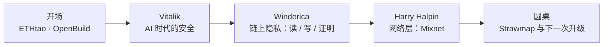
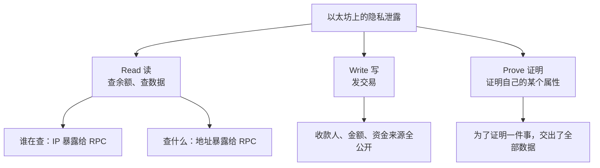

# Day 2 上午：AI 时代的安全、隐私与路线图

主会场第一天上午的四段内容，全部围绕一个问题：<b>在 AI 越来越强的时代，以太坊靠什么保持安全和隐私？</b>
Vitalik 从密码学讲到你自己的钱包，Winderica 拆解「查一次余额会泄露什么」，Nym 讲网络层的匿名，最后一场圆桌把镜头拉回到路线图和去中心化之争。

  
时间2026.10.25 上午

  
地点深圳 · ETHShenzhen 2026 主会场

  
讲者Vitalik · Winderica · Harry Halpin · 路线图圆桌

  
素材现场笔记 + OpenBuild 官方回顾

TL;DR

- **密码学**：AI 的数学能力在飞涨。最可能出事的是椭圆曲线（尤其是「配对」），最稳的是哈希。出事的方式更可能是「参数被迫变大、变慢」，而不是一夜崩溃。
- **你的钱包**：大部分资产放 **2-of-3 多签**、两把钥匙绝不放一起；专用硬件钱包有供应链风险；**最大的风险往往是自己手快犯错**。
- **隐私**：读、写、证明三层都会泄露信息，再加上网络层（IP、时间、频率）。对策分别是 Tor / PIR、隐私池、零知识证明、Mixnet。
- **路线图**：Strawmap 回归「L1 扩容 + 抗量子」。代价是节点门槛可能变高，嘉宾对「还算不算去中心化」意见不一。

---

## 开场：社区在 AI 时代还有什么用？ { #part-0 }

**ETHtao 的 Leo** 介绍了 **Ethereum HK Hub**——香港西九龙的一层社区空间，已经有三四十家以太坊生态团队入驻，平时可以共享办公、办活动。11 月 3 日 ETHtao 还会在香港办 **Devcon 香港分会场**。

**OpenBuild 的 Ian** 的开场我觉得很值得一记。昨天正好 1024，网上有人调侃「今年可能是最后一个程序员节」——AI 写代码这么强，人还需要社区吗？他的回答：

> 大家都能用 AI 把产品做出来之后，下一步是什么？你总不能「自嗨」吧。

他举了一个前辈的例子：用 AI 给自己写了 50 多个小应用，没有一个能拿出去给别人用。所以社区的价值正在从「教你写代码、帮你答疑」变成**「站在你和市场之间，帮你连接人、资源和用户」**。OpenBuild 现在连接了 5 万多名注册开发者、100 多家生态伙伴。

!!! tip "给群友的一句话"
    AI 让「做出来」变便宜了，「有人用」反而更稀缺。这也是为什么线下活动、社区、组队依然值得花时间。

---

## Part 1 · Vitalik：AI 会不会成为密码学的新威胁？ { #part-1 }

Vitalik 把 AI 带来的风险分成三层：**密码学 → 客户端代码 → 用户层**。

### 1.1 起因：AI 的数学能力在飞涨

最近 AI 在数学上做出了很多「之前以为不可能」的事：大量数学证明、更快的乘法算法……Vitalik 说他看了既惊艳又有点害怕。一个耐人寻味的细节：OpenAI 公布了上百份数学成果，**关于密码学却一个字都没有**。他和朋友聊下来，几乎都觉得这不是「没发现」，而是「刻意不说」。

为什么这件事重要？因为**几乎所有密码学都建立在一个假设上：某个数学问题很难，没有高效的解法**。如果 AI 能在 3 年里走完人类 30 年、5 年里走完 50～100 年的数学进展（这是他的设想，不是预测），这些假设就可能动摇。

### 1.2 不同密码学的「抗 AI 体质」

以太坊研究员 Justin Drake 最近提了一个说法：**以前大家讲「抗量子」，现在还要讲「抗 AI」**。Vitalik 按风险高低排了一下：

| 密码学 | 用在哪里 | 抗量子？ | 抗 AI？（Vitalik 的判断） |
|---|---|---|---|
| **哈希函数、对称加密**（如 AES） | 区块链接、STARK 证明、各种承诺 | ✅ | ✅ 最稳：数学结构简单，找不到「捷径」 |
| **普通椭圆曲线**（ECDSA、Schnorr、secp256k1） | 你钱包的签名 | ❌ | ⚠️ 可能有问题 |
| **椭圆曲线配对**（Pairing） | BLS 签名、几乎所有 SNARK（如 PLONK） | ❌ | ⚠️⚠️ 很可能有问题 |
| **格密码**（Lattice） | 后量子签名、全同态加密 FHE、混淆 | ✅ | ❓ 完全不知道，没法估计三年内被破的概率 |

为什么 SNARK 这种「可能有问题」的东西还被大量使用？因为**效率**：基于配对的 SNARK 在链上验证最省 gas，换成纯哈希的方案，gas 要贵 20～30 倍，没有用户付得起。

### 1.3 「出事」更可能长什么样？

Vitalik 强调：他认为**不太可能**出现「AI 突然找到神级算法，第二天所有东西都不安全」的剧本，更可能的是**一种难受但能活下来的中间状态**。他用质因数分解来解释：

- 给你 351，求它等于哪两个数相乘（答案 13 × 27，演示用，27 其实还能再分）；
- 最笨的办法是**试除法**：351 ÷ 2、÷ 3、÷ 5……一路试下去；
- 后来数学家发现了**二次筛法**，再后来是更复杂的 **GNFS（数域筛法）**，一个比一个快。

**而椭圆曲线目前只有「试除法级别」的通用攻击。** 如果哪天 AI 找到了「GNFS 级别」的椭圆曲线攻击：

- 椭圆曲线不会死，但签名可能要从现在的 **64 字节涨到 500 字节**；
- 格密码的密钥可能从 **1 KB 涨到 20 KB**。

也就是说，系统不会崩，而是**参数被迫变得更保守、效率变低**。

### 1.4 为什么偏爱哈希？

一个小历史：**MD4** 是很古老的哈希算法，碰撞（找到两个输入哈希相同）早就被攻破了，但**原像攻击**（已知哈希值反推输入）至今没被打穿。

Vitalik 的解释是：椭圆曲线、格这些结构「数学性质太丰富」——比如加法满足结合律、可以快速数出曲线上有多少个点、还有配对运算——**谁也不敢保证没有第四种、第五种能被利用的结构**。哈希没有这些「抓手」，所以最可能熬过 AI 时代。

以太坊的结论：**能用哈希的地方都换成哈希**——

- **签名**：转向基于哈希的签名方案；
- **证明**：STARK（基于哈希）；
- **内存池**：用基于哈希的「延迟加密」做加密交易池——交易先加密，过一段时间才能解开，等解开时它已经进了区块，三明治攻击就没机会了。

但全同态加密、公钥加密这类事情哈希做不到，还是得用别的密码学，只是要**用得更保守**。

### 1.5 第二层风险：客户端代码

- **短期：用 AI 找漏洞。** Vitalik 提到执行客户端团队 Nethermind 已经申请了 Anthropic 10 月新推出的开源漏洞扫描服务 [OSS Scanner](https://thecurrencyanalytics.com/technology/anthropics-oss-scanner-draws-nethermind-zeus-as-crypto-attacks-multiply-301674)，用 AI 给整个代码库挖洞。按他的说法，目前挖出来的大多是低优先级问题，严重漏洞不多，至少短期是好消息。
- **客户端多样性。** 以太坊有 5 个主流执行客户端，一个出 bug，只要其他客户端加起来超过 2/3，链照常确认。2016 年上海 Devcon 期间的 DoS 攻击就是例子：当时只有 Geth 和 Parity 两个客户端，一个被打挂时另一个顶住了。
- **长期：形式化验证。** 用 Lean 这类工具从数学上证明代码正确，正在 zkEVM、递归 STARK 等方向推进，AI 能让这件事快很多。

### 1.6 第三层风险：用户层（和你最相关的一层）

- **合约语言反而没那么可怕了**：Solidity / Vyper 的安全性已经很高；Vitalik 更担心 **ZK**：越来越多应用依赖 ZK 的正确性，两年后它会像 Solidity 一样重要，但现在大家对它的安全关注远远不够。
- **前端 / UI 攻击**：Safe 前端被篡改导致巨额被盗这类事件之后，Vitalik 自己开始尽量不用别人做的 UI，而是**用本地 AI 给自己写命令行小工具**。
- **钱包：多签。** 他最认可的方式是大部分资产放多签，比如 **2-of-3**：一把钥匙在电脑、一把在手机、一把交给可信的朋友。**最重要的一条规则：永远不要把两把钥匙放在同一个地方。**
- **硬件钱包的供应链风险。** Vitalik 说的是 10 月刚曝光的真事：马来西亚经销商 CryptoBilis 卖出的一批**正品 Ledger** 被拆开植入了 eSIM 和 LTE 模块，用户设置钱包时屏幕上的助记词会被偷偷发给攻击者，前后损失约 8600 万到 9450 万美元（[BleepingComputer](https://www.bleepingcomputer.com/news/security/ledger-confirms-hardware-wallet-spy-implant-behind-crypto-thefts/)、[Help Net Security](https://www.helpnetsecurity.com/2026/10/12/ledger-wallets-compromised-via-hardware-implant/)）。因为原装安全芯片没被动过，官方的真伪校验也照样能通过。他还提到有硬件钱包公司的客户名单泄露过。更微妙的一点：**你专门买一个硬件钱包，等于告诉整条供应链「我有很多币」**。
- **短期替代方案**：买一台旧款 Google Pixel，刷 **GrapheneOS**（很安全的安卓系统），装 **AirGap** 钱包，然后永久断网，当冷钱包用。
- **长期愿景**：做真正安全的**通用**硬件——钱包只是它的功能之一，还能用来登录银行、社交等。功能越多，攻击者越猜不到你用它干什么，反而越安全。

### 1.7 结尾：别让收益率变成 -100%

> 你的年化是 3% 还是 25% 不重要，最重要的是确保它不是 **-100%**。

Vitalik 还自曝：**他因为自己操作失误丢掉的币，比被黑客偷走的还多**——就是在钱包之间转账太快，手一抖。所以「无聊」的安全习惯同样重要。他整体是乐观的：五年后我们会有非常安全的软件、系统和硬件；但接下来一两年，还得辛苦一点。

!!! example "小白能学到什么（Vitalik 部分）"
    1. **密码学安全 = 「某个数学问题很难」的假设。** 假设被削弱时，通常是「参数变大、变慢」，而不是瞬间归零。
    2. **哈希是最朴素也最耐打的工具**，所以「哈希」这个概念一定要吃透（见 [核心概念词典](../../fundamentals/core-concepts.md)）。
    3. **风险分散**是贯穿全场的思路：多客户端、多签、多设备，本质上都是「不要把鸡蛋放在一个篮子里」。
    4. 自己的资产：**测试网练手、小额起步、慢一点操作**，比研究任何高级协议都管用。

---

## Part 2 · Winderica：查一次余额，也可能泄露隐私 { #part-2 }

**演讲题目**：*Privacy as a First-Class Citizen on Ethereum*（让隐私成为以太坊的一等公民）· 以太坊基金会

### 2.1 问题：链上的一切都永久公开

只要知道一个地址，任何人都能看到它的完整交易记录：什么时候、从哪收了多少钱、又转给了谁——而且是**永久**的，现在能看，几十年后也能看。后果：

- 别人知道你有很多钱 → 你成了高价值攻击目标；
- 企业的商业往来、内部转账被竞争对手看光。

Winderica 把泄露场景分成三类：

### 2.2 Read：私密读取

你打开钱包看余额时，钱包会去问 RPC 节点「这个地址有多少钱」。RPC 服务商因此知道了**你的 IP、查询时间、查的是哪个地址**，长期记录下来就能把你的多个地址关联起来。两个方向的解法：

- **隐藏「谁在查」**：把洋葱路由（Tor 那一类技术）做进浏览器插件，请求层层转发，RPC 最后只看到出口节点的 IP；好处是用户几乎不用做任何配置。
- **隐藏「查什么」**：**PIR（Private Information Retrieval，私有信息检索）**。神奇的地方在于：服务器在**不知道你查的是哪个地址**的情况下，依然能把正确的余额返回给你——查询和答案都是加密的。

### 2.3 Write：私密交易

隐身地址（stealth address）、Zcash 式方案都各有局限。他们在做的一种新型**隐私池**：

- 交易里用**标准的 SHA-256 哈希** + 一种较新的**基于哈希的零知识证明**方案，避开两个坑：椭圆曲线的量子风险，以及 Poseidon 这类「为 ZK 定制的非标准哈希」——Poseidon 前几年很流行（在 ZK 里很便宜），但近几年被发现设计上可能有缺陷；
- 用户不直接发交易，而是提交「这笔交易是正确的」的**证明**；
- 一个 **Aggregator（聚合器）** 把很多人的证明合成一个，链上只验一次，**验证成本恒定**。

**怎么兼顾监管？** 他们设计了「动态黑名单」：

- 每个 UTXO 都带着「这笔钱从哪个地址来」的信息；
- 如果某部分钱来自黑名单地址，转出时必须把它打到托管地址或黑洞地址（等于销毁），剩下的「白钱」正常流转；
- 名单可以随时更新，而且**不管黑名单有一万个还是更多地址，证明大小和验证时间都不变**。

### 2.4 Prove：隐私证明

举个生活例子：租房时房东要看你的收入证明。现在的做法是把完整银行流水发过去——房东只需要知道「月收入大于 3000」，却看到了你所有的交易。零知识证明可以只证明「收入 > 3000」这一件事。

更大的场景是**数字身份**。欧盟等地的数字身份方案，是在你手机里存一份政府签名，需要时出示。问题在于：**你每次出示的是同一个签名**，不同网站可以把你的出示记录串起来追踪你。

以太坊基金会 PSE 团队的方案叫 **OpenAC**（[论文](https://eprint.iacr.org/2026/251)，专门按欧盟数字身份框架设计）：用零知识证明代替直接出示签名——「我知道一个有效的政府签名，而且它说明我满 18 岁」。**每次出示都生成一个全新的证明，彼此无法关联**；兼容现有身份系统，不需要政府改造；手机上生成一次证明只要约 **0.1 秒**。

他们还在手机上测了 16 个零知识证明库，结论挺扎心：**一层层筛下来（是否真的满足零知识性质 → 是否抗量子 → 是否完整安全实现），没有一个库能同时满足所有条件**。这是社区和标准化接下来要补的课。

### 2.5 接下来：从应用层走进核心协议

上面这些目前大多还在应用层。下一步是把它们整合进以太坊核心协议：协议层的隐私交易、**FOCIL** 相关的抗审查机制，以及未来可能引入的**隐私池**和**加密交易池**（防 MEV 抢跑）。最终目标是让旁观者看一个地址时，很难把付款人、收款人和金额对应起来。

!!! example "小白能学到什么（Winderica 部分）"
    1. **「公开透明」是区块链的双刃剑**：可验证，但也意味着隐私默认为零。
    2. 隐私不是「要么全藏、要么全露」：零知识证明让你**只证明需要证明的那一件事**。
    3. 隐私和合规不一定冲突：动态黑名单就是一个「两边都照顾」的设计思路。

---

## Part 3 · Harry Halpin：链上加密了，网络踪迹怎么办？ { #part-3 }

**演讲题目**：*The First Real-World Decentralized Mixnet for Anonymity* · Nym 联合创始人兼 CEO（远程视频）

### 3.1 被忽略的「阿喀琉斯之踵」

就算链上交易用了零知识证明，你的钱包连 RPC 节点时，**IP 地址、连接时间、访问频率**都暴露了。像 Infura 这样的基础设施能从中学到很多，甚至可以屏蔽你。以太坊追求抗审查，但它跑在一个本身不怎么隐私的互联网上。Vitalik 的路线图里也提到过：钱包应该可选地**通过 Mixnet 连接多个 RPC 节点**。

### 3.2 Mixnet 和 Tor 有什么不同？

| | Tor（洋葱路由） | Mixnet（混合网络） |
|---|---|---|
| 转发方式 | 先进先出，包按顺序过 | 每一跳**随机延迟、打乱顺序**再发出 |
| 包长什么样 | 大小、时序都可能被分析 | 统一封装成**等长**的 Sphinx 格式包 |
| 空闲时 | 没流量就没包 | 持续发**掩护流量**（cover traffic，假包） |
| 能防住 | 一般的追踪 | 能看到全网流量的强大对手做时序分析 |

Nym 的 Mixnet 已经升级到 **ML-KEM** 后量子加密。它的设计源自 Nym 首席科学家 Ania Piotrowska 等人 2017 年发表的 [Loopix 论文](https://arxiv.org/abs/1703.00536)，感兴趣可以读一读。

### 3.3 开发者怎么用？

- **JavaScript 的 MixFetch**：大约 **5 行代码**，把普通的 `fetch` 请求送进 Mixnet；
- **AnonRPC**：以太坊基金会支持的匿名 RPC，基于 Nym，代码只有十来行；
- **SDK**：Rust（也编译成 WebAssembly 给 JS 用）、C、Go；
- 可以在「快」和「更匿名」之间调节——包越慢、混进的流量越多，你藏得越深。

**已经在用的地方**：AI Agent 匿名上网（他们做了 Mixnet 的 MCP 集成）、Zcash 的 Zingo 钱包、Status 和 SimpleX 这类通讯应用。他还给黑客松选手列了方向：钱包集成、MetaMask Snap、编程 Agent、消息应用。

!!! example "小白能学到什么（Nym 部分）"
    隐私是**分层**的：应用层（ZK）藏住了「你做了什么」，网络层（Mixnet）才能藏住「是谁、从哪、什么时候做的」。只做一层，另一层照样能把你出卖。

---

## Part 4 · 圆桌：Ethereum 的下一次跃迁 { #part-4 }

- **主持**：Leo（ETHtao）
- **嘉宾**：John Yu（独立开发者，Prototype，EPF 参与者）· Qi Zhou（QuarkChain & EthStorage 创始人）· 王首豪（DEX 交易路由与合约开发）

### 4.1 新路线图 Strawmap：回归「经典焦点」

主持人先提到 Vitalik 的旧文 *The Three Transitions*：以太坊要服务十亿人，绕不开速度、安全和用户体验。

**Qi Zhou** 的看法：今年的路线图（**Strawmap**）回到了最核心的两件事——**L1 扩容**（降低延迟、提高吞吐）和**抗量子**；之前各种发散的想法，现在重新聚焦。他自己的体感是：安全问题加上手续费差距不大，很多事情又回到了 L1 上做。

扩容绕不开**状态存储**：如果十亿人每人每天发一笔交易，所有余额、状态都要存，而单机的算力和存储是有限的。**Glamsterdam 升级**里一个很实用的改动：把 gas 分成「执行类」和「状态访问 / 存储类」分别定价——提高 gas 上限、让 CPU 计算更便宜的同时，给昂贵的 IO 操作重新定价。

他认为还缺的是**应用层**：大家都在等下一个杀手级应用，这是全行业的问题。

### 4.2 争论：扩容会不会牺牲去中心化？

这是整场最有技术含量的一段。

**John Yu 的担忧**：以太坊区别于其他链最大的价值是**去中心化和抗审查**——没有去中心化，还不如用云服务器。而 **ePBS**（协议内置的提议者 / 构建者分离）、**Block Access List** 等机制，等于默认让专业机构去「构建区块」，个人质押者（solo staker）只负责「提议」。

- 现在大约 **10%～12%** 的 solo staker 坚持在本地自己构建区块（不用 MEV 中继，先到先得地打包交易）；
- 如果要在本地构建区块，硬件可能从 32 GB 内存 + 4 核，涨到 **64～128 GB 内存 + 8 核 + 4 TB SSD**，而内存和硬盘现在都很贵；
- 结果可能是 solo staker 的比例进一步下降。

**Qi Zhou 的回应**：他们实测过，云服务器上 **128 GB 内存 + 16 核 + 7 TB 硬盘，大约 100 美元一个月**；从这个角度看，开放网络依然能保持去中心化。

两边谁也没说服谁——这正是有意思的地方：**「去中心化」从来不是一个开关，而是成本和性能之间一条不断移动的线**。

### 4.3 应用开发者关心什么：抗量子怎么迁移？

**王首豪**从应用层看：

- **EIP-7702** 让普通账户（EOA）可以把操作权委托给一个智能合约。它被视作一种抗量子过渡手段：万一量子攻击来了，可以把账户控制权交给一个用后量子签名验证的合约；
- 但这目前是合约工程师们「自发」在做，**还没有一份行业标准的 checklist** 告诉你「完成这几项，你的合约就能在后量子时代活下来」；
- 官方回顾里还提到圆桌聊了 **Frame Transactions**：把「谁发起交易」「谁授权」「谁付 gas」进一步拆开，让复杂的交易组合和更友好的体验成为可能；
- 他做 DEX 聚合器，AI 能写出代码，但**缺乏业务上下文**，复杂逻辑必须人工严格 review。

### 4.4 怎么参与以太坊核心开发？

- **John Yu：EPF（Ethereum Protocol Fellowship）**。以前想进核心开发，基本只能被以太坊基金会或某个客户端团队雇用；EPF 提供了另一条路：有导师带的学徒式项目，从学协议知识开始，到在导师指导下提小 PR。现在已经有比较完整的线上学习小组和课程。
- **Qi Zhou：写 EIP 要有耐心。** 他写过七八个 EIP / ERC 的草案，一个 EIP 从 Draft 到 Candidate 往往要**两三年**，要反复讨论、实现、测试，还要考虑各种风险。
- **对 AI 的态度**：Qi Zhou 说和密码学家聊下来，AI 一方面让攻击更容易，另一方面防御也更强——比如形式化验证在 AI 帮助下效率提升了**一两百倍**。所以他相对乐观。

!!! example "小白能学到什么（圆桌部分）"
    1. 路线图不是圣旨：同一份路线图，有人看到性能，有人看到中心化风险，**学会同时听两边的论证**比记住结论更重要。
    2. 想进核心开发，[EPF](https://epf.wiki/) 是现成的入口；写提案以「年」为单位，急不来。
    3. 应用层的抗量子迁移还是空白——对学生来说，这种「还没人写好 checklist」的地方，就是做研究、写文章、做开源的机会。

---

## 延伸概念

`抗量子密码学` `ECDSA` `椭圆曲线配对` `格密码 Lattice` `哈希函数` `STARK / SNARK` `形式化验证` `客户端多样性` `多签 Multisig` `冷钱包` `GrapheneOS` `PIR` `隐私池` `隐身地址` `零知识证明` `Mixnet` `Sphinx` `ML-KEM` `ePBS` `FOCIL` `EIP-7702` `Glamsterdam` `Strawmap` `EPF`

这些概念的人话解释，我按主题整理进了 [安全与隐私](../../security/index.md)。

## 现在能做什么

- [ ] 检查自己的钱包习惯：助记词是否离线手抄？大额资产是否考虑多签或分散存放？
- [ ] 下次转账前，**放慢 10 秒核对地址和金额**——Vitalik 本人都在这里栽过跟头；
- [ ] 读一读 Vitalik 的博客 *The Three Transitions*，理解以太坊为什么同时押注扩容、钱包安全和隐私；
- [ ] 用一次 Tor 浏览器，体会「藏住 IP」是什么感觉；
- [ ] 如果对协议开发感兴趣，去看看 [EPF 的学习资料](https://epf.wiki/)。

!!! quote "说明"
    嘉宾称呼和议程以 OpenBuild 官方回顾为准，OpenAC、OSS Scanner、Ledger 植入事件等细节按公开资料核实过（链接在正文里）。发现错误欢迎在群里指出。
