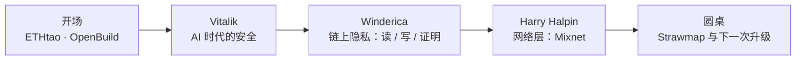
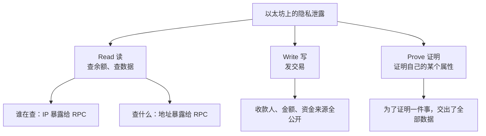

# Day 2 上午：AI 时代的安全、隐私与路线图

主会场上午的四段内容，全部围绕一个问题：<b>在 AI 越来越强的时代，以太坊靠什么保持安全和隐私？</b>
Vitalik 从密码学讲到你自己的钱包，Winderica 拆解「查一次余额会泄露什么」，Nym 讲网络层的匿名，最后一场圆桌把镜头拉回到路线图和去中心化之争。

  
时间2026.10.25 上午

  
地点深圳 · ETHShenzhen 2026 主会场

  
讲者Vitalik · Winderica · Harry Halpin · 路线图圆桌

  
素材现场笔记 + OpenBuild 官方回顾

TL;DR

- **密码学**：Vitalik 讨论 AI 加速数学研究的风险，倾向于减少代数假设、更多采用哈希构造；具体风险仍取决于方案与参数。
- **你的钱包**：多签需要真正独立的签名设备与备份；逐笔核对交易，别让多把私钥共享同一处风险。
- **隐私**：读、写、证明三层都会泄露信息，再加上网络层（IP、时间、频率）。对策分别是 Tor / PIR、隐私池、零知识证明、Mixnet。
- **路线图**：Strawmap 回归「L1 扩容 + 抗量子」。代价是节点门槛可能变高，嘉宾对「还算不算去中心化」意见不一。

---

## 开场：社区在 AI 时代还有什么用？ { #part-0 }

**ETHtao 的 Leo** 介绍了 **Ethereum HK Hub**——香港西九龙的一层社区空间，已经有三四十家以太坊生态团队入驻，平时可以共享办公、办活动。11 月 3 日 ETHtao 还会在香港办 **Devcon 香港分会场**。

**OpenBuild 的 Ian** 的开场我觉得很值得一记。昨天正好 1024，网上有人调侃「今年可能是最后一个程序员节」——AI 写代码这么强，人还需要社区吗？他的回答：

> 大家都能用 AI 把产品做出来之后，下一步是什么？你总不能「自嗨」吧。

他举了一个前辈的例子：用 AI 给自己写了 50 多个小应用，没有一个能拿出去给别人用。所以社区的价值正在从「教你写代码、帮你答疑」变成**「站在你和市场之间，帮你连接人、资源和用户」**。OpenBuild 现在连接了 5 万多名注册开发者、100 多家生态伙伴。

!!! tip "给群友的一句话"
    AI 让「做出来」变便宜了，「有人用」反而更稀缺。这也是为什么线下活动、社区、组队依然值得花时间。

---

## Part 1 · Vitalik：以太坊如何在 AI 网络安全危机中幸存 { #part-1 }

!!! info "11.04 更新：Vitalik 分享详解"
    这一段已按现场投影片重新整理，新增 [Vitalik 专篇：三层安全、哈希与钱包](vitalik-ai-security.md)。专篇补充二次筛法的完整计算、哈希签名原理和官方技术资料。下面保留上午场的阅读摘要。

### 1.1 三层风险，要分别处理

Vitalik 的投影片把危险分成 **协议密码学假设 → 客户端代码 → 用户层**。数学问题出现更快的解法、某个客户端出现 bug、用户在恶意网页上签下一笔交易，是三种不同的失败。

他的长期判断偏乐观：更好的算法分析、软件验证与硬件，能够改善安全。但每一层都得有具体的工程工作，不能只依靠“AI 会帮忙”。

### 1.2 密码学：偏爱哈希，不等于其他方案已经被破解

投影片对比了哈希、AES、椭圆曲线、配对和格，并注明这是讲者的个人观点。他倾向于减少对复杂代数结构的依赖，在适合的地方使用基于哈希的构造。

这里的“抗 AI”是对未来数学进展的讨论，**没有统一的安全认证，也不能从没有公开研究推断已经秘密破解**。后量子安全同样依赖具体方案和参数；SNARK 也不全部依赖椭圆曲线配对。[详解与比较](vitalik-ai-security.md#crypto-assumptions)

现场还用整数分解解释算法进步的影响：更有效的攻击可能让安全参数需要扩大，系统因此变贵。投影片二次筛法的例子为 `15347 = 103 × 149`，[专篇把平方关系和最大公约数算了一遍](vitalik-ai-security.md#factorization)。这是类比，不是椭圆曲线已被攻破的证据。

### 1.3 哈希签名、STARK 与形式化验证

投影片列出 leanWOTS、leanSPHINCS 与 STARK。签名解决授权，证明系统验证计算；“基于哈希”也仍需要分析完整构造、参数和实现。研究方向与已部署方案要分清。[哈希链图解](vitalik-ai-security.md#hash-based)

长期方向是形式化验证。投影片给出 [ArkLib](https://github.com/Verified-zkEVM/ArkLib)，并列了 zk-EVM、递归 STARK 等目标。形式化验证检查的是明确规格和假设下的性质，不能理解成整个以太坊已经无漏洞。[规格、证明与检查器](vitalik-ai-security.md#formal-verification)

### 1.4 客户端：把单个实现的故障隔开

短期使用 AI 辅助找漏洞，同时保留多种独立实现。多样性真正有用，要看实际使用份额、共享依赖和故障类型，不能只数有几个客户端。在 PoS 下还要关注受影响的验证者质押权重与最终确定性门槛。[客户端多样性的准确含义](vitalik-ai-security.md#clients)

### 1.5 用户层：多签与设备隔离

投影片提醒：**用多签钱包，不要把多把私钥放在同一台电脑上。** 如果两把钥匙同时被一处故障拿走，`2-of-3` 的门槛也可能被一次跨过；备份与恢复账户同样需要独立。

他也举了 Pixel、GrapheneOS 和 AirGap 的隔离设备例子。补充到实际选型：设备仍需在安全更新支持期内，断网也不能代替可信初始化、备份与交易核对。[多签和设备隔离详解](vitalik-ai-security.md#wallets)

!!! example "我带走的一句话"
    先问“它保护的是哪一层，还依赖什么”，再判断一项安全方案有没有帮上忙。普通用户可以先从小额练习、逐笔核对，以及独立的设备和备份做起。

---

## Part 2 · Winderica：查一次余额，也可能泄露隐私 { #part-2 }

**演讲题目**：*Privacy as a First-Class Citizen on Ethereum*（让隐私成为以太坊的一等公民）· 以太坊基金会

### 2.1 问题：链上的一切都永久公开

只要知道一个地址，任何人都能看到它的完整交易记录：什么时候、从哪收了多少钱、又转给了谁——而且是**永久**的，现在能看，几十年后也能看。后果：

- 别人知道你有很多钱 → 你成了高价值攻击目标；
- 企业的商业往来、内部转账被竞争对手看光。

Winderica 把泄露场景分成三类：

### 2.2 Read：私密读取

你打开钱包看余额时，钱包会去问 RPC 节点「这个地址有多少钱」。RPC 服务商因此知道了**你的 IP、查询时间、查的是哪个地址**，长期记录下来就能把你的多个地址关联起来。两个方向的解法：

- **隐藏「谁在查」**：把洋葱路由（Tor 那一类技术）做进浏览器插件，请求层层转发，RPC 最后只看到出口节点的 IP；好处是用户几乎不用做任何配置。
- **隐藏「查什么」**：**PIR（Private Information Retrieval，私有信息检索）**。神奇的地方在于：服务器在**不知道你查的是哪个地址**的情况下，依然能把正确的余额返回给你——查询和答案都是加密的。

### 2.3 Write：私密交易

隐身地址（stealth address）、Zcash 式方案都各有局限。他们在做的一种新型**隐私池**：

- 交易里用**标准的 SHA-256 哈希** + 一种较新的**基于哈希的零知识证明**方案，避开两个坑：椭圆曲线的量子风险，以及 Poseidon 这类「为 ZK 定制的非标准哈希」——Poseidon 前几年很流行（在 ZK 里很便宜），但近几年被发现设计上可能有缺陷；
- 用户不直接发交易，而是提交「这笔交易是正确的」的**证明**；
- 一个 **Aggregator（聚合器）** 把很多人的证明合成一个，链上只验一次，**验证成本恒定**。

**怎么兼顾监管？** 他们设计了「动态黑名单」：

- 每个 UTXO 都带着「这笔钱从哪个地址来」的信息；
- 如果某部分钱来自黑名单地址，转出时必须把它打到托管地址或黑洞地址（等于销毁），剩下的「白钱」正常流转；
- 名单可以随时更新，而且**不管黑名单有一万个还是更多地址，证明大小和验证时间都不变**。

### 2.4 Prove：隐私证明

举个生活例子：租房时房东要看你的收入证明。现在的做法是把完整银行流水发过去——房东只需要知道「月收入大于 3000」，却看到了你所有的交易。零知识证明可以只证明「收入 > 3000」这一件事。

更大的场景是**数字身份**。欧盟等地的数字身份方案，是在你手机里存一份政府签名，需要时出示。问题在于：**你每次出示的是同一个签名**，不同网站可以把你的出示记录串起来追踪你。

以太坊基金会 PSE 团队的方案叫 **OpenAC**（[论文](https://eprint.iacr.org/2026/251)，专门按欧盟数字身份框架设计）：用零知识证明代替直接出示签名——「我知道一个有效的政府签名，而且它说明我满 18 岁」。**每次出示都生成一个全新的证明，彼此无法关联**；兼容现有身份系统，不需要政府改造；手机上生成一次证明只要约 **0.1 秒**。

他们还在手机上测了 16 个零知识证明库，结论挺扎心：**一层层筛下来（是否真的满足零知识性质 → 是否抗量子 → 是否完整安全实现），没有一个库能同时满足所有条件**。这是社区和标准化接下来要补的课。

### 2.5 接下来：从应用层走进核心协议

上面这些目前大多还在应用层。下一步是把它们整合进以太坊核心协议：协议层的隐私交易、**FOCIL** 相关的抗审查机制，以及未来可能引入的**隐私池**和**加密交易池**（防 MEV 抢跑）。最终目标是让旁观者看一个地址时，很难把付款人、收款人和金额对应起来。

!!! example "小白能学到什么（Winderica 部分）"
    1. **「公开透明」是区块链的双刃剑**：可验证，但也意味着隐私默认为零。
    2. 隐私不是「要么全藏、要么全露」：零知识证明让你**只证明需要证明的那一件事**。
    3. 隐私和合规不一定冲突：动态黑名单就是一个「两边都照顾」的设计思路。

---

## Part 3 · Harry Halpin：链上加密了，网络踪迹怎么办？ { #part-3 }

**演讲题目**：*The First Real-World Decentralized Mixnet for Anonymity* · Nym 联合创始人兼 CEO（远程视频）

### 3.1 被忽略的「阿喀琉斯之踵」

就算链上交易用了零知识证明，你的钱包连 RPC 节点时，**IP 地址、连接时间、访问频率**都暴露了。像 Infura 这样的基础设施能从中学到很多，甚至可以屏蔽你。以太坊追求抗审查，但它跑在一个本身不怎么隐私的互联网上。Vitalik 的路线图里也提到过：钱包应该可选地**通过 Mixnet 连接多个 RPC 节点**。

### 3.2 Mixnet 和 Tor 有什么不同？

| | Tor（洋葱路由） | Mixnet（混合网络） |
|---|---|---|
| 转发方式 | 先进先出，包按顺序过 | 每一跳**随机延迟、打乱顺序**再发出 |
| 包长什么样 | 大小、时序都可能被分析 | 统一封装成**等长**的 Sphinx 格式包 |
| 空闲时 | 没流量就没包 | 持续发**掩护流量**（cover traffic，假包） |
| 能防住 | 一般的追踪 | 能看到全网流量的强大对手做时序分析 |

Nym 的 Mixnet 已经升级到 **ML-KEM** 后量子加密。它的设计源自 Nym 首席科学家 Ania Piotrowska 等人 2017 年发表的 [Loopix 论文](https://arxiv.org/abs/1703.00536)，感兴趣可以读一读。

### 3.3 开发者怎么用？

- **JavaScript 的 MixFetch**：大约 **5 行代码**，把普通的 `fetch` 请求送进 Mixnet；
- **AnonRPC**：以太坊基金会支持的匿名 RPC，基于 Nym，代码只有十来行；
- **SDK**：Rust（也编译成 WebAssembly 给 JS 用）、C、Go；
- 可以在「快」和「更匿名」之间调节——包越慢、混进的流量越多，你藏得越深。

**已经在用的地方**：AI Agent 匿名上网（他们做了 Mixnet 的 MCP 集成）、Zcash 的 Zingo 钱包、Status 和 SimpleX 这类通讯应用。他还给黑客松选手列了方向：钱包集成、MetaMask Snap、编程 Agent、消息应用。

!!! example "小白能学到什么（Nym 部分）"
    隐私是**分层**的：应用层（ZK）藏住了「你做了什么」，网络层（Mixnet）才能藏住「是谁、从哪、什么时候做的」。只做一层，另一层照样能把你出卖。

---

## Part 4 · 圆桌：Ethereum 的下一次跃迁 { #part-4 }

- **主持**：Leo（ETHtao）
- **嘉宾**：John Yu（独立开发者，Prototype，EPF 参与者）· Qi Zhou（QuarkChain & EthStorage 创始人）· 王首豪（DEX 交易路由与合约开发）

### 4.1 新路线图 Strawmap：回归「经典焦点」

主持人先提到 Vitalik 的旧文 *The Three Transitions*：以太坊要服务十亿人，绕不开速度、安全和用户体验。

**Qi Zhou** 的看法：今年的路线图（**Strawmap**）回到了最核心的两件事——**L1 扩容**（降低延迟、提高吞吐）和**抗量子**；之前各种发散的想法，现在重新聚焦。他自己的体感是：安全问题加上手续费差距不大，很多事情又回到了 L1 上做。

扩容绕不开**状态存储**：如果十亿人每人每天发一笔交易，所有余额、状态都要存，而单机的算力和存储是有限的。**Glamsterdam 升级**里一个很实用的改动：把 gas 分成「执行类」和「状态访问 / 存储类」分别定价——提高 gas 上限、让 CPU 计算更便宜的同时，给昂贵的 IO 操作重新定价。

他认为还缺的是**应用层**：大家都在等下一个杀手级应用，这是全行业的问题。

### 4.2 争论：扩容会不会牺牲去中心化？

这是整场最有技术含量的一段。

**John Yu 的担忧**：以太坊区别于其他链最大的价值是**去中心化和抗审查**——没有去中心化，还不如用云服务器。而 **ePBS**（协议内置的提议者 / 构建者分离）、**Block Access List** 等机制，等于默认让专业机构去「构建区块」，个人质押者（solo staker）只负责「提议」。

- 现在大约 **10%～12%** 的 solo staker 坚持在本地自己构建区块（不用 MEV 中继，先到先得地打包交易）；
- 如果要在本地构建区块，硬件可能从 32 GB 内存 + 4 核，涨到 **64～128 GB 内存 + 8 核 + 4 TB SSD**，而内存和硬盘现在都很贵；
- 结果可能是 solo staker 的比例进一步下降。

**Qi Zhou 的回应**：他们实测过，云服务器上 **128 GB 内存 + 16 核 + 7 TB 硬盘，大约 100 美元一个月**；从这个角度看，开放网络依然能保持去中心化。

两边谁也没说服谁——这正是有意思的地方：**「去中心化」从来不是一个开关，而是成本和性能之间一条不断移动的线**。

### 4.3 应用开发者关心什么：抗量子怎么迁移？

**王首豪**从应用层看：

- **EIP-7702** 让普通账户（EOA）可以委托执行合约钱包逻辑，为探索可替换的签名验证提供空间。**补充：它本身不完成抗量子迁移。** 外层交易签名和委托授权仍依赖 secp256k1；若原密钥失守，攻击者仍可能改换委托。完整迁移还需处理这些原有授权路径，见 [EIP-7702 规范](https://eips.ethereum.org/EIPS/eip-7702)；
- 但这目前是合约工程师们「自发」在做，**还没有一份行业标准的 checklist** 告诉你「完成这几项，你的合约就能在后量子时代活下来」；
- 官方回顾里还提到圆桌聊了 **Frame Transactions**：把「谁发起交易」「谁授权」「谁付 gas」进一步拆开，让复杂的交易组合和更友好的体验成为可能；
- 他做 DEX 聚合器，AI 能写出代码，但**缺乏业务上下文**，复杂逻辑必须人工严格 review。

### 4.4 怎么参与以太坊核心开发？

- **John Yu：EPF（Ethereum Protocol Fellowship）**。以前想进核心开发，基本只能被以太坊基金会或某个客户端团队雇用；EPF 提供了另一条路：有导师带的学徒式项目，从学协议知识开始，到在导师指导下提小 PR。现在已经有比较完整的线上学习小组和课程。
- **Qi Zhou：写 EIP 要有耐心。** 他写过七八个 EIP / ERC 的草案，一个 EIP 从 Draft 到 Candidate 往往要**两三年**，要反复讨论、实现、测试，还要考虑各种风险。
- **对 AI 的态度**：Qi Zhou 说和密码学家聊下来，AI 一方面让攻击更容易，另一方面防御也更强——比如形式化验证在 AI 帮助下效率提升了**一两百倍**。所以他相对乐观。

!!! example "小白能学到什么（圆桌部分）"
    1. 路线图不是圣旨：同一份路线图，有人看到性能，有人看到中心化风险，**学会同时听两边的论证**比记住结论更重要。
    2. 想进核心开发，[EPF](https://epf.wiki/) 是现成的入口；写提案以「年」为单位，急不来。
    3. 应用层的抗量子迁移还是空白——对学生来说，这种「还没人写好 checklist」的地方，就是做研究、写文章、做开源的机会。

---

## 延伸概念

`抗量子密码学` `ECDSA` `椭圆曲线配对` `格密码 Lattice` `哈希函数` `STARK / SNARK` `形式化验证` `客户端多样性` `多签 Multisig` `冷钱包` `GrapheneOS` `PIR` `隐私池` `隐身地址` `零知识证明` `Mixnet` `Sphinx` `ML-KEM` `ePBS` `FOCIL` `EIP-7702` `Glamsterdam` `Strawmap` `EPF`

这些概念的人话解释，我按主题整理进了 [安全与隐私](../../security/index.md)。

## 现在能做什么

- [ ] 检查自己的钱包习惯：助记词是否离线手抄？大额资产是否考虑多签或分散存放？
- [ ] 下次转账前，**放慢 10 秒核对地址和金额**——Vitalik 本人都在这里栽过跟头；
- [ ] 读一读 Vitalik 的博客 *The Three Transitions*，理解以太坊为什么同时押注扩容、钱包安全和隐私；
- [ ] 用一次 Tor 浏览器，体会「藏住 IP」是什么感觉；
- [ ] 如果对协议开发感兴趣，去看看 [EPF 的学习资料](https://epf.wiki/)。

!!! quote "说明"
    嘉宾称呼和议程以 OpenBuild 官方回顾为准，相关官方资料和技术报告链接附在正文里。现场观点按个人理解整理，发现错误欢迎在群里指出。
