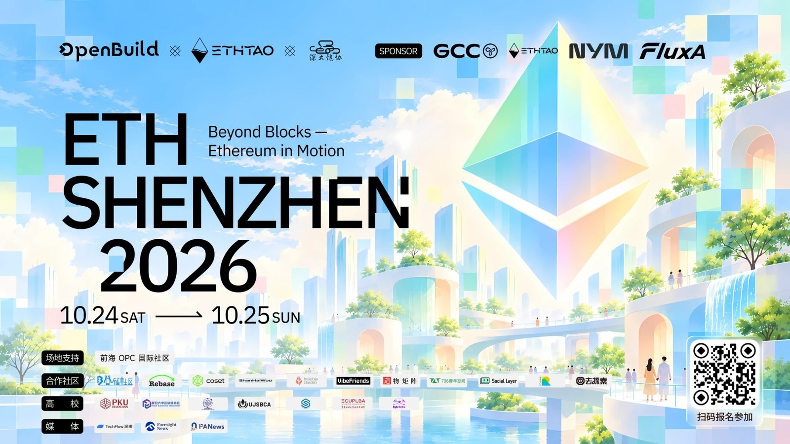
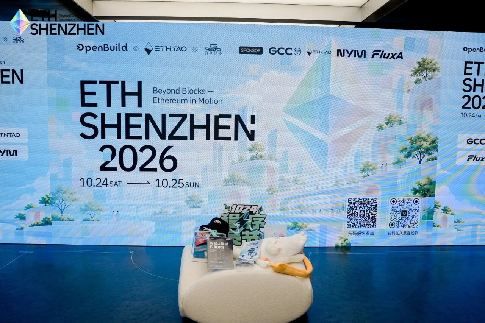
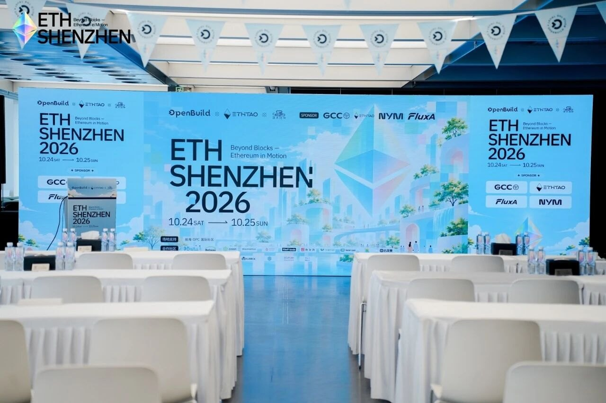
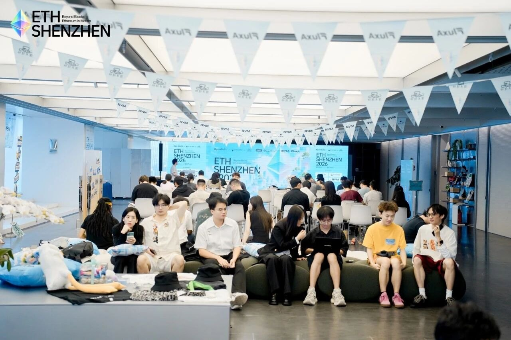
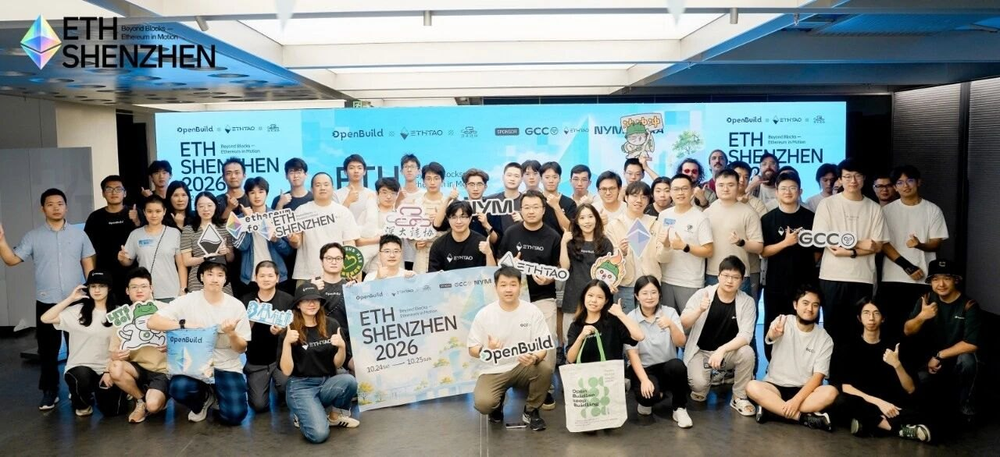

# ETHShenzhen 2026：当 AI 遇上 Ethereum

两天、500+ 人、28 个黑客松项目。第一天是程序员节，大家在现场组装硬件钱包、用 AI 写代码、赶黑客松；
第二天 Vitalik、以太坊基金会和一群 Builder 聊了密码学、隐私、路线图，以及 Agent 到底该拿多大的权限。
这一页是整个系列的目录，四篇正文按时间顺序排在下面。

<figure class="w3-poster" markdown>
{ width="1600" height="900" loading="lazy" }
<figcaption>ETHShenzhen 2026 主视觉（主办：OpenBuild × ETHTAO × 深大链协；图源：活动官方公众号）</figcaption>
</figure>

  
时间2026.10.24 – 10.25

  
地点深圳 · 自贸时代中心

  
主办OpenBuild · ETHtao · SZUBA

  
三个方向Agent Infra &amp; Economy · Privacy &amp; Security · Verifiable AI

我的三句话总结

1. **AI 同时在加强「攻」和「守」。** Vitalik 担心 AI 会加速破解密码学，但形式化验证也因为 AI 提速了上百倍。以太坊的对策很朴素：能用哈希的地方就用哈希，其他地方把参数调得更保守。
2. **隐私要分层做。** 「读」（查余额）、「写」（发交易）、「证明」（证明我满 18 岁）三层都会泄露信息，再往下还有网络层（IP、时间、频率）——Winderica 和 Nym 分别讲了上面三层和网络层。
3. **Agent 进入真实世界，卡在「钱」和「权限」。** 共识是：只给完成任务所需的最小数据，把预算 / 对象 / 时限写死在链上或程序里，最后付款那一步留给人确认。

<figure markdown>
{ width="1280" height="853" loading="lazy" }
<figcaption>主舞台</figcaption>
</figure>
<figure markdown>
{ width="1280" height="853" loading="lazy" }
<figcaption>开场前的会场</figcaption>
</figure>
<figure markdown>
{ width="1280" height="853" loading="lazy" }
<figcaption>听分享的参会者</figcaption>
</figure>
<figure class="w3-gallery__wide" markdown>
{ width="1280" height="586" loading="lazy" }
<figcaption>合影。以上照片都来自 ETHShenzhen 官方公众号；照片里的人如果不希望出现在这里，告诉我就删。</figcaption>
</figure>

## 四篇正文

  <a class="w3-card" href="day1-workshops/">
    Day 1 · 10.24 · 工作坊
    
硬件钱包 × Vibecoding

    
OSKey 带大家用开发板 DIY 硬件钱包；Tiny 熊从 LLM 原理讲到 Agent、Harness 和 AI 写以太坊代码的实操；FluxA 聊 x402 之后的 Agent 支付。

    张文超 · Tiny 熊 · Jack Xiao→
  </a>
  <a class="w3-card" href="day1-demos/">
    Day 1 · 10.24 · 黑客松
    
黑客松现场展示

    
我录到的几支队伍：支付的「消费语义」、可复现的 AI 漏洞验证、Agent 打榜、旅行凭证核销、开源作者感谢墙，外加一个 LP 小工具。

    18 / 19 / 22 / 23 号等→
  </a>
  <a class="w3-card" href="day2-morning/">
    Day 2 · 10.25 · 上午
    
安全、隐私与路线图

    
Vitalik：AI 会不会成为密码学的新威胁；Winderica：查一次余额也会泄露隐私；Harry Halpin：Mixnet；圆桌：Strawmap、扩容与去中心化之争。

    Vitalik · Winderica · Harry · Qi Zhou→
  </a>
  <a class="w3-card" href="day2-afternoon/">
    Day 2 · 10.25 · 下午
    
AI 开发与 Agent 边界

    
AI 几分钟写完的代码为什么要审几周；数据上链后贡献怎么算；企业 AI 落地先做一件小事；Agent 的信任边界；华语 Builder 走向全球；获奖项目。

    Qi Zhou · Jason · Yakio Liu · 圆桌→
  </a>

## 日程速览

### Day 1 · 10.24 · Hackathon Build Day（程序员节）

| 时间段 | 内容 | 我的笔记 |
|---|---|---|
| 上午 | 签到、赛题介绍、项目介绍与组队 | — |
| 上午 | 工作坊《Build Your Hardware Wallet》· OSKey 开发者 **张文超** | [Day 1 · 工作坊](day1-workshops.md#part-1) |
| 上午 | 工作坊《Vibecoding On Ethereum》· 登链社区发起人 **Tiny 熊** | [Day 1 · 工作坊](day1-workshops.md#part-2) |
| 下午 | 《Beyond x402: FluxA Brings Agents to Real-World Commerce》· FluxA **Jack Xiao** | [Day 1 · 工作坊](day1-workshops.md#part-3)（无录音，据官方回顾） |
| 下午 | 1024 特别活动「数字炸弹」 | — |
| 16:00 后 | 黑客松提交截止，现场展示与评审（共 28 个项目） | [Day 1 · 黑客松展示](day1-demos.md) |

### Day 2 · 10.25 · Main Conference

| 时间段 | 内容 | 我的笔记 |
|---|---|---|
| 上午 | 欢迎辞 · ETHtao **Leo**、OpenBuild **Ian** | [Day 2 上午](day2-morning.md#part-0) |
| 上午 | Opening Remark · **Vitalik Buterin** | [Day 2 上午](day2-morning.md#part-1) |
| 上午 | 《Privacy as a First-Class Citizen on Ethereum》· 以太坊基金会 **Winderica** | [Day 2 上午](day2-morning.md#part-2) |
| 上午 | 《The First Real-World Decentralized Mixnet for Anonymity》· Nym **Harry Halpin**（远程视频） | [Day 2 上午](day2-morning.md#part-3) |
| 上午 | 圆桌「Ethereum 的下一次跃迁：未来路线图与升级」 | [Day 2 上午](day2-morning.md#part-4) |
| 午间 | 「Ethereum 吟游诗人」Shaka 的尤克里里弹唱 | — |
| 下午 | 《GCC of Commons：公共物品之路》· GCC **路人蝙** | [Day 2 下午](day2-afternoon.md#part-1) |
| 下午 | 《如何利用 AI 开发基于 Ethereum 的区块链技术》· **Qi Zhou** | [Day 2 下午](day2-afternoon.md#part-2) |
| 下午 | 《AI Frontier Sharing and Bring Data Onchain》· **Jason** | [Day 2 下午](day2-afternoon.md#part-3) |
| 下午 | 《FDE 实践：从内部试验到客户现场》· Hast **Yakio Liu** | [Day 2 下午](day2-afternoon.md#part-4) |
| 下午 | 圆桌「AI 的信任边界：数据、隐私与自主权」 | [Day 2 下午](day2-afternoon.md#part-5) |
| 下午 | 圆桌「从中文到国际：对话 Ethereum 全球社区」 | [Day 2 下午](day2-afternoon.md#part-6) |
| 收尾 | 黑客松获奖项目展示与颁奖 | [Day 2 下午](day2-afternoon.md#part-7) |

## 黑客松结果

28 个项目里选出了前三名，方向分别是**钱包硬件**、**合约升级安全**和 **Agent 社交支付**：

| 名次 | 项目 | 作者 | 一句话 | 链接 |
|---|---|---|---|---|
| 🥇 | **Nokia Wallet** | 超级李大猫 | 把老款诺基亚 S60 手机改造成低调的硬件钱包 | [Demo](https://nokia-wallet.lidamao.tech/) · [GitHub](https://github.com/LidamaoHub/Nokia-Wallet) |
| 🥈 | **Upgrade Airlock** | Ted Chem | 合约升级前加冷却期 + 自动化攻击模拟，有风险就一票否决 | [Demo](https://upgrade-airlock.pages.dev/) · [GitLab](https://gitlab.com/jiapunk/upgrade-airlock) |
| 🥉 | **meet-agent** | liwa | 让你的 Agent 和别人的 Agent 先聊，帮你在大会上找队友 | — |

其他项目（来自官方回顾）：AgentVerse、AgentOS、aegis-agent、AttackPilot、shadowPass、zkIE、语义钱包、NovelForge、PetPact、AvaTrip 等。获奖项目的详细拆解见 [Day 2 下午 · 获奖项目](day2-afternoon.md#part-7)。

## 嘉宾 & 组织速查

> 方便读正文时对号入座。称呼以官方回顾为准，录音转写里的谐音已经统一改过来了。

| 名字 | 身份 | 出现在 |
|---|---|---|
| **Vitalik Buterin** | 以太坊联合创始人 | Day 2 上午 · 开场演讲 |
| **Winderica** | 以太坊基金会（Ethereum Foundation），隐私方向 | Day 2 上午 |
| **Harry Halpin** | Nym 联合创始人兼 CEO | Day 2 上午（远程视频） |
| **Qi Zhou（周琦）** | QuarkChain & EthStorage 创始人 | Day 2 上午圆桌 + 下午演讲 |
| **John Yu** | 独立开发者（Prototype），以太坊协议学徒计划 EPF 参与者 | Day 2 上午圆桌 |
| **王首豪** | DEX 交易路由与智能合约开发者 | Day 2 上午圆桌 |
| **Leo** / **LEO** | ETHtao | 主持 + 两场圆桌 |
| **Ian** | OpenBuild | Day 2 欢迎辞 |
| **张文超** | OSKey 开源硬件钱包开发者 | Day 1 工作坊 |
| **Tiny 熊** | 登链社区发起人 | Day 1 工作坊 + Day 2 社区圆桌 |
| **Jack Xiao** | FluxA Head of Ecosystem | Day 1 演讲 + Day 2 圆桌主持 |
| **路人蝙** | GCC（数字公共物品捐赠基金） | Day 2 下午 |
| **Jason** | 数据资产 / 数据上链方向 | Day 2 下午 |
| **Yakio Liu** | Hast 团队 | Day 2 下午 |
| **Sputnik** · **dizzy_dz** · **Laughing** | 密码学博士 · Nym APAC 市场负责人 · Kite APAC Lead | Day 2「AI 的信任边界」圆桌 |
| **qiuqiu** · **Zeugh** · **Leo Lara** | OpenBuild · 巴西社区 blockful · Invisible Garden / EthPadThai 发起人 | Day 2 社区圆桌 |

## 推荐阅读顺序

- **完全零基础**：先读 [Day 2 上午](day2-morning.md) 的 Vitalik 部分（钱包安全那几条现在就能用上），再读 [Day 1 工作坊](day1-workshops.md) 的 LLM / Agent 原理；
- **在用 AI 写代码**：[Day 1 · Tiny 熊](day1-workshops.md#part-2) + [Day 2 · Qi Zhou](day2-afternoon.md#part-2) 连着读，一个讲「怎么让 AI 干得好」，一个讲「AI 干完之后人该负什么责」；
- **对 Agent 支付 / Agent 产品感兴趣**：[Day 2 下午的信任边界圆桌](day2-afternoon.md#part-5) + [黑客松展示](day1-demos.md)，再回看旧笔记 [路演夜](../pitch-night.md) 里的 Text Permit。

## 资料来源与转写说明

- 我自己的现场录音转写（4 份）+ 自动生成的纪要；
- OpenBuild 官方回顾文章《当 AI 遇上 Ethereum，深圳聚起了一群 Builder｜ETHShenzhen 2026 现场回顾》——嘉宾称呼、日程、获奖名单都以它为准；
- 录音里的专有名词经常被听错（「文东」其实是张文超，「温主任」其实是 Winderica），正文里都已经按官方回顾和公开资料改正；发现错误欢迎在群里说。
