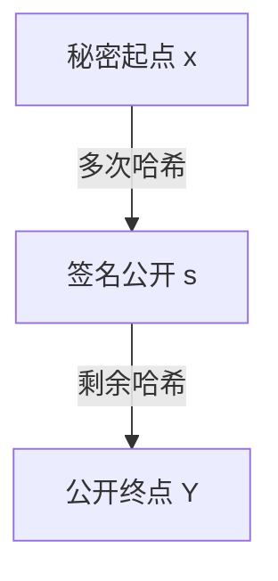

# Vitalik：以太坊如何在 AI 网络安全危机中幸存

<p class="w3-lead">AI 更会做数学、更会读代码之后，以太坊的安全边界会发生什么变化？Vitalik 在 ETHShenzhen 把这个问题拆成了三层：密码学假设、客户端代码，以及最后握着私钥的人。沿着这三层看，才能理解他为什么反复讲哈希、形式化验证和多签。</p>

<div class="w3-meta">
  <div><span class="k">场次</span><span class="v">ETHShenzhen 2026 · 10.25 上午</span></div>
  <div><span class="k">讲者</span><span class="v">Vitalik Buterin · 以太坊联合创始人</span></div>
  <div><span class="k">更新</span><span class="v">2026.11.04 · 结合投影片完善内容</span></div>
  <div><span class="k">系列</span><span class="v"><a href="../">R04 专题总览</a> · <a href="../day2-morning/#part-1">上午场笔记</a></span></div>
</div>

<div class="w3-tldr" markdown>
<span class="k">先读这几句</span>

- **数学假设可能需要重新评估。** 讲者倾向于少依赖复杂代数结构，多采用基于哈希的构造；实际安全性仍需逐个方案分析。
- **代码层要让攻击更难扩散。** AI 辅助找漏洞，多种独立客户端分散共同故障，形式化验证检查明确写出的性质。
- **用户层要把失败隔开。** 多签的价值取决于签名设备是否独立；几把钥匙都在同一台电脑上，门槛只是表面上的。
- **他的长期判断偏乐观。** 软件、硬件和证明工具都能变得更可靠，但迁移、实现和日常操作仍需要认真对待。
</div>

本文结合现场投影片整理，解释性补充标为「补充」，并附上技术资料，方便继续读下去。

## 1. 先把三种危险分开 { #three-layers }

演讲开头先列出三个入口。它们会相互影响，但修复方式不同：

| 层次 | 真正担心什么 | 对应的防线 |
|---|---|---|
| **协议的密码学假设** | 原来被认为很难的数学问题，出现了更有效的攻击 | 重新评估假设、选择构造和参数、准备迁移 |
| **客户端代码** | 密码学原理没坏，实现、网络处理或依赖库却出了错 | 找漏洞、测试、独立实现、形式化验证 |
| **用户层** | 网页、设备、签名流程或人自己出问题 | 多签、设备隔离、可信显示与恢复流程 |

一个钱包被钓鱼网站骗签，并不说明椭圆曲线被破解；某个客户端崩溃，也不等于共识规则本身失效。排查时先认清是哪一层，才知道要换算法、修代码，还是重做签名流程。

## 2. 「抗 AI」究竟在担心什么？ { #crypto-assumptions }

以前谈长期密码学安全，常见问题是「量子计算机会不会把它打破」。这场分享又加了一个问题：**AI 会不会帮助人类更快地发现数学算法，削弱现有安全假设？**

密码学依赖的通常是经过明确描述的计算困难性；如果解题方法变快，原来选定的参数未必还提供足够的安全余量。

### 不同构造，依赖不同假设

投影片把哈希、AES、椭圆曲线、配对和格放在同一张图里比较，并明确写着「这是我的个人观点」。读这张图时，需要把两列分开：

| 构造 | 关于量子攻击的背景 | 本场对 AI 风险的讨论 |
|---|---|---|
| **哈希、对称加密** | 通常可以通过合适的参数抵御已知通用量子攻击，不能省略参数条件 | 讲者相对更信任，倾向于减少对复杂代数结构的依赖 |
| **椭圆曲线签名**，如 ECDSA | 足够强的量子计算机可用 Shor 算法攻击其离散对数问题 | 担心未来出现更有效的数学攻击；没有宣告现有签名已失效 |
| **椭圆曲线配对**，如 BLS、Groth16 中的相关构造 | 同样面对量子威胁 | 讲者对其丰富结构尤其谨慎 |
| **格密码**，如 ML-DSA，以及部分 FHE 构造 | 某些具体方案已成为后量子标准，安全性依赖各自问题和参数 | 对 AI 能带来的新进展保留不确定性 |

**补充：目前没有一个通用、标准化的「抗 AI」认证。** NIST 的后量子标准针对的是包含量子攻击的威胁模型，也不保证未来不会出现新的经典数学攻击。[NIST 后量子密码学项目](https://csrc.nist.gov/projects/post-quantum-cryptography)

**SNARK 的具体构造也有差别。** Groth16 使用配对；PLONK 的具体安全假设还取决于采用的承诺方案。评估时要问：**你用的那套证明系统，具体依赖什么假设？** [PLONK 原始论文](https://eprint.iacr.org/2019/953)

### 为什么他更偏爱哈希

投影片用「结构丰富」与「没有结构」来对比椭圆曲线和哈希。椭圆曲线有群运算，能研究点数，也能在特定曲线上构造配对；这些性质让密码协议很高效，同时也给数学分析提供了入口。

**我的理解**：他希望把更多安全依赖放在经过充分分析的哈希构造上，减少额外的代数假设。这里的「没有结构」是演讲中的简化表达；哈希也有内部设计，也可能被攻击。具体函数、使用方式和参数一样要审查。

## 3. 新算法出现后，系统可能先变贵 { #factorization }

演讲用**整数分解**打了一个比方：从逐个尝试因子，到二次筛法，再到数域筛法，攻击算法的进步会改变达到同等安全水平所需的参数。

他关心的一种可能后果是：**更快的攻击迫使系统扩大参数，承担更多通信、存储和验证成本。** 椭圆曲线会不会出现类似进展，仍是开放的研究问题；参数升级能否补救，也要看新攻击到底削弱了什么。

### 把投影片里的分解例子算一遍

开头的小例子是 `351 = 13 × 27`，完整的素因子分解为 `351 = 3³ × 13`。后面二次筛法的例子更有意思：

```text
N = 15347
124² − N = 29
127² − N = 782   = 2 × 17 × 23
195² − N = 22678 = 2 × 17 × 23 × 29
```

把右边三行相乘，每个素因子的指数都变成偶数，所以乘积是一个平方：

```text
29 × 782 × 22678 = 22678²
124 × 127 × 195 = 3070860

3070860² ≡ 22678²  (mod 15347)
```

于是 `N` 整除两个平方的差，接下来计算最大公约数：

```text
gcd(3070860 − 22678, 15347) = 103
gcd(3070860 + 22678, 15347) = 149
15347 = 103 × 149
```

这段演示的重点是**怎样把分解问题改写成寻找平方关系**。将素因子指数对 2 取模，写成矩阵，就能用线性代数寻找哪些关系相乘后会凑出偶数指数。这让“算法进步”这件抽象的事变得具体：换一种组织问题的方法，搜索过程就可能大幅改变。

## 4. 哈希怎样变成签名和证明？ { #hash-based }

投影片列出了三组方向：**leanWOTS / leanSPHINCS 签名、STARK 证明，以及其他基于哈希的密码学构造**。它们承担不同任务。

### 哈希链：公开终点，出示中间值

可以先把 Winternitz 一次性签名理解为若干条哈希链。选一个秘密起点 `x`，重复计算哈希，公开终点 `Y`。签名时，根据消息摘要中的数值，公开链上对应位置的值 `s`；验证者再往前计算剩余步数，检查能否到达 `Y`。



完整方案还需要多条链、消息编码和校验机制。**一次性签名尤其不能随便复用同一把密钥**；如何安全地签多次、管理状态或组织签名树，是完整方案需要解决的问题。[RFC 8391：WOTS+ 与 XMSS](https://www.rfc-editor.org/rfc/rfc8391.html)

**补充：研究方案与标准要分清。** NIST 标准 **SLH-DSA** 基于 SPHINCS+；现场提到的 leanWOTS、leanSPHINCS 不能直接当作它的别名，也不能由此认定已部署到以太坊主网。[FIPS 205：SLH-DSA](https://csrc.nist.gov/pubs/fips/205/final) · [leanSPHINCS 研究草案](https://github.com/leanEthereum/sig.golf-dev)

### STARK：证明计算，与交易签名是两件事

签名回答「谁授权了这条消息」，证明系统回答「某个计算是否符合约束」。STARK 的承诺构造通常依赖哈希，能够减少对椭圆曲线离散对数假设的依赖；但完整系统仍有算术约束、随机挑战、参数和实现等安全条件。[STARK 原始论文](https://eprint.iacr.org/2018/046)

所以「用哈希」只是安全分析的开头。还要看证明的是不是需要的命题、验证器是否正确，以及最终验证有没有再包一层依赖其他假设的证明。

## 5. 客户端代码：找漏洞，也要控制共同故障 { #clients }

投影片第 7 页把应对分成短期与长期。短期已经在用 AI 找漏洞，同时依靠多个客户端降低单个实现出问题的影响；长期则把更多性质交给形式化验证。

### AI 找到的报告，还需要证据

模型读代码、列攻击面、写测试，都可以帮助安全工作。但“像漏洞”的输出要经过复现和判断：是否真的能触发、攻击者需要什么条件、影响的是局部进程还是网络，以及修复有没有造成新问题。

**补充**：以太坊基金会 Protocol Security 团队的公开实践也强调了这条链路，尤其是报告筛选、复现与人工判断。把 AI 接到仓库上，不等于完成了审计。[EF：The triage is the product](https://blog.ethereum.org/2026/07/09/triage-is-the-product)

### 客户端多样性：看份额，也看共同依赖

多个团队独立实现同一协议，能降低一个 bug 同时打倒所有节点的风险。**关键是使用份额与独立程度**：五种实现都存在、绝大多数验证者却用同一种，仍然有集中风险；共享依赖也可能带来共同故障。

补充到当前 PoS 语境，最终确定性通常需要至少三分之二的质押权重参与正确投票。某一故障实现影响超过三分之一的权重，就可能阻断最终确定性；超过三分之二的故障还有更严重的错误最终确定风险。这里算的是**受影响的验证者权重**，不能用“客户端个数”或公开节点数量替代。[ethereum.org：客户端多样性](https://ethereum.org/developers/docs/nodes-and-clients/client-diversity/)

## 6. 形式化验证：把「正确」写成能检查的命题 { #formal-verification }

现场长期目标的表述很有气势：「形式化验证一切」。投影片同时列了较近的目标——zk-EVM、递归 STARK、leanWOTS 与 SPHINCS，并给出 [Verified-zkEVM / ArkLib](https://github.com/Verified-zkEVM/ArkLib)。

可以把这项工作拆成三步理解：

1. **先写清楚规格。** 程序应该接受什么、拒绝什么，依赖哪些假设。
2. **构造证明。** 证明程序、算法或协议在这些条件下满足指定性质。
3. **由证明检查器核验。** AI 可以协助写证明，人也仍要审查规格与建模是否覆盖真实需求。

ArkLib 是用 Lean 形式化证明系统的一项基础工作，覆盖范围要看具体的定理与实现。数学模型、规格、源码、编译产物和真实设备之间，仍需要逐段建立可信联系；规格本身也要准确表达应用需要的安全性质。

我觉得这一段和前面的担忧正好接上：AI 可能加快攻击算法的研究，也可能让寻找 bug、完善规格和写证明更容易。最终有用的是经过检查的结果，单凭模型一句“安全”还不够。

## 7. 用户层：把钥匙和出错机会分开 { #wallets }

最后两页落到了普通人能理解的东西：操作系统、签名设备、多签和私钥。这里的重点是**独立的防线**。

### 多签最怕的，是几把钥匙其实共享一处风险

投影片写得很直接：「用多签名钱包，不要把多个私钥放在一个电脑上！」

以 `2-of-3` 为例，需要三名签名者中的任意两名授权。若两把私钥都在同一台电脑，恶意软件拿到这台电脑后，可能一次获得满足门槛的权限。两台设备如果同步到同一个云盘、同一处备份或同一个恢复账户，也可能重新汇合到同一风险上。

三名独立签名者 A、B、C 中，`A + B`、`A + C` 或 `B + C` 都能满足 `2-of-3`；只有 A 一名签名者则不足以授权。设备与备份的安排，要能承受其中一处丢失或泄露。

**我的操作提醒**：先用测试网或小额练习转账、拒签和恢复；每个签名者核对同一笔交易的目标、金额与调用内容。多签不会自动识别恶意交易，几个人一起盲签仍然可能一起出错。[ethereum.org：多签钱包](https://ethereum.org/developers/docs/smart-contracts/#multisig)

### 签名设备：操作系统、隔离与更新

投影片第 9 页提到更安全的操作系统与沙盒，并举了 **Pixel + GrapheneOS + AirGap** 的隔离设备例子；长期还需要更好的硬件验证和主流系统安全。

**补充**：GrapheneOS 对设备有支持周期，选型要检查是否仍有完整安全更新；AirGap 的离线签名也需要正确的初始化、备份和传递交易流程。断网减少了网络攻击面，可信初始化、设备完整性与签名核对则需要另外保证。[GrapheneOS 支持设备](https://grapheneos.org/faq#device-support) · [AirGap 文档](https://support.airgap.it/)

## 8. 我带走的结论 { #takeaways }

演讲最后写的是：**网络安全的长期未来是光明的**，未来软件和硬件会更安全，也会更清楚哪些密码学值得信任。这是讲者的长期判断，不是已经完成的工程状态。

我的理解是，三层风险各有一件需要持续做的事：

- **做协议和密码学的人**：把依赖的假设列清楚，持续分析，并给参数和算法迁移留位置。
- **做软件的人**：把漏洞报告变成可复现证据，把“正确”变成明确规格，减少共同依赖造成的故障。
- **用钱包的人**：让设备、私钥和备份有真实隔离，重要签名慢一点，恢复流程提前练。

“将来会更安全”需要这些具体工作一点点兑现。对我这样的学习者，先把每种方案保护了哪一层、还剩哪些假设讲清楚，就已经比背一串安全术语有用。

## 资料与继续阅读 { #sources }

- **本场内容**：Vitalik 在 ETHShenzhen 2026 的分享与投影片。日程与活动信息见 [ETHShenzhen 专题总览](index.md)。
- **密码学背景**：[NIST 后量子密码学项目](https://csrc.nist.gov/projects/post-quantum-cryptography) · [SLH-DSA 标准 FIPS 205](https://csrc.nist.gov/pubs/fips/205/final) · [STARK 原始论文](https://eprint.iacr.org/2018/046)。
- **软件与验证**：[客户端多样性](https://ethereum.org/developers/docs/nodes-and-clients/client-diversity/) · [EF 的 AI 安全研究实践](https://blog.ethereum.org/2026/07/09/triage-is-the-product) · [ArkLib](https://github.com/Verified-zkEVM/ArkLib)。
- **设备与钱包**：[GrapheneOS FAQ](https://grapheneos.org/faq#device-support) · [AirGap 文档](https://support.airgap.it/) · [多签钱包介绍](https://ethereum.org/developers/docs/smart-contracts/#multisig)。

接着读：[Winderica 与 Nym：链上和网络层的隐私](day2-morning.md#part-2) · [Qi Zhou：AI 写完之后，谁来负责？](day2-afternoon.md#part-2) · [安全与隐私知识页](../../security/index.md)
