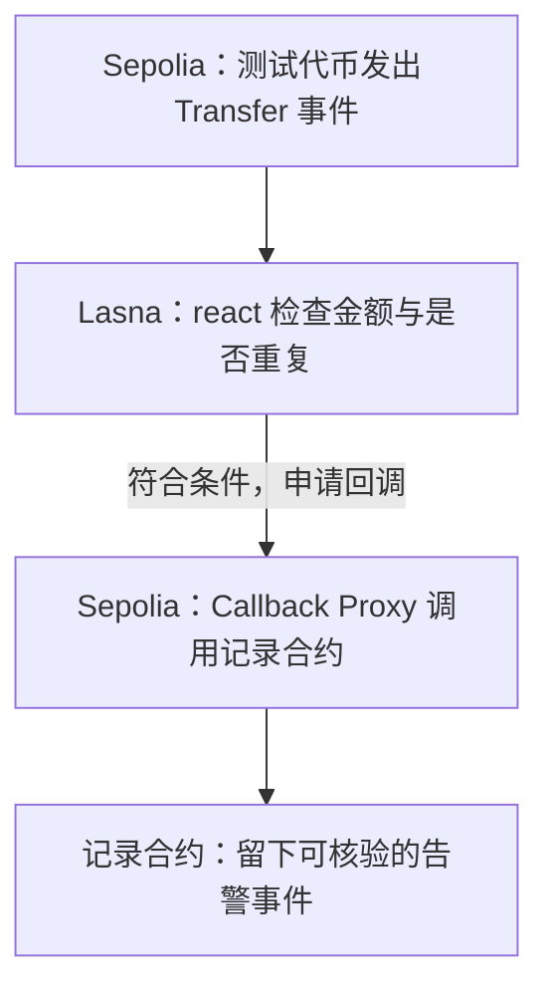

# Reactive 共学：从链上事件到自动回调

<p class="w3-lead">
前面参加活动时，总能听到「Agent 自动执行」「跨链自动化」。这次跟着 Reactive Builder Camp 动手，把它拆成一条具体的流程：<b>谁发事件、谁判断条件、谁真正执行、费用又由谁付</b>。这篇把开营技术分享和自己的练习放在一起，后面部署有进展再往下补。
</p>

<div class="w3-meta">
  <div><span class="k">活动</span><span class="v">Reactive Builder Camp · 线上共学（R06）</span></div>
  <div><span class="k">共学</span><span class="v">2026.11.16–11.29 · ETHPanda × Reactive Network</span></div>
  <div><span class="k">技术分享</span><span class="v">Constantine · Reactive Network 开发者关系</span></div>
  <div><span class="k">本次记录</span><span class="v">2026.11.17 · 环境、用例卡与费用参数</span></div>
</div>

共学日期和模板见 [ETHPanda 官方仓库](https://github.com/ethpanda-org/reactive-builder-camp)。它对接的 **Reactive Omni Buildathon** 是另一项活动，赛期为 **2026.11.05–12.05**；共学结业、营内展示和 DoraHacks 正式提交分别完成。[官方赛事介绍](https://blog.reactive.network/reactive-omni-buildathon-thirty-days-to-find-out-what-one-second-buys/)写明总奖金为 **5,500 美元，使用 REACT 支付**。

## 这次先记住什么

- **智能合约需要被调用才执行**。Reactive 让网络接手事件监听和触发，开发者在合约里写条件。
- **Omni 已经换了写法**。新练习按当前文档写，别把旧版 RVM 示例混进来。
- **两边都要准备费用**。Lasna 上的判断与目标链上的回调分别计费；自己的钱包有币，也不代表两个合约都能持续运行。
- **成功要看完整流程**。源链事件、Reactive 交易、目标链回调都能查到，才有证据说明自动化跑通了。

## 1. 一条事件怎样变成另一笔交易 {#event-loop}

普通合约不会自己醒来盯着另一个合约。Reactive 合约可以订阅指定链、合约地址和事件主题；匹配的日志到来后，系统调用它的 `react()`，再由它判断是否请求目标链回调。源链和目标链也可以是同一条链。[Reactive Contracts 文档](https://dev.reactive.network/reactive-contracts)解释了订阅与触发方式。

用我这次想做的大额转账告警举例：



订阅可以先缩小范围：只看某个测试代币、某个钱包的转出，金额判断再放进 `react()`。这样能减少无关事件触发的计算和费用。链上告警记录后面还可以接通知服务；要发 Telegram 等消息，仍需另外接链下服务。

我给自己的选题判断是：**拿掉 Reactive 后，哪一步需要自己持续维护机器人？** 如果整个项目只读链下数据、也没有事件驱动的链上动作，就要重新想想这项集成的作用。

## 2. Omni 更新之后，旧示例哪里容易用错 {#omni}

[2026 年 10 月 28 日的主网迁移公告](https://blog.reactive.network/reactive-mainnet-migration-complete/)确认：Reactive 已迁到 CometBFT，约一秒出块；RVM 双环境被移除，合约只部署到一个环境，常规 Solidity、Foundry、Hardhat 和 Remix 工具可用。旧部署的兼容支持仍在，新项目直接对照 Omni 文档。

我现在核对示例时会看这几处：

1. **入口权限**：`react()` 加 `onlySystem`，让系统合约调用；否则别人可能伪造日志传进来。
2. **订阅位置**：通过 `SYSTEM.subscribe()` 配置。当前系统合约是 `0x8888888888888888888888888888888888888888`。
3. **回调请求**：用 `requestCallbackV_1_0()`，把目标链、接收合约、gas 限额和调用数据写清楚。
4. **目标链验身份**：回调接收方同时检查 Callback Proxy 与被授权的 Reactive 合约。只认其中一个，权限就缺了一层。

对应说明在 [Reactive Contracts](https://dev.reactive.network/reactive-contracts) 和 [Callback Contracts](https://dev.reactive.network/callback-contracts)。要抄例子时，我用 [官方 demos 的 Omni 分支](https://github.com/Reactive-Network/reactive-smart-contract-demos/tree/omni/src/micro-demos)，同时检查当前文档，避免搜到旧版代码直接粘进去。

## 3. 为什么钱包有币，合约还是不动 {#fees}

这里有两笔账：Reactive 合约为 `react()` 付费，目标链接收合约为回调付费。后者用的是**目标链原生币**，例如 Sepolia 的测试 ETH；前者在 Lasna 用测试币 lREACT。[费用文档](https://dev.reactive.network/economy)把两边的记账方式放在一起讲。

同一个合约又有三个容易混淆的数：

- **balance**：合约自己持有的钱。
- **reserves**：预存到系统合约或 Callback Proxy、专门抵扣执行费的钱。
- **debt**：已产生但还没结清的费用。

**只要 debt 大于零，后续执行就暂停。** 直接给合约转账只增加 balance，不会自动清掉已有 debt。用服务提供方的 `depositTo(address)` 给指定合约充值，会先清债，再把余款放进 reserves；如果合约提供了清债入口，也可以从它自己的 balance 支付。

另一个要记牢的点：`react()` 回滚仍会按已用 gas 收费，回调失败也可能收费。普通的「这条事件不符合条件」应该判断后正常返回，避免把 `revert` 当过滤器，一边什么也没做，一边反复烧掉费用。

## 4. 排错从哪里开始 {#debugging}

技术分享里强调的几件事，刚好能整理成一次排错顺序：

1. **先看资金和欠款**。两侧都查，Reactscan 上也能看到合约状态。
2. **确认订阅真的匹配**。链 ID、事件发出合约、`topic0` 和 indexed 参数都要对应。
3. **确认发生过 Reactive 执行**。没有 `react()` 交易，就先查事件和订阅；已经执行，再查有没有请求回调。
4. **查目标链失败原因**。接收合约回滚时关注 `CallbackFailure`，继续看权限、参数和 gas；不能只看到请求发出，就认定目标动作成功。

**重复执行要自己设计保护。** 同一事件送达两次，业务上应只产生一次结果。我准备给源链事件生成标识，在判断端和接收端检查是否处理过。源链如果发生重组，还得按具体业务决定如何补偿；Reactive 自身的最终性，不能让外部链也失去重组风险。

定时器也要看清单位。活动中提到 Base Sepolia 的快速出块，官方赛事说明要求在这条链上用时间戳表达计时、冷却和截止时间。不要把「几个区块」直接当成固定秒数。**约一秒出块也不是完整跨链流程一秒完成**，选题涉及套利、止损时，需要测源事件到回调落地的总延迟。

## 5. 三个赛道，我怎么选 {#tracks}

本届 [官方赛道说明](https://blog.reactive.network/reactive-omni-buildathon-thirty-days-to-find-out-what-one-second-buys/)分成三类，下面按这届活动记录：

- **Every Second Counts**：关注低延迟 DeFi，指定用 Lasna 搭配 Unichain Sepolia、Base Sepolia 或两者。展示时要能拿出完整流程的延迟数据。第一名 2,000 美元，第二名 250 美元。
- **Set It and Forget It**：做自己愿意长期留着运行的自动化工具，例如提醒、仓位追踪、再平衡。允许用 AI 辅助开发。第一名 2,000 美元，第二名 250 美元。
- **Reactive Meets AI**：AI 必须参与系统运行，比如解释事件或参与决策。只用 AI 帮忙写代码，不能证明这一点。第一名 1,000 美元。

我的告警用例更接近第二类：先把一个小工具做可靠，再考虑复杂策略。如果以后让 AI 参与决策，合约还要明确哪些动作允许执行、上限多少，和 [ETHShenzhen 的 Agent 信任边界](ethshenzhen-2026/day2-afternoon.md#part-5) 可以连着看。

评审关注 **Execution、Integration、Usefulness、Craft**：是否实际运行、Reactive 是否做了必要工作、有没有用、别人能不能读懂并复现。提交要有公开开源仓库、部署地址、展示完整流程的交易哈希和简短 Demo 视频。具体截止时间及规则仍在 [DoraHacks 赛事页](https://dorahacks.io/hackathon/reactive-omni-buildathon/detail)确认。

## 6. 11/17：我的练习进度 {#my-progress}

现在的进度放在 [自己的公开学习仓库](https://github.com/mia03ther/reactive-builder-camp-learning)，这一节只记已经留下材料的部分。

**环境准备**：Foundry 1.9.0 已安装，Lasna 测试币余额已验证，模板的 `forge test` 为 **8 个通过、0 个失败**。[环境记录](https://github.com/mia03ther/reactive-builder-camp-learning/blob/main/notes/day-00-environment.md)里有版本与验证结果。这说明模板在本地测试通过，还需要自己部署并验证链上流程。

**D1 用例卡**：选定「测试钱包大额 ERC-20 转出告警」。监听 Sepolia 测试代币的 `Transfer`，单笔转出达到 **100 枚测试代币**时，由 Lasna 判断、去重，回调 Sepolia 的 `AlertRecorder` 留下告警。[D1 卡片](https://github.com/mia03ther/reactive-builder-camp-learning/blob/main/notes/d1-use-case.md)回答了监听什么、触发条件、目标动作和不用 Reactive 时怎么办。**这是方案，合约与完整回调还没部署。** 告警也不能保证赶在攻击交易之前，更不能承诺追回已转出的资产。

**D2 费用参数**：11 月 17 日用 `cast` 从 Lasna 系统合约实际读到：

```text
_gasPriceCoeffPer1000() = 1000
_extraGas()             = 100000
_maxChargeGas()         = 50000
```

费用可以读成：

```text
max(tx.gasprice, block.basefee)
× (_gasPriceCoeffPer1000 / 1000)
× (实际消耗 gas + _extraGas)
```

这次的系数是 `1000 / 1000 = 1`，固定附加量为 `100000 gas`。`50000` 是**结算付款调用的 gas 上限**，不能再加进费用公式。金额还取决于实际 gas 消耗和价格，这三个参数也可能调整；它们只是当日 Lasna 的读取结果。三条命令与输出见 [D2 费用笔记](https://github.com/mia03ther/reactive-builder-camp-learning/blob/main/notes/day-02-lasna-fees.md)，参数含义对应 [官方 Economy 文档](https://dev.reactive.network/economy)。

## 小白能学到什么

我这次最大的收获是把「自动化」拆开了：事件从哪里来、谁有权发起动作、每次执行花多少钱、失败后还能不能继续跑。能画出流程，也能沿着交易记录找到每一步，才知道自己到底做成了哪一段。

## 接下来做什么

- [ ] 部署测试代币、Reactive 合约和告警记录合约，补上真实的部署记录。
- [ ] 跑通一条「源链事件 → Lasna 执行 → Sepolia 回调」，保存三个阶段的交易链接。
- [ ] 测试未达阈值、重复事件、权限错误、回调失败与欠款暂停这些情况。
- [ ] 再决定是否增加通知、定时巡检或 AI 判断，并写清新增部分的信任边界。

想继续读，可以从 [共学模板与 FAQ](https://github.com/ethpanda-org/reactive-builder-camp)、[当前 Omni 合约文档](https://dev.reactive.network/reactive-contracts)和 [Callback Contracts](https://dev.reactive.network/callback-contracts)开始。参赛材料怎么组织，也可以对照本站的 [黑客松参赛指南](../handbook/hackathon.md)。
