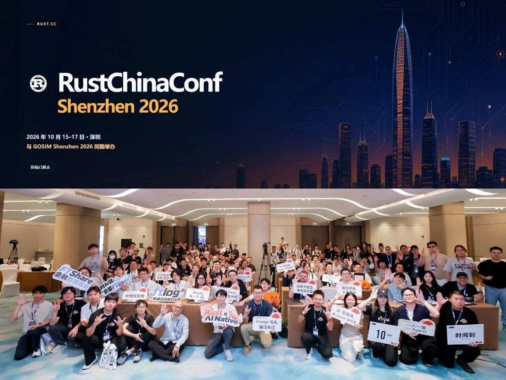

# RustChinaConf 2026：Rust × AI，和一次展位上的求职课

10 月 15–17 日，RustChinaConf 2026 在深圳举办（和 GOSIM Shenzhen 2026 同期），其中 16–17 日是两天正式大会，主题是 <b>Rust × AI</b>。我 17 号（第三天，也是最后一天）去当志愿者，大部分时间在场内跑来跑去，所以这篇不是逐场的听会笔记，而是三样东西：大会速览、展区里「谁在生产环境用 Rust」，以及在 Kimi 展位听到的一段很实在的求职聊天。

<figure class="w3-poster" markdown>
{ width="1280" height="720" loading="lazy" }
<figcaption>RustChinaConf 2026 大会海报（图源：TinTinLand 公众号）</figcaption>
</figure>

  
活动RustChinaConf 2026 正式大会（R03）

  
时间2026.10.15–17 · 深圳（16–17 日正式大会，在南山伊敦酒店；与 GOSIM Shenzhen 2026 同期举办）

  
我的身份志愿者，只在 10.17（第三天，也是最后一天）

  
主题Rust × AI · 可靠的基础设施 · AI 开发工具 · Rust 在生产环境

  
素材现场见闻 + 官方参会指南；完整议程见 <a href="https://rustchinaconf.org">rustchinaconf.org</a>

TL;DR

- **Rust 已经跑在很多「看不见的地方」**：手机操作系统内核、量化交易、区块链（Solana、NEAR）……
- **AI 公司不只招训模型的人**：一类做模型本身，一类围绕模型做应用和工作流；有些岗位看重的反而是品味和表达。
- **简历上写「熟悉某某大模型」没什么分量**：长期给一个开源项目提 PR、做一个能演示的真实产品，更有说服力。
- **让 AI「看屏幕、点鼠标」不一定是最优解**：软件有 API 或脚本接口时，直接调接口通常更快更稳。

---

## Part 1 · 大会速览 { #part-1 }

<figure class="w3-poster" markdown>
{ width="1280" height="960" loading="lazy" }
<figcaption>上：官网头图（2026 年 10 月 15–17 日 · 深圳，与 GOSIM Shenzhen 2026 同期举办）；下：现场合影。图源：RustChinaConf 官方公众号；照片里的人如果不希望出现在这里，告诉我就删。</figcaption>
</figure>

- **正式大会两天都在深圳南山伊敦酒店**（南山区蛇口龟山路 8 号）；
- **上午并厅主会，下午 T1、T2、T3 三轨并行**，想听的场次要提前挑好，跨厅也要留出时间；
- 主题围绕 **Rust × AI**，也回到开发者每天面对的具体问题：怎样构建可靠的基础设施、怎样用好 AI 开发工具、怎样把 Rust 用到真实的生产环境里；
- 展区有一张集章卡（7 个展台章位）和一面**招聘墙**，下面两节就是从这里来的。

---

## Part 2 · 展区：Rust 都用在了哪 { #part-2 }

| 展台 | 官方介绍里的关键信息 |
|---|---|
| **vivo** | 自研的蓝河操作系统 BlueOS，内核 BlueKernel 用 Rust 写，并且面向行业开源 |
| **非凸科技** | 把大模型和 Rust 工程化实践结合，做数智交易、AI 金融数据和投资工具 |
| **Solana Foundation** | Solana 是用 Rust 开发的高性能公链，展台主要聊 Rust 开发者在 Solana 生态的机会 |
| **观测云** | 可观测性平台，统一接入 App、Web、后端、中间件、K8s、云平台和业务数据 |
| **开放原子旋武开源社区** | 开放原子开源基金会孵化，推动 Rust 在操作系统、终端设备、安全、基础软件里落地，欢迎国内 Rust 开源项目入驻 |
| **Kimi（月之暗面）** | 2023 年 10 月推出的 AI 助手；展位上听到的内容见 [Part 3](#part-3) |
| **建元科技** | 开源 DHttp 协议栈，让私网设备也能接收请求、开放 API，人和 Agent 可以跨网络直接协作 |

**招聘墙上的 12 家**：vivo、非凸科技、Solana Foundation、观测云、开放原子旋武开源社区、Kimi、建元科技、Kong、CoHDL、NEAR、GreptimeDB、ideavibes.ai。

!!! tip "给做 Web3 的群友"
    Solana 和 NEAR 两条公链都在招聘墙上，它们的链上程序也主要用 Rust 写：Solana 常用 [Anchor](https://www.anchor-lang.com/) 框架，NEAR 有官方的 [near-sdk-rs](https://github.com/near/near-sdk-rs)。如果在 Solidity 之外想多学一门链上开发语言，Rust 很值得。

---

## Part 3 · 在 Kimi 展位听到的 { #part-3 }

!!! warning "先说清楚"
    这是展位上的聊天，不是官方宣讲，也不代表任何校招内幕。下面是我记下的要点，加上我自己的理解。

### AI 公司的两类岗位

同样是做 AI，差别很大：

- **一类偏模型本身**：研究、算法、训练和推理优化、基础设施、效率；
- **一类围绕模型做应用和工作流**：把模型真的用到具体的事情上。

两类需要的能力不太一样，**别一听「AI 公司」就以为只招会训模型的人**。有些机会看重的反而是**品味和表达**：做设计、写东西、剪视频，做出来的东西好不好看、讲不讲得清楚。现场的校招负责人举了几个例子：用 Computer Use 操作 Blender、制作创意内容、让 AI 操作电脑完成任务。

他反复强调的一点：**用户用模型做出来的好工作流、好结果，能不能反过来帮产品、甚至帮模型变得更好。**

!!! note "我的补充：几个容易混在一起的词"
    - **知识蒸馏**有具体含义：大致是用一个模型的输出去训练另一个（通常更小的）模型，出自 Hinton 等人 2015 年的论文 [Distilling the Knowledge in a Neural Network](https://arxiv.org/abs/1503.02531)；
    - **收集反馈、做评测、观察用户怎么用**是另外几件事，不等于蒸馏；
    - 我不知道 Kimi 或任何一家公司具体怎么使用这些数据。你用 AI 工具做出来的东西归谁、会被怎么用，**最好自己去看一眼用户协议**。

### 求职：比「熟悉某某大模型」更有用的东西

简历上写「熟悉某某大模型」，分量不如这两件事：

1. **长期参与一个开源社区**：选一个喜欢的方向，在那个组织里持续提 PR。放在 Rust 大会的语境里，就是长期参与维护某个 Rust 项目；
2. **做一个能演示、面向用户的产品**：解决一个真实的问题，并且能讲清楚**为什么这么设计、哪里还不行、怎么验证它有效**。

至于刷 Star 这类操作有没有用，就看具体的 HR 怎么看了。

### 多想一步：让 AI「看屏幕、点鼠标」真的高效吗？

Computer Use（让 AI 看屏幕、点鼠标来操作软件）很酷，但不一定是最优解：

- 如果软件本身有 **API、命令行或脚本接口**，直接调接口通常更快也更稳。比如 Blender 就有 [Python 脚本接口](https://docs.blender.org/api/current/)；
- 两者怎么结合，还有待大家一起探索，而且**不同岗位的差异极大**：建模涉及几何、拓扑、材质和交付要求，剪辑涉及素材组织、叙事节奏、音画配合和多轨道协作；
- **某个步骤能自动完成，离整个岗位被替代还有多远**，要看完整工作流的表现，而不是只看一段演示。

想接着看 Agent 怎么调用工具，可以读 [MCP 与 AI Agents](../ai-web3/mcp-agents.md) 和 [AI 辅助开发](../devtools/ai-coding.md)。

---

## 小白能学到什么

1. Rust 不只是「一门很难学的语言」：从手机内核、交易系统到公链，它常出现在「又要快、又不能出错」的地方；
2. 去 AI 公司不一定要会训模型，做应用、做工作流、做内容同样有位置，关键是拿得出作品；
3. 能被验证的东西（PR 记录、能跑的 Demo）比简历上的形容词有用；
4. 用 AI 自动化一件事之前，先问一句：这个软件有没有现成的接口？

## 现在能做什么

- [ ] 打开 [rustchinaconf.org](https://rustchinaconf.org) 的议程，挑一个感兴趣的题目，去搜搜相关的开源项目；
- [ ] Rust 零基础：从官方的 [The Rust Programming Language](https://doc.rust-lang.org/book/)（[中文版](https://kaisery.github.io/trpl-zh-cn/)）和 [Rustlings](https://github.com/rust-lang/rustlings) 小练习开始；
- [ ] 想做 Web3：看看 Solana 的 [Anchor](https://www.anchor-lang.com/) 文档，用 Rust 写一个最简单的链上程序；
- [ ] 找一个你常用的开源项目，从修文档、补测试开始提第一个 PR；
- [ ] 翻一下你常用的 AI 工具的用户协议，找到讲「数据使用」的那一段。

!!! quote "说明"
    我只在 10 月 17 日做志愿者，没能完整听会，所以这篇没有逐场的演讲笔记。展台和招聘信息来自大会官方的参会指南，Kimi 展位的内容是现场聊天的记录，不代表官方观点。
