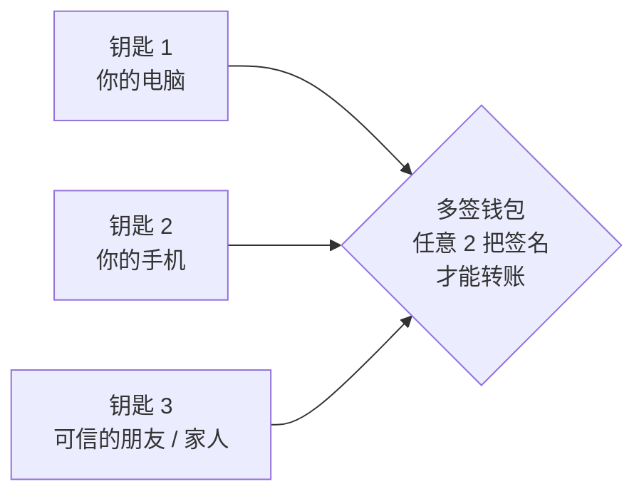

# 安全与隐私

这一页把几场活动里关于安全和隐私的内容按主题重新串了一遍。先从和你最相关的「怎么保住自己的钱」开始，
再往下看密码学、软件和隐私。每节结尾都标了出处，想看完整上下文可以点回现场笔记。

最重要的五条

1. **助记词离线手抄**，永远不拍照、不存云端、不发给任何人（包括「客服」）；
2. **大额资产用多签**，比如 2-of-3，**两把钥匙绝不放在同一个地方**；
3. **转账前慢 10 秒**核对地址和金额——Vitalik 自己因手误丢的币比被黑客偷的还多；
4. **先测试网、再小额**，看不懂的合约和链接不签、不点；
5. 给 AI / Agent 授权时：**最小数据、硬边界、关键一步人来确认**。

## 1. 先保住自己的资产 { #assets }

### 1.1 钱包基本功

| 要点 | 为什么 |
|---|---|
| 助记词手抄在纸上，放在安全的地方 | 谁拿到助记词，谁就拥有你的全部资产，没有「找回密码」 |
| 日常用的钱包和存钱的钱包分开 | 日常钱包经常连各种网站，风险高，只放少量资金 |
| 定期检查并撤销不用的代币授权 | 很多盗币不是偷私钥，而是你曾经「无限授权」给了一个有问题的合约 |
| 不点私信里的链接、不在陌生网站签名 | 钓鱼网站会伪装成你熟悉的项目，一个签名就能转走资产 |

### 1.2 多签：不要把鸡蛋放在一个篮子里

Vitalik 最认可的方式：**大部分资产放在多签钱包里**。以 2-of-3 为例——

丢了任意一把钥匙，资产还在；被偷了任意一把，资产也还在。前提是**两把钥匙绝不放在同一个地方**。

### 1.3 硬件钱包：好用，但不是万能

- **好处**：私钥永远不碰联网设备；带屏幕的设备让你「看懂再签」；
- **供应链风险**：有人在流通的硬件钱包里植入 SIM 卡，生成私钥后直接外发；也有厂商的客户名单泄露过。而且**专门买一个硬件钱包，本身就向整条供应链暴露了「我有很多币」**；
- **开源固件**：像 [OSKey](https://github.com/butterfly-community/oskey-firmware) 这样，用通用开发板 + 自己刷开源固件，不必信任某一家厂商；
- **低调的替代方案**：旧款 Google Pixel + GrapheneOS + AirGap 钱包，永久断网当冷钱包；黑客松冠军 Nokia Wallet 则把旧诺基亚改造成没人会怀疑的签名设备。

> 出处：[Day 2 上午 · Vitalik](../field-notes/ethshenzhen-2026/day2-morning.md#part-1) · [Day 1 · OSKey](../field-notes/ethshenzhen-2026/day1-workshops.md#part-1) · [获奖项目](../field-notes/ethshenzhen-2026/day2-afternoon.md#part-7)

## 2. AI 时代的密码学

几乎所有密码学都建立在「**某个数学问题很难**」的假设上。AI 的数学能力越来越强，这些假设可能被削弱。Vitalik 的风险分级：

| 密码学 | 用在哪里 | 抗量子 | 抗 AI |
|---|---|---|---|
| 哈希函数、对称加密（AES） | 区块链接、STARK、承诺 | ✅ | ✅ 最稳 |
| 普通椭圆曲线（ECDSA、Schnorr） | 钱包签名 | ❌ | ⚠️ 可能有问题 |
| 椭圆曲线配对 | BLS 签名、大多数 SNARK | ❌ | ⚠️⚠️ 很可能有问题 |
| 格密码（Lattice） | 后量子签名、全同态加密 | ✅ | ❓ 未知 |

两个关键结论：

- **出事的方式更可能是「变慢变大」而不是「一夜崩溃」**：比如签名从 64 字节变成 500 字节、密钥从 1 KB 变成 20 KB；
- **能用哈希就用哈希**：哈希的数学结构最简单，最难找到「捷径」。以太坊正在把签名、证明、加密内存池都往基于哈希的方案迁移。

> 出处：[Day 2 上午 · Vitalik](../field-notes/ethshenzhen-2026/day2-morning.md#part-1)

## 3. 软件层：代码怎么才算安全

| 做法 | 解决什么 | 出处 |
|---|---|---|
| **客户端多样性** | 一个客户端出 bug，其他客户端撑住网络 | [Vitalik](../field-notes/ethshenzhen-2026/day2-morning.md#part-1) |
| **形式化验证** | 用数学证明代码正确，AI 让它快了上百倍 | [Vitalik / 圆桌](../field-notes/ethshenzhen-2026/day2-morning.md#part-4) |
| **重视 ZK 电路安全** | 越来越多应用依赖 ZK，但大家对它的安全关注远远不够 | [Vitalik](../field-notes/ethshenzhen-2026/day2-morning.md#part-1) |
| **警惕前端被篡改** | 合约没问题、网页被换掉一样会出事 | [Vitalik](../field-notes/ethshenzhen-2026/day2-morning.md#part-1) |
| **合约升级加冷却期 + 自动检查** | 升级权限被滥用或被盗 | [Upgrade Airlock](../field-notes/ethshenzhen-2026/day2-afternoon.md#part-7) |
| **AI 写的代码必须人能解释、两人审核** | 区块链的损失是突发型的，99% 正确也不够 | [Qi Zhou](../field-notes/ethshenzhen-2026/day2-afternoon.md#part-2) |
| **漏洞验证可复现** | 「AI 说有漏洞」要能被证明、被复查 | [黑客松 18 号](../field-notes/ethshenzhen-2026/day1-demos.md) |

## 4. 隐私：四个层次

链上的一切默认**永久公开**。隐私要一层一层做，只做一层，另一层照样会出卖你：

| 层次 | 泄露了什么 | 对应技术 |
|---|---|---|
| **网络层** | 你的 IP、上网时间、访问频率 | Tor、**Mixnet**（Nym）、匿名 RPC |
| **读** | 你在查哪个地址、什么时候查 | 浏览器内置洋葱路由、**PIR 私有信息检索** |
| **写** | 收款人、金额、资金来源 | 隐身地址、**隐私池**、加密交易池 |
| **证明** | 为了证明一件事，交出了全部数据 | **零知识证明**、不可关联的匿名凭证（如 OpenAC） |

隐私和合规也不一定冲突：隐私池可以用「**动态黑名单**」——来自黑名单地址的资金必须销毁或转入托管，其余资金正常流转，名单随时可更新。

> 出处：[Day 2 上午 · Winderica & Nym](../field-notes/ethshenzhen-2026/day2-morning.md#part-2)

## 5. Agent 的权限边界

AI Agent 开始替人花钱、替人操作账号，安全问题从「代码」延伸到了「授权」：

<ol class="w3-steps" markdown>
<li markdown>**最小数据**：订机票需要出行时间和身份信息，不需要你全部的聊天记录。私钥、聊天记录、财产信息与 Agent 隔离。</li>
<li markdown>**硬边界**：金额上限、交易对象、时间范围由智能合约或独立程序来守，**不能让 Agent 自己承诺会遵守**。</li>
<li markdown>**人在关键一步**：付款、发布、删除等不可逆操作前要人确认——公众号「最后一步必须管理员扫码」就是这个思路。</li>
<li markdown>**可追溯**：每一次授权、调用、付款都留下记录，出了问题能查清楚。</li>
</ol>

> 出处：[路演夜 · Text Permit](../field-notes/pitch-night.md) · [Day 2 下午 · 信任边界圆桌](../field-notes/ethshenzhen-2026/day2-afternoon.md#part-5) · [交流会 · 自动发布演示](../field-notes/ai-web3-meetup.md)

## 6. 概念速查

哈希 Hash
:   把任意数据变成固定长度「指纹」的函数。改一个字，指纹完全不同；从指纹几乎不可能反推原文。区块链防篡改的基础。

ECDSA / 椭圆曲线签名
:   以太坊和比特币钱包签名用的算法，安全性依赖椭圆曲线上的离散对数难题。量子计算机能破解它。

椭圆曲线配对 Pairing
:   椭圆曲线上一种特殊的运算，BLS 签名和大多数 SNARK 都靠它，效率高，但数学结构最「丰富」，Vitalik 认为最怕 AI。

格密码 Lattice
:   基于「格」上难题的密码学，被认为能抵抗量子计算机，后量子签名、全同态加密都基于它；能不能抵抗 AI 还不知道。

抗量子密码学 PQC
:   能抵抗量子计算机攻击的密码学。以太坊路线图的两大重点之一。

零知识证明 ZK
:   在不透露秘密的前提下，证明某件事是真的。比如证明「我满 18 岁」而不交出身份证。分为 SNARK（小而快，常基于配对）和 STARK（基于哈希，更抗量子）。

PIR 私有信息检索
:   让服务器在不知道你查什么的情况下，把正确答案返回给你。

隐私池 / 隐身地址
:   隐私池把很多人的资金混在一起，用零知识证明保证合法性；隐身地址让每次收款都用一个一次性地址。

Mixnet 混合网络
:   把网络数据包加密、统一大小、随机延迟、打乱顺序再转发，并持续发送掩护流量，让旁观者无法通过时间和流量判断谁在和谁通信。

多签 Multisig
:   需要多把钥匙中的若干把共同签名才能转账（如 2-of-3）。

MPC 多方计算
:   私钥被拆成多个分片分给不同参与方，签名时各自计算、无需把私钥拼回来。

形式化验证
:   用数学方法证明程序在所有情况下都符合规范，而不是靠测试「抽查」。

FIDO2 / Passkey
:   新一代免密码登录标准，用硬件设备或手机里的密钥代替密码，防钓鱼。

FOCIL
:   以太坊的一项抗审查提案：让多个验证者共同指定「必须被打包」的交易，防止区块构建者故意漏掉某些交易。

ePBS
:   协议内置的「提议者 / 构建者分离」：出块的人和构建区块内容的人分开。能提升性能，但也引发了去中心化方面的担忧。

## 延伸阅读

- 现场笔记：[ETHShenzhen 2026 · Day 2 上午](../field-notes/ethshenzhen-2026/day2-morning.md)（这一页的主要来源）
- 合约安全练习：[精选课程中心](../roadmap/courses.md) 里的 Ethernaut、Capture the Ether
- 更多基础概念：[核心概念词典](../fundamentals/core-concepts.md)
