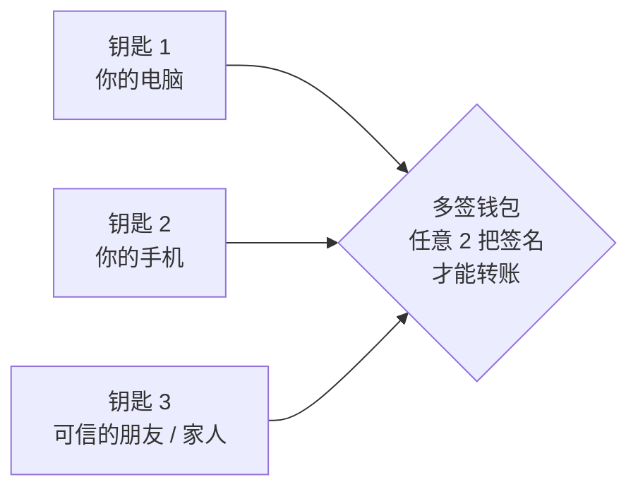

# 安全与隐私

这一页把几场活动里关于安全和隐私的内容按主题重新串了一遍。先从和你最相关的「怎么保住自己的钱」开始，
再往下看密码学、软件和隐私。每节结尾都标了出处，想看完整上下文可以点回现场笔记。

最重要的五条

1. **助记词离线手抄**，永远不拍照、不存云端、不发给任何人（包括「客服」）；
2. **大额资产用多签**，比如 2-of-3，**两把钥匙绝不放在同一个地方**；
3. **转账前停一下**，核对地址、网络、金额和实际签名内容；
4. **先测试网、再小额**，看不懂的合约和链接不签、不点；
5. 给 AI / Agent 授权时：**最小数据、硬边界、关键一步人来确认**。

## 1. 先保住自己的资产 { #assets }

### 1.1 钱包基本功

| 要点 | 为什么 |
|---|---|
| 助记词手抄在纸上，放在安全的地方 | 谁拿到助记词，谁就拥有你的全部资产，没有「找回密码」 |
| 日常用的钱包和存钱的钱包分开 | 日常钱包经常连各种网站，风险高，只放少量资金 |
| 定期检查并撤销不用的代币授权 | 很多盗币不是偷私钥，而是你曾经「无限授权」给了一个有问题的合约 |
| 不点私信里的链接、不在陌生网站签名 | 钓鱼网站会伪装成你熟悉的项目，一个签名就能转走资产 |

### 1.2 多签：不要把鸡蛋放在一个篮子里

Vitalik 最认可的方式：**大部分资产放在多签钱包里**。以 2-of-3 为例——

在多签合约和配置正常的前提下，丢失一把钥匙仍可用另外两把操作；攻击者只拿到一把，也不足以转账。签名设备和备份要分开，避免一次设备入侵或备份泄露就凑齐门槛。

### 1.3 硬件钱包：好用，但不是万能

- **好处**：把签名和联网电脑隔开，减少私钥暴露面；独立屏幕提供核对交易的机会，仍要看清它实际显示了什么。
- **供应链风险**：设备来源、固件和屏幕显示都属于信任边界。独立签名设备仍需保证购买渠道、初始化和核对流程可信。
- **开源固件**：像 [OSKey](https://github.com/butterfly-community/oskey-firmware) 这样，用通用开发板刷开源固件，便于检查实现；自行组装仍需信任硬件、构建工具、固件来源和安装过程。
- **通用设备方案**：Vitalik 提到 Pixel + GrapheneOS + AirGap 的离线签名思路。实际选择要看设备是否仍获完整安全更新，不能把「旧手机能刷机」当成安全保证（[GrapheneOS 官方支持说明](https://grapheneos.org/faq#device-support)）。黑客松冠军 Nokia Wallet 是旧手机签名设备的探索，比赛获奖也不等于产品已经完成安全审计。

> 出处：[Vitalik 专题 · 钱包与设备](../field-notes/ethshenzhen-2026/vitalik-ai-security.md#wallets) · [Day 1 · OSKey](../field-notes/ethshenzhen-2026/day1-workshops.md#part-1) · [获奖项目](../field-notes/ethshenzhen-2026/day2-afternoon.md#part-7)

## 2. AI 时代的密码学

密码学的安全依赖具体问题、算法和参数。AI 可能帮助发现新的攻击方法，**「抗 AI」目前没有通用认证**。Vitalik 在现场更偏好基于哈希的方案，这是一种风险判断，仍需要后续研究和攻击分析来检验。

- **哈希和对称加密**：不依赖椭圆曲线离散对数或格难题；它们仍需抵抗碰撞、原像搜索或密钥搜索等攻击，并选择足够的安全参数。量子算法也会影响这些攻击的成本，安全余量需要结合参数评估。
- **椭圆曲线与配对**：ECDSA、Schnorr、BLS，以及 Groth16、采用 KZG 承诺的 PLONK 实现等有各自的代数安全假设；不是所有 SNARK 都依赖配对。足够强的量子计算机能威胁这些传统椭圆曲线方案，AI 是否能带来实用的新攻击则是另一件事。
- **格密码**：是后量子密码学的重要路线；抵抗已知量子攻击，不代表未来的数学进步不会改变安全评估。现场讨论的是这种不确定性，没有给出格密码已经被实用攻破的结论。

新攻击可能迫使方案扩大密钥或签名、降低效率，也可能要求更换算法，具体后果取决于攻击本身。以太坊正在研究哈希签名、STARK 等方向，[SLH-DSA 已有 NIST 标准](https://csrc.nist.gov/pubs/fips/205/final)，主网的迁移则涉及另外的协议与工程工作。加密内存池也有多种设计，各自依赖不同的技术和假设。

> 出处：[Vitalik 专题 · 密码学假设](../field-notes/ethshenzhen-2026/vitalik-ai-security.md#crypto-assumptions)

## 3. 软件层：代码怎么才算安全

| 做法 | 解决什么 | 出处 |
|---|---|---|
| **客户端多样性** | 分散单个实现的故障风险；能否继续确认取决于故障性质和受影响的质押权重 | [Vitalik · 客户端](../field-notes/ethshenzhen-2026/vitalik-ai-security.md#clients) |
| **形式化验证** | 在明确规范和假设下证明性质；AI 可辅助写证明，结果仍由证明检查器核验 | [Vitalik · 形式化验证](../field-notes/ethshenzhen-2026/vitalik-ai-security.md#formal-verification) |
| **重视 ZK 电路安全** | 检查电路表达的条件、证明系统及实现，避免「证明通过」却未证明实际想要的事 | [Vitalik · 形式化验证](../field-notes/ethshenzhen-2026/vitalik-ai-security.md#formal-verification) |
| **警惕前端被篡改** | 合约正常时，网页仍可能诱导你签署错误的交易 | [Vitalik · 钱包与设备](../field-notes/ethshenzhen-2026/vitalik-ai-security.md#wallets) |
| **合约升级加冷却期 + 自动检查** | 升级权限被滥用或被盗 | [Upgrade Airlock](../field-notes/ethshenzhen-2026/day2-afternoon.md#part-7) |
| **AI 写的代码必须人能解释、两人审核** | 区块链的损失是突发型的，99% 正确也不够 | [Qi Zhou](../field-notes/ethshenzhen-2026/day2-afternoon.md#part-2) |
| **漏洞验证可复现** | 「AI 说有漏洞」要能被证明、被复查 | [黑客松 18 号](../field-notes/ethshenzhen-2026/day1-demos.md) |

## 4. 隐私：四个层次

链上的一切默认**永久公开**。隐私要一层一层做，只做一层，另一层照样会出卖你：

| 层次 | 泄露了什么 | 对应技术 |
|---|---|---|
| **网络层** | 你的 IP、上网时间、访问频率 | Tor、**Mixnet**（Nym）、匿名 RPC |
| **读** | 你在查哪个地址、什么时候查 | 浏览器内置洋葱路由、**PIR 私有信息检索** |
| **写** | 收款人、金额、资金来源 | 隐身地址、**隐私池**、加密交易池 |
| **证明** | 为了证明一件事，交出了全部数据 | **零知识证明**、不可关联的匿名凭证（如 OpenAC） |

隐私和合规也不一定冲突：隐私池可以用「**动态黑名单**」——来自黑名单地址的资金必须销毁或转入托管，其余资金正常流转，名单随时可更新。

> 出处：[Day 2 上午 · Winderica & Nym](../field-notes/ethshenzhen-2026/day2-morning.md#part-2)

## 5. Agent 的权限边界

AI Agent 开始替人花钱、替人操作账号，安全问题从「代码」延伸到了「授权」：

<ol class="w3-steps" markdown>
<li markdown>**最小数据**：订机票需要出行时间和身份信息，不需要你全部的聊天记录。私钥、聊天记录、财产信息与 Agent 隔离。</li>
<li markdown>**硬边界**：金额上限、交易对象、时间范围由智能合约或独立程序来守，**不能让 Agent 自己承诺会遵守**。</li>
<li markdown>**人在关键一步**：付款、发布、删除等不可逆操作前要人确认——公众号「最后一步必须管理员扫码」就是这个思路。</li>
<li markdown>**可追溯**：每一次授权、调用、付款都留下记录，出了问题能查清楚。</li>
</ol>

> 出处：[路演夜 · Text Permit](../field-notes/pitch-night.md) · [Day 2 下午 · 信任边界圆桌](../field-notes/ethshenzhen-2026/day2-afternoon.md#part-5) · [交流会 · 自动发布演示](../field-notes/ai-web3-meetup.md)

## 6. 概念速查

哈希 Hash
:   把任意数据变成固定长度「指纹」的函数。改一个字，指纹完全不同；从指纹几乎不可能反推原文。区块链防篡改的基础。

ECDSA / 椭圆曲线签名
:   以太坊普通账户所用的签名算法，安全性依赖椭圆曲线上的离散对数难题。足够大且容错的量子计算机会威胁它，不等于现有量子设备已能破解。

椭圆曲线配对 Pairing
:   特定椭圆曲线上的双线性运算，用于 BLS 签名、Groth16、KZG 等。并非所有 SNARK 都需要配对；安全性要看具体方案和假设。

格密码 Lattice
:   基于格上难题构建的密码学，是后量子签名和全同态加密的重要路线；不能把所有后量子签名或所有 FHE 方案都等同于格密码。

抗量子密码学 PQC
:   以抵抗已知量子攻击为目标的密码学，仍依赖所选算法、参数和实现的安全性。

零知识证明 ZK
:   在不泄露指定秘密的前提下证明一个陈述，例如证明满 18 岁而不交出完整身份证。SNARK 强调简洁、非交互的知识论证；STARK 是透明、可扩展的证明路线。两者不是互斥的安全等级，零知识性和后量子安全都需看具体构造。

PIR 私有信息检索
:   让服务器在不知道你查什么的情况下，把正确答案返回给你。

隐私池 / 隐身地址
:   隐私池把很多人的资金混在一起，用零知识证明保证合法性；隐身地址让每次收款都用一个一次性地址。

Mixnet 混合网络
:   把网络数据包加密、统一大小、随机延迟、打乱顺序再转发，并持续发送掩护流量，让旁观者无法通过时间和流量判断谁在和谁通信。

多签 Multisig
:   需要多把钥匙中的若干把共同签名才能转账（如 2-of-3）。

MPC 多方计算
:   私钥被拆成多个分片分给不同参与方，签名时各自计算、无需把私钥拼回来。

形式化验证
:   用机器可检查的数学证明，验证系统在明确假设下符合所写规范。规范是否正确、证明覆盖到哪一层，也需要审查。

FIDO2 / Passkey
:   新一代免密码登录标准，用硬件设备或手机里的密钥代替密码，防钓鱼。

FOCIL
:   以太坊的一项抗审查提案：让多个验证者共同指定「必须被打包」的交易，防止区块构建者故意漏掉某些交易。

ePBS
:   协议内置的「提议者 / 构建者分离」：出块的人和构建区块内容的人分开。能提升性能，但也引发了去中心化方面的担忧。

## 延伸阅读

- 重点专题：[Vitalik · AI 时代的以太坊安全](../field-notes/ethshenzhen-2026/vitalik-ai-security.md)
- 现场笔记：[ETHShenzhen 2026 · Day 2 上午](../field-notes/ethshenzhen-2026/day2-morning.md)（含 Winderica、Nym 与路线图圆桌）
- 合约安全练习：[精选课程中心](../roadmap/courses.md) 里的 Ethernaut、Capture the Ether
- 更多基础概念：[核心概念词典](../fundamentals/core-concepts.md)
